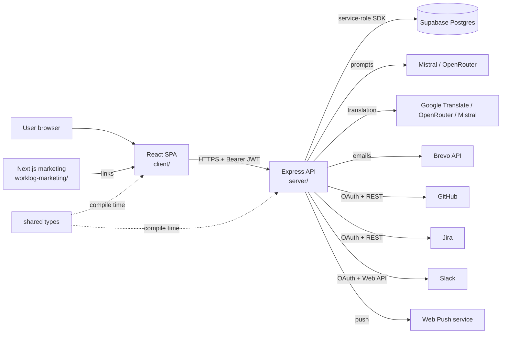

# 01 — Project Overview

> **Status:** Verified
> **Source commit:** `7567207`
> **Last reviewed:** 2026-11-27
> **Audience:** Beginner, Junior, Senior

---

## 1. What is Worklog AI?

Worklog AI is a web application that helps people remember what they did at work,
then turns those memories into polished performance reviews.

The original product is small and focused:

1. Every week, the app reminds you to write down what you accomplished, what was
   hard, what you learned, and what you plan to do next.
2. Those weekly entries pile up like a diary.
3. When review season arrives, you paste in your company's appraisal criteria.
4. An AI reads your entries and writes a draft self-appraisal.
5. You copy it, edit it, and submit it.

Over time the product grew into a work-intelligence platform: teams and
organizations, OKRs, Jira/GitHub/Slack integrations, AI performance reports,
subscription tiers, a news hub, and a separate marketing website.

### The five-year-old explanation

Imagine a notebook that asks you every Friday, "What did you do this week?"
You scribble a few lines. Months later, when your boss asks "What have you
achieved?", the notebook reads all your scribbles and writes the answer for you.
That is Worklog AI. The rest of the app is the notebook growing arms: it can
share pages with your team, connect to your work tools, and produce reports.

### The technical explanation

Worklog AI is an npm-workspaces monorepo containing:

- a React single-page application (`client/`),
- an Express REST API (`server/`),
- a shared TypeScript type package (`shared/`),
- a separate Next.js marketing site (`worklog-marketing/`),
- Supabase Postgres schemas and migrations,
- 11 scheduled jobs and 3 webhook receivers.

The browser never talks to Postgres directly for product data. It calls the
Express API with a JWT bearer token. Express verifies the token, then queries
Supabase using a **service-role** client. Authorization is enforced in Node,
not by Row Level Security (see §7).

---

## 2. Who uses it?

| Persona | What they do | Main screens |
|---|---|---|
| Individual contributor | Logs weekly work, generates self-appraisals, chats with their history | Dashboard, Log Entry, Appraisals, Chat |
| Manager / team lead | Creates team goals, reviews progress, assigns goals | Team Goals, Org Settings |
| Organization admin / owner | Manages members, departments, teams, integrations, billing tier | Org Settings, Integrations, Billing |
| Prospective customer | Tries the public appraisal playground, reads the marketing site | Landing page, Playground |
| AI Pulse reader | Browses AI news and impact cards, bookmarks articles | AI Pulse hub |

---

## 3. Verified feature inventory

Status meanings: **Implemented** = route + UI + persistence traced.
**Partial** = some layers exist but the end-to-end path is incomplete or
provider-dependent. **Not verified** = code exists but requires external
credentials/runtime to confirm.

### Individual productivity

| Feature | Status | Entry points |
|---|---|---|
| Email/password signup with email verification | Implemented | `client/src/pages/Login.tsx`, `server/src/routes/auth.ts:38` |
| Login, JWT access token, rotating refresh token | Implemented | `server/src/routes/auth.ts:326`, `client/src/context/AuthContext.tsx:107` |
| Forgot / reset password | Implemented | `server/src/routes/auth.ts:480`, `:554` |
| Onboarding profile capture | Implemented | `client/src/pages/Onboarding.tsx`, `PUT /api/users/profile` |
| Weekly work-log CRUD | Implemented | `server/src/routes/entries.ts`, `client/src/pages/LogEntry.tsx` |
| Dashboard with history and streak | Implemented | `client/src/pages/Dashboard.tsx` |
| AI self-appraisal generation | Implemented | `server/src/routes/appraisal.ts:111`, `client/src/pages/Appraisal.tsx` |
| Public appraisal playground (no auth) | Implemented | `server/src/routes/appraisal.ts:29`, `PlaygroundWidget.tsx` |
| Monthly summaries | Implemented | `server/src/routes/summaries.ts`, `jobs/monthlySummaryJob.ts` |
| AI chat over work history (SSE streaming) | Implemented | `server/src/routes/chat.ts`, `lib/chatService.ts`, `client/src/pages/Chat.tsx` |
| Feedback submission | Implemented | `server/src/routes/feedback.ts` |
| Profile, password change, account deletion | Implemented | `server/src/routes/users.ts` |
| Web push notifications | Implemented | `server/src/routes/push.ts`, `client/src/lib/push.ts` |

### Team and organization

| Feature | Status | Entry points |
|---|---|---|
| Organizations, departments, nested teams | Implemented | `server/src/routes/organizations.ts`, `services/teamService.ts` |
| Org and team roles with rank checks | Implemented | `services/authz.ts`, `routes/teams.ts` |
| Goals/OKRs, key results, check-ins, assignees, links | Implemented | `server/src/routes/goals.ts`, `services/goalService.ts` |
| Goal rollup and digest jobs | Implemented | `jobs/goalRollupJob.ts`, `jobs/goalDigestJob.ts` |
| Jira OAuth (user + org) | Implemented | `routes/integrations.ts`, `lib/jiraAdapter.ts` |
| GitHub OAuth, GitHub App, webhooks | Implemented | `routes/integrations.ts`, `lib/githubApp.ts`, `routes/webhooks/github.ts` |
| Slack OAuth, slash commands, notifications | Implemented | `lib/slackOAuth.ts`, `routes/webhooks/slack.ts` |
| Jira webhooks | Implemented | `routes/webhooks/jira.ts` |
| Subscription tiers and feature gates | Implemented (enforcement) | `services/subscriptionService.ts`, `middleware/tierGate.ts` |
| Payment-provider checkout / billing webhook | **Not found** | No Paddle/Stripe route or webhook exists in the server |
| AI performance reports (enterprise) | Implemented | `routes/reports.ts`, `services/reportGenerationService.ts` |
| Per-team Slack / per-user sync preferences | Implemented | `routes/channelPreferences.ts` |

### Content and marketing

| Feature | Status | Entry points |
|---|---|---|
| AI Pulse articles and impact cards | Implemented | `routes/aiPulse.ts`, `client/src/pages/ai-pulse/Hub.tsx` |
| Bookmarks | Implemented | `routes/aiPulse.ts:197-280` |
| OG image generation for articles | Implemented | `routes/aiPulse.ts:465-522` |
| News collection job | Implemented | `jobs/newsCollectionJob.ts`, `lib/newsService.ts` |
| Marketing site (landing, blog, role templates) | Implemented | `worklog-marketing/src/app` |

---

## 4. The four subsystems

| Subsystem | Responsibility | Technology | Talks to |
|---|---|---|---|
| `client/` | Rendering, routing, forms, auth state, API calls | React 19, Vite, Tailwind, React Router 7 | Express API, Supabase JS (only for optional direct reads) |
| `server/` | Auth, authorization, business logic, AI orchestration, integrations, jobs | Express 4, TypeScript, node-cron | Supabase Postgres, AI providers, Brevo, Slack, Jira, GitHub, web push |
| `shared/` | Type contracts used by both sides | TypeScript declarations | Nobody at runtime |
| `worklog-marketing/` | Public marketing, blog, SEO templates | Next.js App Router | Static content; no product API |

### How they connect



**Plain language:** the browser is the storefront, Express is the shopkeeper,
Postgres is the stockroom, and the AI/email/chat providers are outside
specialists the shopkeeper phones when needed.

---

## 5. Technology stack and why it is there

| Technology | Where used | Why it is used | Example in this codebase |
|---|---|---|---|
| React 19 | `client/src` | Component UI with lazy routes | `client/src/App.tsx:9-29` |
| Vite 6 | `client/vite.config.ts` | Fast dev server and bundling | `npm run dev:client` |
| Tailwind 3 | `client/tailwind.config.js` | Utility-first styling | `client/src/index.css` |
| React Router 7 | `client/src/App.tsx` | Client-side routing and guards | `ProtectedRoute` at `:31` |
| i18next | `client/src/i18n/index.ts` | UI localization | `useAutoLocale` hook |
| Express 4 | `server/src/index.ts` | HTTP routing and middleware | 21 mounted routers at `:184-204` |
| TypeScript 5.7 | whole repo | Static types across boundaries | `shared/index.ts` |
| Supabase JS | `server/src/lib/database.ts` | Postgres access over PostgREST | `supabase.from('work_log_entries')` |
| jsonwebtoken | `server/src/middleware/auth.ts` | Signs and verifies access tokens | `generateAccessToken` at `:41` |
| bcrypt | `server/src/routes/auth.ts` | Password hashing | signup/login handlers |
| zod | route validation | Request payload validation | goal, report, integration routes |
| express-rate-limit | `server/src/index.ts:121-134` | Abuse protection in production | global + auth limiters |
| node-cron | `server/src/jobs` | Scheduled reminders and maintenance | `reminderJob.start()` at `:313` |
| Mistral SDK | `server/src/lib/mistral.ts` | Primary appraisal, summary, chat, report, news model | `mistral-large-latest` / `mistral-small-latest` |
| OpenRouter | `server/src/lib/openRouter.ts` | Public playground + UI translation primary/fallback | `routes/appraisal.ts`, `routes/translate.ts` |
| NVIDIA NIM (startup log only) | `server/src/index.ts:284-291` | Checked for startup logging only; no runtime AI calls invoke it | `NVIDIA_NIM_API_KEY` env check |
| Brevo HTTP API | `server/src/lib/email.ts:88` | Transactional email | verification, reminders, digests |
| web-push | `server/src/lib/webPush.ts` | Browser push notifications | `routes/push.ts` |
| PostHog | client + server | Product analytics and exceptions | `lib/posthog.ts` |
| Vitest 4 | `server/vitest.config.ts` | Unit tests for authz/goals/webhooks | `server/src/__tests__` |
| Vercel | `client/vercel.json` | SPA hosting | client deploy |
| Render | `render.yaml`, `nixpacks.toml` | API hosting | server deploy |
| Next.js | `worklog-marketing/` | SEO marketing pages | `src/app/page.tsx` |

---

## 6. Repository map

```text
worklog-ai/
├── client/                 React SPA (73 TS/TSX files, ~11.3k LOC)
│   ├── src/pages/          21 page components
│   ├── src/components/     Layout, landing, goals, teams, chat, AI Pulse
│   ├── src/context/        AuthContext, SubscriptionContext
│   ├── src/hooks/          useHasOrg, useIsLoggedIn, usePageMeta, useTeamRole
│   ├── src/lib/            API clients, storage, analytics, push, SSE
│   ├── public/             icons, manifest, service worker, sitemap, llms.txt
│   └── test/               2 test files (no configured runner)
├── server/                 Express API (72 TS files, ~13.3k LOC)
│   ├── src/routes/         21 route modules, 112 handlers
│   ├── src/services/       authz, goals, teams, subscriptions, reports, aggregation
│   ├── src/lib/            AI, email, DB, crypto, integrations, logging
│   ├── src/middleware/     auth, requestId, tierGate
│   ├── src/jobs/           11 cron jobs (3 marketing loops)
│   └── src/__tests__/      6 Vitest suites
├── shared/                 API and domain types
├── worklog-marketing/      Next.js marketing site
├── migrations/             4 incremental SQL migrations
├── supabase-migrations/    7 feature migrations
├── supabase-schema*.sql    Base schemas (47 tables total across all SQL)
├── scripts/                backup, restore, brand asset generation
├── skills/                 Vendored agent skill packs (third-party)
├── .venv/                  Vendored Python environment (third-party)
└── docs/                   This documentation set
```

### Excluded from deep documentation

| Path | Why |
|---|---|
| `.venv/` | Vendored Python packages (setuptools, pip). Not application code. |
| `skills/` | Vendored agent skill packs with their own tests and docs. |
| `node_modules/`, `dist/`, `dist-stale/` | Installed dependencies and build output. |
| `shared/index.js`, `shared/index.d.ts`, maps | Compiled output of `shared/index.ts`. |
| `package-lock.json`, `server/package-lock.json` | Dependency lockfiles. |
| `headroom_memory.db`, `desktop_pagespeed.json` | Local artifacts, not runtime inputs. |

---

## 7. Architectural facts a new engineer must know

1. **Auth is custom, not Supabase Auth.** Signup hashes passwords with bcrypt;
   login issues a 15-minute JWT and a 30-day opaque refresh token stored as a
   SHA-256 hash. Supabase Auth is not used by the product. Evidence:
   `server/src/middleware/auth.ts:41-126`, `server/src/routes/auth.ts:326`.
2. **The API uses the service-role key.** `req.supabase` bypasses RLS. Every
   query must be scoped by `req.userId` or an org/team authorization check.
   The warning is written at `server/src/middleware/auth.ts:1-6`.
3. **RLS is defense-in-depth, not the primary control.** Many newer tables use
   `CREATE POLICY "Deny all public" ... USING (false)`. Node code is the real
   gate. Evidence: `supabase-migrations/2026-06-16_teams_goals_integrations.sql:1283`.
4. **Authorization uses numeric rank maps**, never lexical role comparison:
   org `member=1 < admin=2 < owner=3`; team `member=1 < manager=2 < admin=3 < owner=4`.
   Evidence: `server/src/services/authz.ts:24-35`.
5. **The backend is a modular monolith, not microservices.** One Express process
   mounts 21 routers and runs 11 cron jobs in the same process.
6. **AI uses Mistral and OpenRouter.** Mistral (`server/src/lib/mistral.ts`) powers appraisals, summaries, chat, reports, and AI Pulse news summarization; OpenRouter (`server/src/lib/openRouter.ts`) powers the public playground and translation (with Google Translate and Mistral fallbacks). `@anthropic-ai/sdk` is an unused dependency and `NVIDIA_NIM_API_KEY` is only checked in the startup log (`server/src/index.ts:284-291`).
7. **Email is Brevo, not Resend.** `server/src/lib/email.ts:88-112` posts to
   `api.brevo.com`. Root docs claiming Resend are stale.
8. **Billing enforcement exists; a payment provider does not (as of this commit).**
   `subscriptionService.ts` resolves tiers and gates features, but no
   Paddle/Stripe checkout or billing webhook route was found.

---

## 8. Documentation drift

The root documentation is older than the implementation. Treat this table as a
warning, not as an insult to the authors.

| Root claim | Actual implementation | Evidence |
|---|---|---|
| Supabase Auth magic link | Custom bcrypt + JWT + refresh tokens | `middleware/auth.ts`, `routes/auth.ts` |
| Server validates JWT with Supabase | Server verifies its own JWT secret | `middleware/auth.ts:120-126` |
| RLS scopes every query | Service-role client bypasses RLS; Node scopes queries | `middleware/auth.ts:1-6` |
| Railway deployment | `render.yaml` (Render) + `client/vercel.json` proxy alongside `nixpacks.toml` | repo root, `client/vercel.json` |
| Five tables | 47 distinct tables | SQL inventory |
| Mistral only | Mistral + OpenRouter (+ Google Translate for i18n); Anthropic SDK unused; NVIDIA NIM startup log check only | `server/src/index.ts:284-294`, `lib/mistral.ts`, `lib/openRouter.ts`, `routes/translate.ts` |
| Resend email | Brevo HTTP API | `lib/email.ts:88` |
| Weekly reminder only | 11 cron jobs (8 core + 3 gated marketing loops) | `server/src/jobs`, `server/src/index.ts:312-330` |

---

## 9. How to read this documentation

| If you are... | Start here |
|---|---|
| Completely new to programming | `13-glossary/beginner-friendly-glossary.md`, then §1 of this page |
| A junior developer joining the project | This page → `02-architecture/system-architecture.md` → `03-codebase-structure/directory-map.md` → one feature flow |
| An experienced engineer reviewing the design | `02-architecture/*`, `08-security/security-architecture.md`, `12-code-review/*` |
| Debugging a specific bug | `05-feature-flows/feature-index.md` → the matching flow → function docs |
| Deploying or operating it | `10-environment-and-deployment/*` → `05-feature-flows/notifications-and-jobs.md` |
| Extending the API | `06-api-reference/*` → `04-function-documentation/backend-*.md` |

---

## Related documents

- [System architecture](./02-architecture/system-architecture.md)
- [Directory map](./03-codebase-structure/directory-map.md)
- [Function index](./04-function-documentation/function-index.md)
- [Feature index](./05-feature-flows/feature-index.md)
- [Security architecture](./08-security/security-architecture.md)

## Verification notes

Inspected: root manifests, `client/src/App.tsx`, `client/src/context/AuthContext.tsx`,
`client/src/lib/api.ts`, `server/src/index.ts`, `server/src/middleware/auth.ts`,
`server/src/lib/database.ts`, `server/src/lib/email.ts`,
`server/src/services/authz.ts`, `server/src/services/subscriptionService.ts`,
SQL schemas, and route definitions.

Not verified at runtime: AI provider behavior, email delivery, OAuth flows,
webhook delivery, payment/billing provider (not found).
