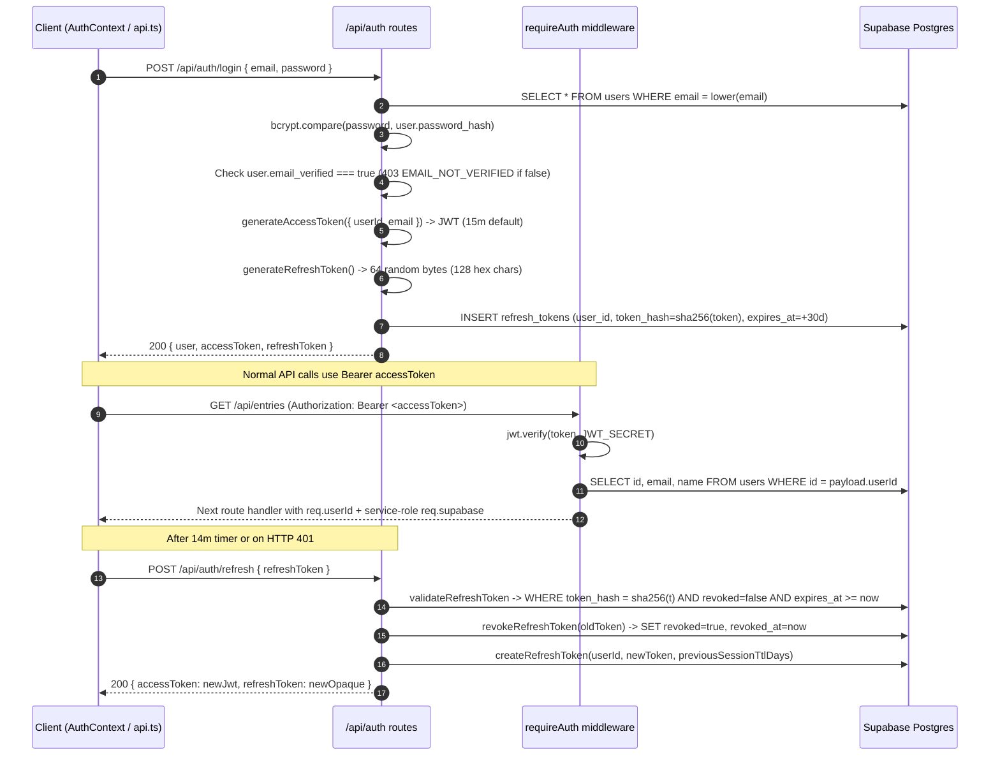

# Authentication & Authorization Architecture

> **Status:** Verified
> **Source commit:** `7567207`
> **Last reviewed:** 2026-11-27
> **Audience:** Junior, Senior

---

## 1. Plain-Language Overview (Explain Like I Am Five)

Think of **Authentication** ("Who are you?") and **Authorization** ("What are you allowed to touch?") like entering an office building:

1. **Authentication (Your Badge):** You show your email + password at the front desk (`POST /api/auth/login`). If you already clicked the activation link in your email, the guard hands you two passes:
   - A **15-minute visitor sticker** (`accessToken` JWT) for fast door swipes.
   - A **30-day replacement pass** (`refreshToken` random secret) kept safely in your pocket (`localStorage`/`sessionStorage`). The server only locks away a scrambled fingerprint (`SHA-256 hash`) of that pass, never the raw pass itself.
2. **Authorization (Which Rooms Open):**
   - For **your own notes** (logs, appraisals, chats), doors check that the folder has your name (`req.userId`).
   - For **company & team OKRs**, doors check your **rank number** (`member = 1`, `manager = 2`, `admin = 3`, `owner = 4`) and even walk up the org chart (`team_closure`) so a director above your team automatically keeps manager permissions below them.

---

## 2. Authentication Architecture (Custom JWT + Rotating Refresh Tokens)

Worklog AI originally started with Supabase Auth (`auth.users`) but migrated to a **custom authentication stack** (`server/src/routes/auth.ts`, `server/src/middleware/auth.ts`) to remove email-rate bottlenecks by sending verification and reset emails via **Brevo**.

### Startup Invariant
`server/src/middleware/auth.ts:32-35` enforces at module load time:
```ts
if (!ACCESS_TOKEN_SECRET || ACCESS_TOKEN_SECRET.length < 32) {
  throw new Error('JWT_SECRET must be set and at least 32 characters')
}
```
If `JWT_SECRET` is absent or shorter than 32 characters, the Express server refuses to start.

### Token Lifecycle



| Credential / Token | Format & Entropy | Storage on Client | Storage on Server | Lifetime | Reference |
|---|---|---|---|---|---|
| Password | Raw user input, checked min length 8 (`auth-utils.ts`) | Not stored | `users.password_hash` (bcrypt cost 10) | Until changed/reset | `server/src/lib/auth-utils.ts:9-18` |
| Access Token (`accessToken`) | HS256 JWT `{ userId, email }` | `localStorage` (`rememberMe`) or `sessionStorage` | Stateless (verified with `JWT_SECRET`; user existence re-queried in `requireAuth`) | `ACCESS_TOKEN_EXPIRY` (default `15m`) | `server/src/middleware/auth.ts:36-45,152-167` |
| Refresh Token (`refreshToken`) | 64 crypto random bytes (`128` hex chars) | Same storage slot as `accessToken` | `refresh_tokens.token_hash` (SHA-256 hex digest) | 30 days default (preserved on rotation via `session_ttl_days`) | `server/src/middleware/auth.ts:50-78,257-259` |
| Email Verification Token | 32 random bytes | URL query (`token`, `userId`) | `email_verifications` (hashed after `2026-06-07` migration) | 24 hours (typical; verified in `routes/auth.ts`) | `server/src/routes/auth.ts:100-219` |
| Password Reset Token | 32 random bytes | URL query (`token`, `userId`) | `password_resets` (hashed) | Short-lived expiry | `server/src/routes/auth.ts:480-624` |

### `requireAuth` vs `optionalAuth` (`server/src/middleware/auth.ts:138-252`)
- **`requireAuth`:** Rejects missing/malformed `Bearer` header (`401`), expired/invalid JWT (`401`), or deleted user (`401`). Populates `req.userId`, `req.user`, MDC `context.userId`, and creates a per-request **service-role** `req.supabase` client.
- **`optionalAuth`:** Used on public AI Pulse read endpoints (`aiPulse.ts:70,101,125,162`) to attach `req.userId` when logged in without failing anonymous visitors.

---

## 3. Authorization Architecture

Because `req.supabase` uses the **service-role key** (bypassing Postgres RLS), authorization operates across **4 explicit Node enforcement mechanisms** plus **OAuth/Webhook signature boundaries**:

### 3.1 Personal Resource Ownership (User Scoping)
Single-user routes (`entries.ts`, `appraisal.ts`, `summaries.ts`, `chat.ts`, `feedback.ts`, `users.ts`, `aiPulse.ts` bookmarks, `push.ts`) enforce isolation by chaining `.eq('user_id', req.userId)` (or `.eq('id', req.userId)` on `users`) into every PostgREST query.

### 3.2 Organization & Hierarchical Team Rank Model (`server/src/services/authz.ts:1-285`)
Roles are **never compared alphabetically** (`'admin' < 'member'` lexicographically would be a critical bug); numeric rank maps control all checks:

```text
ORG_RANK  (authz.ts:24): member (1) < admin (2) < owner (3)
TEAM_RANK (authz.ts:25): member (1) < manager (2) < admin (3) < owner (4)
```

**Effective Team Role Algorithm (`getEffectiveTeamRole`, `authz.ts:64-118`):**
Never short-circuits on a lower org/team match; takes the numeric **maximum** across three candidates:
1. Direct `team_members` row role for `(userId, teamId)`.
2. Org role (`getUserOrgRole`): org `admin` → team `admin` candidate; org `owner` → team `owner` candidate (org `member` gives no automatic team candidate).
3. Ancestor teams (`team_closure` where `descendant_id = teamId AND ancestor_id != teamId`): highest `manager`, `admin`, or `owner` role on any ancestor team (`'member'` on an ancestor is excluded from inheritance).

If no candidate exists, returns `null` (not on team → `403 Forbidden`).

### 3.3 Route-Parameter-Only Trust (`requireOrgRole`, `requireTeamRole`, `tierGate.ts`)
- **`requireOrgRole(min)` (`authz.ts:239-258`)** reads **only** `req.params.orgId`, never `req.body.orgId` or `req.query.orgId`, preventing IDOR attacks where an attacker passes an org they own in query/body alongside a victim URL parameter.
- **`requireTeamRole(min)` (`authz.ts:265-284`)** reads **only** `req.params.teamId`.
- **`requireTier` / `requireFeature` (`middleware/tierGate.ts:20-84`)** also restrict `resolveOrgId` strictly to `req.params.orgId`.

### 3.4 Goal Edit Authorization (`canEditGoal`, `authz.ts:168-221`)
1. Verify caller is currently a member of `goal.org_id` via `getUserOrgRole` (if removed from org, always `false` — even if they originally created or were assigned the goal!).
2. If org `admin` or `owner` → `true`.
3. If `scope === 'individual'` → `true` if `created_by === userId` OR row exists in `goal_assignees`.
4. If `scope === 'team'` → `canManageTeamGoals(db, userId, goal.team_id)` (effective team role `>= 'manager'`).
5. If `scope === 'department'` → `true` if caller `canManageTeamGoals` for any team in `goal.department_id`.
6. If `scope === 'organization'` → `false` (already handled by org `admin`/`owner` check in step 2).

### 3.5 Webhook & Integration Security Boundaries
- **Encrypted OAuth Secrets (`lib/crypto.ts`):** AES-256-GCM encryption (`v1:<keyHash8hex>:<iv>:<tag>:<ct>`) using `INTEGRATION_ENCRYPTION_KEYS` / `INTEGRATION_ENCRYPTION_KEY`, plus HMAC-JWT OAuth `state` tokens backed by single-use `temp_oauth_states` rows (`10m` TTL).
- **Inbound Webhooks (`lib/webhookSecurity.ts`):**
  - GitHub: HMAC-SHA256 over `rawBody` (`X-Hub-Signature-256`) using `GITHUB_APP_WEBHOOK_SECRET`.
  - Slack: `v0` HMAC-SHA256 over `v0:${timestamp}:${rawBody}` with 5-minute replay window (`X-Slack-Signature`, `X-Slack-Request-Timestamp`).
  - Jira: SHA-256 + `timingSafeEqual` token match against decrypted `org_integrations.webhook_secret_enc` (see [Threat Model & Findings](../08-security/threat-model-and-findings.md) for caveats).

---

## Related Documents

- [Security Architecture](../08-security/security-architecture.md)
- [Threat Model & Findings](../08-security/threat-model-and-findings.md)
- [Auth & Onboarding Flow](../05-feature-flows/auth-and-onboarding.md)

## Verification Notes

- Inspected: `server/src/middleware/auth.ts`, `server/src/middleware/tierGate.ts`, `server/src/services/authz.ts`, `server/src/lib/auth-utils.ts`, `server/src/lib/crypto.ts`, `server/src/lib/webhookSecurity.ts`, `client/src/context/AuthContext.tsx`.
- Verified via tests: `server/src/__tests__/authz.test.ts` (47 tests), `webhookSecurity.test.ts` (19 tests), `audit-fixes.test.ts` (65 tests).