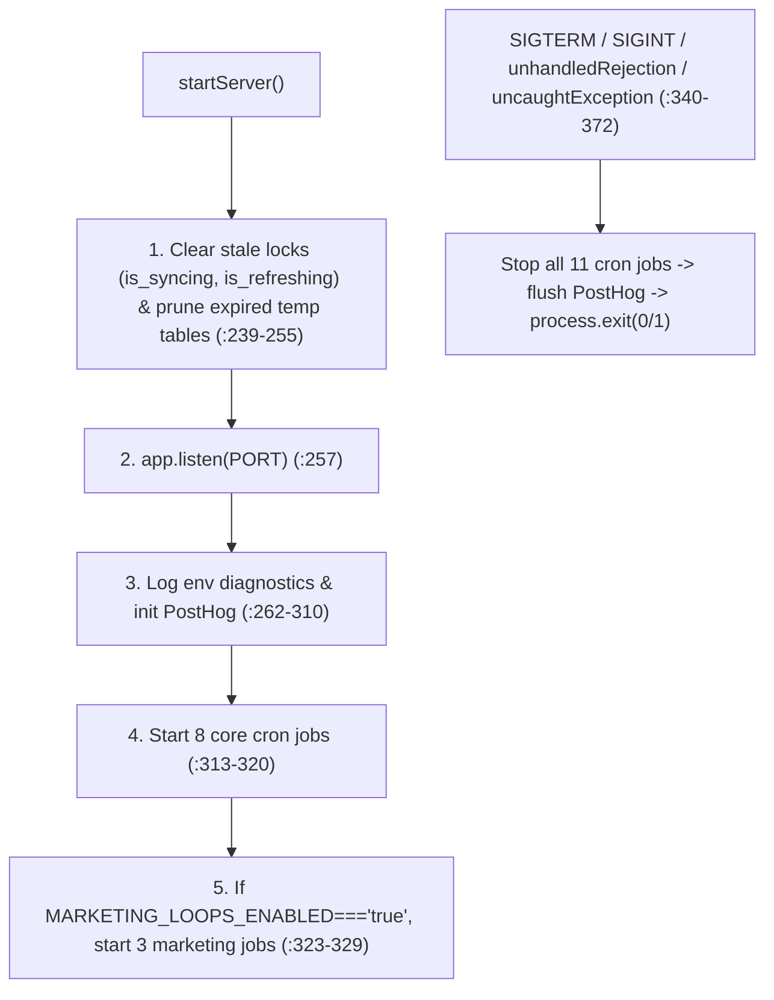

# Backend Architecture

> **Status:** Verified
> **Source commit:** `7567207`
> **Last reviewed:** 2026-11-27
> **Audience:** Junior, Senior

---

## 1. Plain-Language Overview (Explain Like I Am Five)

Think of the backend (`server/`) as one busy kitchen inside a single building:

- **The front door (`index.ts`)** checks if visitors are allowed inside (CORS), counts how fast they knock (`express-rate-limit`), hands every visitor a numbered ticket (`requestIdMiddleware`), and keeps an envelope intact when a webhook arrives (`rawBody`) so signatures can be verified before unsealing the JSON.
- **Security guards (`requireAuth`, `requireOrgRole`, `requireTeamRole`, `requireTier`)** check badges before letting anyone into the recipe counters (`routes/*`).
- **Specialty chefs (`services/*` & `lib/*`)** handle hard jobs like calculating OKR goal percentages, talking to Mistral AI, translating text, or encrypting OAuth tokens with AES-256-GCM.
- **Night-shift robots (`jobs/*`)** wake up on timers (`node-cron`) inside the exact same building to send Monday email reminders, collect AI news RSS feeds, sync Jira/GitHub activity, and compute goal rollups.

---

## 2. Express Application & Middleware Pipeline (`server/src/index.ts:46-232`)

```mermaid
flowchart LR
    REQ["HTTP Request"] --> CORS["1. cors() allowlist (:79-95)"]
    CORS --> RAW["2. Raw-body capture on /api/webhooks* (:98-110)"]
    RAW --> JSON["3. express.json() + urlencoded (:111-112)"]
    JSON --> TRUST["4. trust proxy = 1 (:115)"]
    TRUST --> RATE["5. rateLimit (!dev global 100/15m, /api/auth 20/hr) (:120-135)"]
    RATE --> RID["6. requestIdMiddleware + AsyncLocalStorage MDC (:138)"]
    RID --> LOG["7. Pino log + PostHog JWT capture on res.finish (:140-181)"]
    LOG --> ROUTER["8. Mounted Router (21 modules, :184-204)"]
    ROUTER --> ERR["9. 4-arg Error Handler + captureException (:227-231)"]
```

**Important subtle details verified in `server/src/index.ts`:**
1. **CORS policy (`index.ts:62-95`):** Permits requests with no `Origin` header (curl, webhooks, mobile/server clients), any `http://localhost:<port>`, exact origins in `FRONTEND_URL` (comma-separated), and HTTPS hostnames ending in `.vercel.app` whose subdomain matches `VERCEL_ALLOWED_APPS`.
2. **Duplicate raw-body middleware registration (`index.ts:98-110`):** `/api/webhooks` attaches `express.json` + `express.urlencoded` with `verify` callback saving `req.rawBody = buf`, followed by per-provider `express.json`/`express.urlencoded` raw-body hooks on `/api/webhooks/github`, `/jira`, `/slack` *before* global `express.json()`. Note that webhook routes still rely on `rawBody` for HMAC verification (`server/src/lib/webhookSecurity.ts`).
3. **Production rate limits (`index.ts:118-135`):** Disabled completely when `NODE_ENV === 'development'`. In all other environments, applies global limiter (`RATE_LIMIT_WINDOW` default 15 min, `RATE_LIMIT_MAX_REQUESTS` default 100) and `/api/auth` limiter (20 req/hr). Three additional route-local limiters exist (`playgroundLimiter` in `appraisal.ts`, `waitlistLimiter` in `waitlist.ts`, `slackLinkStartLimiter` / `slackLinkConfirmLimiter` in `integrations.ts`).
4. **Telemetry & Request Tracing (`requestId.ts:12-27`, `index.ts:138-181`):** `requestIdMiddleware` validates client `X-Request-Id` against `/^[A-Za-z0-9_-]{8,64}$/` (CWE-117 log injection defense) or generates a UUID, wraps the async chain in `AsyncLocalStorage` MDC (`mdc.ts`), and `logger.ts` prepends `[req=...|user=...]` on every Pino log line. Wait-free `res.on('finish')` parses JWT payload *only for PostHog analytics distinctId* (real auth happens later in `requireAuth`).

---

## 3. Mounted Routers & Layering

| Mount Path | Router Module | Domain | Primary Auth Gate |
|---|---|---|---|
| `/api/auth` | `authRoutes` (`routes/auth.ts`) | Signup, verify email, login, refresh, logout, forgot/reset | Public (`GET /me` uses `requireAuth`) |
| `/api/users` | `userRoutes` (`routes/users.ts`) | Profile CRUD, password change, account deletion | Router-wide `router.use(requireAuth)` |
| `/api/entries` | `entriesRoutes` (`routes/entries.ts`) | Weekly work log CRUD + invalidates monthly summary | `requireAuth` |
| `/api/appraisal` | `appraisalRoutes` (`routes/appraisal.ts`) | Public playground + AI appraisal generation + history | Playground public; others `requireAuth` |
| `/api/summaries` | `summariesRoutes` (`routes/summaries.ts`) | Monthly summaries list & on-demand generation | `requireAuth` |
| `/api/chat` | `chatRoutes` (`routes/chat.ts`) | Chat sessions & SSE streaming critique assistant | `requireAuth` |
| `/api/feedback` | `feedbackRoutes` (`routes/feedback.ts`) | User feedback submit & history | `requireAuth` |
| `/api/ai-pulse` | `aiPulseRoutes` (`routes/aiPulse.ts`) | Articles, impact cards, bookmarks, SVG OG images, admin endpoints | Public/optionalAuth (`bookmarks` & `/for-you` use `requireAuth`; see Security Findings for admin routes) |
| `/api/translate` | `translateRoutes` (`routes/translate.ts`) | UI bundle localization + `translation_cache` | Public |
| `/api/waitlist` | `waitlistRoutes` (`routes/waitlist.ts`) | Email waitlist capture (`waitlistLimiter`) | Public |
| `/api/orgs` | `organizationRoutes` (`routes/organizations.ts`) | Org CRUD, departments, teams, members, closure rebuild, org goals | `requireAuth` + `requireOrgRole` |
| `/api/teams` | `teamRoutes` (`routes/teams.ts`) | Reparent/delete teams, team membership & roles | `requireAuth` + `requireTeamRole` |
| `/api/goals` | `goalRoutes` (`routes/goals.ts`) | Goals, key results, assignees, check-ins, external links, parenting | `requireAuth` + inline `authz.ts` checks |
| `/api/webhooks/github` | `githubWebhookRoutes` (`routes/webhooks/github.ts`) | GitHub App installation, PR, issue events | HMAC `X-Hub-Signature-256` |
| `/api/webhooks/jira` | `jiraWebhookRoutes` (`routes/webhooks/jira.ts`) | Jira issue events | Shared token comparison |
| `/api/webhooks/slack` | `slackWebhookRoutes` (`routes/webhooks/slack.ts`) | Slack `/worklog`, `/goals`, `/log` slash commands & URL challenge | HMAC `X-Slack-Signature` |
| `/api/integrations` | `integrationRoutes` (`routes/integrations.ts`) | Jira/GitHub/Slack OAuth flows, GitHub App link, Slack 6-digit PIN, disconnect | Mix of `requireAuth` & OAuth browser callbacks |
| `/api/subscriptions` | `subscriptionRoutes` (`routes/subscriptions.ts`) | Org subscription status & limits | `requireAuth` + `requireOrgRole('member')` |
| `/api/reports` | `reportRoutes` (`routes/reports.ts`) | Enterprise AI performance report generation & read | `requireAuth` + `requireTier('enterprise')` + `requireOrgRole('manager'/'admin')` |
| `/api/channel-preferences` | `channelPreferenceRoutes` (`routes/channelPreferences.ts`) | Personal sync filters + org team Slack channel map | `requireAuth` + `requireOrgRole` |
| `/api/push` | `pushRoutes` (`routes/push.ts`) | VAPID public key + browser push subscribe/unsubscribe | VAPID public; sub routes use `requireAuth` |

---

## 4. Layering Discipline & Singletons

### Services (`server/src/services/`) vs Inline Route Queries
The backend uses a **hybrid architecture**:
- **Service-backed domains:** `authz.ts` (role hierarchy & goal edit guards), `teamService.ts` (org/team hierarchy & closure table), `goalService.ts` (goals, KRs, links, check-ins, rollup cycle prevention), `subscriptionService.ts` (tier lookup, in-memory cache, seat check, sync filter helpers), `activityAggregationService.ts` (fetches GitHub/Jira/Slack/manual logs per user/period), `reportGenerationService.ts` (compiles AI performance reports).
- **Route-direct database queries:** `auth.ts`, `users.ts`, `entries.ts`, `appraisal.ts`, `feedback.ts`, `aiPulse.ts`, `waitlist.ts`, `channelPreferences.ts`, `push.ts`, and parts of `integrations.ts` query Postgres directly via `supabase` or `req.supabase`.

### Two Separate Supabase Singletons
- **`server/src/lib/database.ts:17-47`:** Exports `supabase` and `isDatabaseConfigured`, logs via Pino (`logger`), imported by most routes, middleware, and jobs.
- **`server/src/lib/supabase.ts:16-61`:** Exports a separate `supabase` client plus `isSupabaseConfigured`, `canRunReminderJobs`, and `getSupabaseClient(accessToken?)`; imported by `summaryService.ts`, `chatService.ts`, `monthlySummaryJob.ts`, and `routes/translate.ts`.
- **Fallback hazard:** Both `database.ts:21` and `supabase.ts:20` list `'VITE_SUPABASE_ANON_KEY'` as a fallback after `SUPABASE_SERVICE_KEY` and `SUPABASE_SERVICE_ROLE_KEY`. If the service key is omitted and only anon key exists, queries would silently hit RLS restrictions! Notice `index.ts:39` also imports `isDatabaseConfigured` without ever using it (triggering the server ESLint error).

---

## 5. Server Startup, Background Jobs & Graceful Shutdown (`server/src/index.ts:234-372`)

| Job | Schedule / Trigger | Purpose | Gate / Lock |
|---|---|---|---|
| `reminderJob` | Periodic check (`reminderJob.ts`) | Weekly work-log reminders via Brevo + Web Push | `reminder_logs` dedup |
| `monthlySummaryJob` | End/start of month (`monthlySummaryJob.ts`) | Pre-computes Mistral monthly work-log summaries | `monthly_summaries` upsert |
| `newsCollectionJob` | Every 6 hours (`newsCollectionJob.ts`) | Fetches RSS feeds & summarizes AI Pulse articles via Mistral | `ai_articles` slug check |
| `weeklyDigestJob` | Weekly digest (`weeklyDigestJob.ts`) | Emails top AI Pulse articles to users | Queries `user_profiles.user_id` (known schema mismatch bug) |
| `weeklySyncJob` | Periodic sync (`weeklySyncJob.ts`) | Pulls GitHub/Jira items into `pending_review` work log entries | `acquire_integration_sync_lock` + `IS_SCHEDULER_NODE` |
| `goalRollupJob` | Periodic rollup (`goalRollupJob.ts`) | Syncs GitHub/Jira link completion & recomputes leaf goals | `global_locks` + `IS_SCHEDULER_NODE` |
| `goalDigestJob` | Scheduled digest (`goalDigestJob.ts`) | Sends Slack Block Kit OKR summaries to channels | `global_locks` + `IS_SCHEDULER_NODE` |
| `pruneJob` | Daily maintenance (`pruneJob.ts`) | Cleans expired tokens/states/old events | Direct table deletes |
| `activationLoop`, `dormancyWatch`, `weeklyReview` | Marketing crons (`jobs/marketing/*`) | Lifecycle onboarding/churn emails & weekly KPI log | Only starts if `MARKETING_LOOPS_ENABLED === 'true'` (`index.ts:323`) |

---

## Related Documents

- [System Architecture](./system-architecture.md)
- [Auth & Authorization Architecture](./auth-and-authorization.md)
- [API Overview](../06-api-reference/api-overview.md)
- [Backend Functions Index](../04-function-documentation/function-index.md)

## Verification Notes

- Inspected: `server/src/index.ts`, `server/src/lib/database.ts`, `server/src/lib/supabase.ts`, `server/src/middleware/*`, all 21 route files, all 6 service files, and all 11 job files.
- Verified: `npm run typecheck` passed (`tsc`); `npx vitest run` in `server/` passed 6 files / 147 tests.
- Failed: `npm run lint --workspace=server` failed on `server/src/index.ts:39:10` (`isDatabaseConfigured` unused import).
