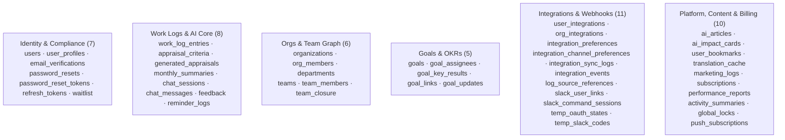

# Database Architecture

> **Status:** Verified (SQL files inspected statically; live Postgres instance not queried at runtime)
> **Source commit:** `7567207`
> **Last reviewed:** 2026-11-27
> **Audience:** Junior, Senior

---

## 1. Plain-Language Overview (Explain Like I Am Five)

Imagine a giant filing cabinet with **47 labeled drawers** inside Supabase Postgres:

- **Drawers 1–6 (Your Personal Notebook):** Hold who you are (`users`, `user_profiles`), what you did each week (`work_log_entries`), AI-written summaries (`monthly_summaries`, `generated_appraisals`), your questions in chat (`chat_sessions`, `chat_messages`), and feedback (`feedback`).
- **Drawers 7–15 (Your Company & Goals):** Store companies (`organizations`), departments (`departments`), nested teams (`teams` + a shortcut map `team_closure` so the computer instantly knows every sub-team under a manager), and goals (`goals`, `goal_key_results`, `goal_links`).
- **Drawers 16–24 (Tool Connectors & Safety Locks):** Store secret encrypted badges for Jira/GitHub/Slack (`user_integrations`, `org_integrations`), incoming webhook receipts (`integration_events`), and "Do Not Disturb" locks (`global_locks`) so two background workers don't do the same chore twice.
- **One huge catch:** Normally, Postgres gives every drawer its own padlock (called Row-Level Security / RLS). Because our Express server opens the filing cabinet using the **master janitor key** (`SUPABASE_SERVICE_KEY`), those drawer padlocks are bypassed — so the server code itself must carefully check whose badge is asking before handing over any folder!

---

## 2. Database Engine & Schema Evolution (11 Migrations + 4 Root SQL Files)

The repository uses raw ordered SQL scripts in Supabase rather than an automated ORM migration tool (`Prisma`/`Drizzle`):

1. **`supabase-schema.sql` (542 lines):** Original Supabase-Auth-era base tables (`user_profiles` with `on_auth_user_created` trigger on `auth.users`), later appended with custom auth (`users`, `email_verifications`, `password_reset_tokens`, `refresh_tokens`), chat/summaries, feedback, AI Pulse, marketing logs, and `translation_cache`.
2. **`supabase-schema-custom-auth.sql` (206 lines):** Recreates core tables without `auth.users` foreign keys (`users`, `email_verifications`, `refresh_tokens`, `password_resets`, `waitlist`, `work_log_entries`, `appraisal_criteria`, `generated_appraisals`, `reminder_logs`) and defines `cleanup_expired_tokens()`.
3. **`supabase-migration-ai-pulse.sql` (267 lines) & `supabase-schema-ai-pulse-seed.sql` (207 lines):** Standalone AI Pulse tables + 5 seed articles + 5 seed impact cards.
4. **`migrations/` (4 files):** Early incremental scripts (`001_monthly_summaries_and_chat.sql`, `002_add_reminder_columns_to_users.sql`, `003_make_log_fields_optional.sql`, `add_feedback_table.sql`).
5. **`supabase-migrations/` (7 files):** Production hardening & enterprise expansion:
   - `2026-06-05_i18n_support.sql` (`users.preferred_language`, `translation_cache`)
   - `2026-06-07_security_token_hashing.sql` (SHA-256 token hashing columns/cleanup)
   - `2026-06-16_teams_goals_integrations.sql` (1,375 lines — 22 tables, 20 PL/pgSQL functions, 34 triggers)
   - `2026-06-18_followup_constraints.sql` (additional check/member integrity triggers & `updated_at` triggers)
   - `2026-06-20_premium_subscriptions.sql` (4 tables: `subscriptions`, `performance_reports`, `activity_summaries`, `integration_channel_preferences` + free-tier auto-provisioning trigger)
   - `cohort-tracking.sql` (`users` streak/cohort trigger `user_cohort_stats_trigger`)
   - `push-subscriptions.sql` (`push_subscriptions` table)

---

## 3. Domain Grouping of the 47 Distinct Tables

---

## 4. Key Architectural Mechanisms in Postgres

### 4.1 RLS Model: Legacy Permissive vs Enterprise Deny-All vs Service-Role Reality
- **Base & older tables** (`work_log_entries`, `monthly_summaries`, `chat_sessions`, `user_bookmarks`, `subscriptions`) declare `auth.uid() = user_id` or `USING (false)` / permissive policies depending on which migration ran last.
- **Enterprise migration (`supabase-migrations/2026-06-16_teams_goals_integrations.sql:1280-1325`)** explicitly drops legacy policies and attaches **deny-all public policies** (`USING (false)`) across 22 integration/org/team/goal tables, explicitly noting: *"This migration uses the SERVICE ROLE key on the server side and relies on `req.userId` for authorization. RLS is enabled with deny-all public policies to provide defense-in-depth."*
- **Consequence:** Because `server/src/lib/database.ts` and `middleware/auth.ts` connect with `SUPABASE_SERVICE_KEY`, Postgres grants the API unrestricted table access across all tenants. Data isolation depends 100% on Node filters and triggers.

### 4.2 Team Hierarchy Closure Table (`team_closure`)
Recursive SQL CTEs for deep org trees can be slow on every authorization check. Instead, `supabase-migrations/2026-06-16_teams_goals_integrations.sql:182-189,734-840` maintains a pre-computed **transitive closure table** (`team_closure(ancestor_id, descendant_id, depth)`):
- `team_closure_after_insert()` auto-inserts `(id, id, 0)` plus all `(ancestor, new_id, depth+1)` rows whenever a team is created.
- `teams_parent_cycle_guard()` rejects reparenting a team under itself or any descendant.
- `team_closure_after_reparent()` rewires closure paths when `parent_team_id` changes.
- `viewable_user_ids(p_user_id, p_org_id)` (`:548-585`) resolves visibility in one SQL RPC by joining `team_members` with `team_closure`.

### 4.3 Goal Progress Auto-Rollup & Org-Integrity Triggers
Postgres enforces structural invariants that Node routes rely on (`2026-06-16_teams_goals_integrations.sql:846-1220`):
- **Cross-org tampering prevention:** Triggers `verify_team_department_org()`, `verify_goal_relations_org()`, `prevent_org_id_mutation()` (installed across 9 tables), and `enforce_goal_structure_integrity()` block mixing rows from two different organizations or changing an existing row's `org_id`.
- **Automatic progress computation (`recompute_goal_progress(p_goal_id)` at `:997-1075`):** Recomputes weighted Key Results (`goal_key_results`), external ticket completion (`goal_links` where `is_done = true`), and child-goal cascade (`goals.parent_goal_id`) automatically whenever child records change, skipping `manual` mode goals while still rippling up parent rollups.
- **Safety locks (`acquire_integration_sync_lock`, `lock_organization_row`, `global_locks`):** Postgres functions and lock tables coordinate multi-instance syncs, reparenting (`moveTeam`), and scheduled cron jobs.

### 4.4 Declared Schema vs Runtime Usage Gaps
Detailed table-by-table differences are cataloged in [Migrations & Drift](../07-database/migrations.md), including:
- `password_reset_tokens` (`supabase-schema.sql`) vs `password_resets` (`supabase-schema-custom-auth.sql`, used at runtime by `routes/auth.ts`).
- `temp_slack_codes`: `server/src/routes/integrations.ts:822` inserts an `email` column that is absent from `CREATE TABLE temp_slack_codes` (`2026-06-16_teams_goals_integrations.sql:361-370`).
- `push_subscriptions`: `routes/push.ts:41` upserts `onConflict: 'endpoint'`, while `push-subscriptions.sql` declares `UNIQUE(user_id, endpoint)` (no standalone `UNIQUE(endpoint)` constraint).
- `weeklyDigestJob.ts:46` queries `user_profiles.user_id`, whereas `user_profiles.id` references `users.id` (no `user_id` column).

---

## Related Documents

- [Database Schema Reference](../07-database/schema.md)
- [Table Relationships & ERD](../07-database/relationships.md)
- [Queries, Locks & Triggers](../07-database/queries-and-operations.md)
- [Migrations & Schema Drift](../07-database/migrations.md)

## Verification Notes

- Inspected: All 15 `.sql` files in repo root, `migrations/`, and `supabase-migrations/`.
- Not verified against a live Postgres database; trigger execution and RLS enforcement require a deployed Supabase instance.