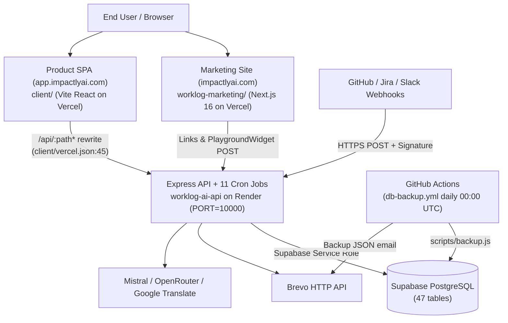

# Deployment Architecture

> **Status:** Verified (Deployment manifests inspected; live Render/Vercel/GitHub dashboards not accessible)
> **Source commit:** `7567207`
> **Last reviewed:** 2026-11-27
> **Audience:** Junior, Senior

---

## 1. Plain-Language Overview (Explain Like I Am Five)

Think of putting this app on the internet like opening two storefronts connected to one warehouse:

1. **The Main App Website (`client/` on Vercel):** Holds all the colorful screens you click in your browser. Whenever the app asks `/api/...` for data, Vercel quietly forwards that letter across the internet to the backend kitchen so it looks like both live at the same address!
2. **The Marketing Website (`worklog-marketing/` on Vercel):** A separate, search-engine-friendly brochure website (`impactlyai.com`) with blog posts and templates. When you click *"Get Started"*, it sends you to the main app (`app.impactlyai.com/login`).
3. **The Kitchen (`server/` on Render):** A Node.js server listening on port `10000` (with a legacy Railway config `nixpacks.toml` also still checked into git) that talks to the **Supabase Postgres** database, sends emails with **Brevo**, asks **Mistral / OpenRouter** to draft reviews, and runs background alarm clocks (`node-cron`).
4. **Automated Helpers (GitHub Actions):** Two scheduled workflows keep an eye on things: **CodeQL** scans code for bugs every Monday, and **`db-backup.yml`** emails a database backup every midnight UTC.

---

## 2. Production Topology

---

## 3. Deployable Units & Configuration Files

### 3.1 Product Frontend (`client/` → Vercel)
- **Root configs:** `vercel.json` (`framework: "vite"`) and `client/vercel.json` (`framework: "vite"`, `outputDirectory: "dist"`).
- **Output helper:** `scripts/vercel-prepare-output.mjs` and wrapper `client/public/scripts/vercel-prepare-output.mjs` locate `client/dist` across possible monorepo working directories and copy it to `<cwd>/dist`.
- **Rewrites (`client/vercel.json:44-47`):**
  - `/api/:path*` → `https://worklog-ai-7qh6.onrender.com/api/:path*`
  - `/(.*)` → `/index.html` (SPA history fallback)
  - *Crucial OAuth implication:* Because `/api/*` is reverse-proxied through Vercel, `server/src/routes/integrations.ts` builds OAuth redirect URIs using `${getFrontendUrl()}/api/integrations/.../callback`, routing callbacks cleanly through the frontend domain back to Render.
- **Security Headers & CSP (`client/vercel.json:5-43`):**
  - Immutable 1-year caching on `/assets/(.*)`; 1-day caching + explicit `Content-Type` on `robots.txt`, `sitemap.xml`, `llms.txt`.
  - Global security headers: `X-Frame-Options: DENY`, `X-Content-Type-Options: nosniff`, `Referrer-Policy: strict-origin-when-cross-origin`, `Permissions-Policy: camera=(), microphone=(), geolocation=()`, and a Content Security Policy allowing `'unsafe-inline'` scripts/styles, `*.posthog.com`, `*.googletagmanager.com`, `*.supabase.co`, `*.logrocket.io`, `worklog-ai-7qh6.onrender.com`, and Google Fonts. *(Note: Vite builds load Google Fonts if configured, and `script-src` allows `'unsafe-inline'`.)*

### 3.2 Backend API (`server/` → Render, with Legacy Railway Configs)
- **Primary Manifest (`render.yaml:1-48`):**
  - Service type: `web`, name `worklog-ai-api`, region `oregon`, plan `free`, rootDir `.`.
  - Build: `npm install && npm run build --workspace=server`
  - Start: `npm run start --workspace=server` (`node dist/index.js`)
  - Health check: `/health` (`server/src/index.ts:222-225` returns `{ status: "ok", timestamp, uptime }`)
  - Env vars declared (`18` keys): `NODE_ENV=production`, `PORT=10000`, `SUPABASE_URL`, `SUPABASE_SERVICE_KEY`, `BREVO_API_KEY`, `BREVO_FROM_EMAIL`, `BREVO_FROM_NAME`, `JWT_SECRET`, `FRONTEND_URL`, `MISTRAL_API_KEY`, `INTEGRATION_ENCRYPTION_KEY`, `JIRA_CLIENT_ID`, `JIRA_CLIENT_SECRET`, `GITHUB_APP_ID`, `GITHUB_APP_PRIVATE_KEY`, `GITHUB_APP_WEBHOOK_SECRET`, `SLACK_SIGNING_SECRET`, `VERCEL_ALLOWED_APPS`.
  - *Note:* Runtime code also reads many variables **not** listed in `render.yaml` (`VAPID_PUBLIC_KEY`, `VAPID_PRIVATE_KEY`, `OPENROUTER_API_KEY`, `GOOGLE_TRANSLATE_API_KEY`, `POSTHOG_API_KEY`, `GITHUB_CLIENT_ID`/`SECRET`, `SLACK_CLIENT_ID`/`SECRET`, `IS_SCHEDULER_NODE`, `MARKETING_LOOPS_ENABLED`, `ADMIN_API_KEY`). These must be added manually in the Render dashboard.
- **Legacy Railway configs still present:** `nixpacks.toml` (Node 20 Nixpacks build/start) and `server/Procfile` (`web: node dist/index.js`). Root docs (`README.md`, `CLAUDE.md`) still mention Railway, whereas `render.yaml` and `client/vercel.json` establish Render (`worklog-ai-7qh6.onrender.com`) as the active host.
- **Render free-tier caveat:** Single instance sleeps after inactivity; on startup `server/src/index.ts:239-255` clears orphaned `is_syncing`/`is_refreshing` locks and prunes expired OAuth/Slack/event rows before launching cron jobs. Multi-instance scheduler safety relies on setting `IS_SCHEDULER_NODE` cleanly (`weeklySyncJob.ts`, `goalRollupJob.ts`, `goalDigestJob.ts`).

### 3.3 Marketing Site (`worklog-marketing/` → Vercel Next.js)
- **Config (`worklog-marketing/vercel.json`):** `{ "framework": "nextjs" }`, `next.config.ts` empty default.
- Not included in root `package.json` `"workspaces": ["client", "server", "shared"]` — built/deployed independently via Vercel.
- Links conversion CTAs to `https://app.impactlyai.com/login` and calls `NEXT_PUBLIC_API_URL || "https://worklog-ai-7qh6.onrender.com"` from `PlaygroundWidget.tsx:102`. Also includes Google AdSense (`ca-pub-7620811634558573`), GA4 (`G-HW2VQ27KDY`), and `@vercel/analytics`.

### 3.4 Automation & CI Workflows (`.github/workflows/`)
1. **Daily Database Backup (`.github/workflows/db-backup.yml:1-35`):**
   - Runs daily at `00:00 UTC` + manual `workflow_dispatch`.
   - Executes `node scripts/backup.js`, dumping 14 tables (`scripts/backup.js:30-45` — does **not** include the newer org/team/goal/integration/subscription/push tables!) and emailing a raw JSON attachment (`.txt` extension) via Brevo.
2. **CodeQL SAST Analysis (`.github/workflows/codeql.yml:1-100`):**
   - Runs on `push`/`pull_request` to `main` and weekly Monday cron (`21 20 * * 1`), analyzing `javascript-typescript` in `build-mode: none`.

---

## Related Documents

- [Environment Variables Catalogue](../10-environment-and-deployment/environment-variables.md)
- [Deployment Guide](../10-environment-and-deployment/deployment-guide.md)
- [Local Setup Guide](../10-environment-and-deployment/local-setup.md)

## Verification Notes

- Inspected: `vercel.json`, `client/vercel.json`, `render.yaml`, `nixpacks.toml`, `server/Procfile`, `scripts/vercel-prepare-output.mjs`, `client/public/scripts/vercel-prepare-output.mjs`, `.github/workflows/db-backup.yml`, `.github/workflows/codeql.yml`, `worklog-marketing/vercel.json`, `worklog-marketing/next.config.ts`.
- Not verified at runtime: Live Vercel DNS/rewrites, Render env dashboard values, GitHub Actions secret configuration.