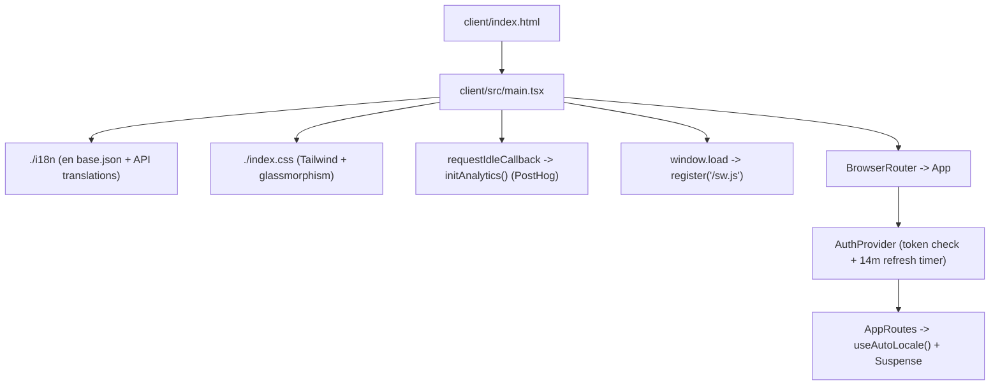

# Frontend Architecture

> **Status:** Verified
> **Source commit:** `7567207`
> **Last reviewed:** 2026-11-27
> **Audience:** Beginner, Junior, Senior

---

## 1. Plain-Language Overview (Explain Like I Am Five)

Think of the frontend as a digital coloring book + dashboard that runs right inside your web browser:

- When you visit a web page, your browser downloads one main helper (`client/src/main.tsx`), which sets up languages (like English, Spanish, Arabic), an analytics notebook (`posthog-js`), and a background helper (`sw.js`) so the browser can ring a bell (push notification) when it is time to log work.
- A receptionist (`App.tsx`) looks at the web address (`/dashboard`, `/log`, `/goals`, `/ai-pulse`, etc.). If a room is members-only, a guard (`ProtectedRoute`) checks your VIP wristband (`AuthContext`) first.
- Every button or form talks to a shared messenger (`client/src/lib/api.ts`), which attaches your badge (`Authorization: Bearer ...`) and automatically swaps expired badges (`refreshAccessToken`) behind the scenes so you don't get kicked out while typing.

---

## 2. Technical Architecture

The product web application is a **React 19 Single-Page Application (SPA)** built with **Vite 6**, **Tailwind CSS 3**, **React Router 7**, and **i18next 26**, sharing TypeScript types from `shared/`. A completely separate marketing site lives in [`worklog-marketing/`](../../worklog-marketing/package.json) (Next.js 16 App Router) and links users to the hosted app (`https://app.impactlyai.com/login`).

### Entry & Bootstrap Sequence (`client/src/main.tsx:1-42`)

**What happens on startup:**
1. **`client/src/i18n/index.ts`** initializes i18next synchronously using the bundled English dictionary (`client/src/locales/en/base.json`, 742 lines) so first paint never blocks on network translation calls.
2. **PostHog Analytics** (`client/src/lib/analytics.ts:15-30`) initializes lazily via `window.requestIdleCallback` (fallback `setTimeout(..., 1)`) using `VITE_PUBLIC_POSTHOG_PROJECT_TOKEN` or `VITE_POSTHOG_KEY` (`client/src/main.tsx:9-25`).
3. **Service Worker** (`client/public/sw.js`) registers on `window.load` to handle Web Push events and notification click focus/open behavior (`client/src/main.tsx:27-33`).
4. **`<AuthProvider>`** (`client/src/context/AuthContext.tsx:43-281`) wraps `<AppRoutes />` (`client/src/App.tsx:210-216`), restores `accessToken` + `refreshToken` from `localStorage` or `sessionStorage`, verifies session via `GET /api/users/profile`, identifies the user in PostHog, and starts a **14-minute** background refresh timer (`:54-59`).

---

## 3. Routing & Code Splitting (`client/src/App.tsx:9-208`)

Every page except `LandingPage` is loaded on demand with `React.lazy()` (`client/src/App.tsx:9-29`) and wrapped in `<Suspense>`.

| Route | Component | Guard | Layout Chrome? | Evidence |
|---|---|---|---|---|
| `/` | `LandingPage` | Public | No | `client/src/App.tsx:92` |
| `/login` | `Login` | Public | No | `client/src/App.tsx:93` |
| `/forgot-password` | `ForgotPassword` | Public | No | `client/src/App.tsx:94` |
| `/reset-password` | `ResetPassword` | Public | No | `client/src/App.tsx:95` |
| `/verify-email` | `VerifyEmail` | Public | No | `client/src/App.tsx:192` |
| `/terms` | `Terms` | Public | Yes (`Layout`) | `client/src/App.tsx:193` |
| `/privacy` | `Privacy` | Public | Yes (`Layout`) | `client/src/App.tsx:194` |
| `/ai-pulse` | `AIPulseHub` | Public (auth optional for bookmarks) | Yes (`Layout`) | `client/src/App.tsx:195` |
| `/onboarding` | `Onboarding` | `OnboardingRoute` (auth required, no onboarding gate) | No | `client/src/App.tsx:67-84,185-190` |
| `/dashboard` | `Dashboard` | `ProtectedRoute` (auth + onboarding check) | Yes (`Layout`) | `client/src/App.tsx:96-103` |
| `/log` | `LogEntry` | `ProtectedRoute` | Yes (`Layout`) | `client/src/App.tsx:104-111` |
| `/appraisals` | `Appraisal` | `ProtectedRoute` | Yes (`Layout`) | `client/src/App.tsx:112-119` |
| `/chat` | `Chat` | `ProtectedRoute` | Yes (`Layout`) | `client/src/App.tsx:120-127` |
| `/settings` | `Settings` | `ProtectedRoute` | Yes (`Layout`) | `client/src/App.tsx:128-135` |
| `/feedback` | `Feedback` | `ProtectedRoute` | Yes (`Layout`) | `client/src/App.tsx:136-143` |
| `/goals` | `Goals` | `ProtectedRoute` | Yes (`Layout`) | `client/src/App.tsx:144-151` |
| `/team-goals` | `TeamGoals` | `ProtectedRoute` | Yes (`Layout`) | `client/src/App.tsx:152-159` |
| `/org-settings` | `OrgSettings` | `ProtectedRoute` | Yes (`Layout`) | `client/src/App.tsx:160-167` |
| `/integrations` | `Integrations` | `ProtectedRoute` | Yes (`Layout`) | `client/src/App.tsx:168-175` |
| `/integrations/link-github` | `LinkGithub` | `ProtectedRoute` | Yes (`Layout`) | `client/src/App.tsx:176-183` |
| `/billing` | `Billing` | `ProtectedRoute` | Yes (`Layout`) | `client/src/App.tsx:196-203` |
| `*` | `NotFound` | Public | Yes (`Layout`) | `client/src/App.tsx:204` |

**First-run onboarding redirect (`client/src/App.tsx:56-61`):** `ProtectedRoute` checks `if (requireOnboarding && user.onboardingCompleted === false && location.pathname !== '/onboarding')` using strict `=== false` so partially hydrated profiles do not cause redirect loops.

---

## 4. State Management & Contexts

The frontend does **not** use Redux or Zustand. State is divided cleanly into two React Contexts plus local component state:

1. **`AuthContext` (`client/src/context/AuthContext.tsx:39-289`):**
   - Stores `user`, `accessToken`, `refreshToken`, `loading`.
   - Implements `login` (respects `rememberMe` by choosing `localStorage` vs `sessionStorage`), `signup`, `logout`, `verifyEmail`, `resendVerificationEmail`, `refreshProfile`.
   - Proactively calls `handleRefreshToken()` every 14 minutes (1 minute ahead of the server's default 15-minute JWT lifetime).
2. **`SubscriptionContext` (`client/src/context/SubscriptionContext.tsx:15-59`):**
   - **Important implementation finding:** `SubscriptionProvider` is **not** mounted in `App.tsx`; instead it is mounted locally only inside `Billing.tsx:110-114`. Moreover, `SubscriptionContext.tsx:27` calls `fetch('/api/subscriptions/${orgId}')` *without* an `Authorization: Bearer` header or `API_URL` prefix, whereas `server/src/routes/subscriptions.ts:24` requires `requireAuth` and `requireOrgRole('member')`. As a result, `SubscriptionContext` receives HTTP `401` and falls back to `'free'`.

---

## 5. HTTP & Streaming Data Layer (`client/src/lib/`)

| Module | Responsibility | Token Strategy | Reference |
|---|---|---|---|
| `api.ts` | REST wrapper + CRUD for entries, appraisals, profile, waitlist, feedback | Calls `getStoredTokens()`; on `401`, calls `refreshAccessToken()`, updates header, retries once; redirects to `/login` unless `ignoreAuthRedirect: true` | `client/src/lib/api.ts:38-86` |
| `authStorage.ts` | Abstracts `localStorage` vs `sessionStorage` token storage | Preserves existing storage slot during refresh rotation | `client/src/lib/authStorage.ts:14-42` |
| `useSSE.ts` | Reads Server-Sent Events stream for AI Critique Chat | Uses `fetch()` (`POST /api/chat/sessions/:id/messages`) instead of `EventSource` so Bearer header can be sent; parses `data: ...` chunks (`type: 'chunk' \| 'done' \| 'error'`); auto-refreshes once on `401` | `client/src/lib/useSSE.ts:5-116` |
| `goalsApi.ts`, `teamsApi.ts`, `integrationsApi.ts`, `chatApi.ts` | Typed wrappers delegating to `apiRequest<T>()` | Inherited from `apiRequest` | `client/src/lib/` |
| `push.ts` | Subscribes browser PushManager using server VAPID key & posts subscription to `/api/push/subscribe` | Uses `apiRequest` | `client/src/lib/push.ts:28-79` |
| `supabase.ts` | Creates browser Supabase anon client | Unused by core app routes; exported for optional direct client access | `client/src/lib/supabase.ts:1-11` |

---

## 6. Styling, Build & Bundling

- **Design system (`client/src/index.css`):** Dark obsidian surface (`#0a0a0f`) with glassmorphism utilities (`.glass`, `.glass-strong`, `.glow-primary`, `.glow-accent`, `.glow-cyan`, `.gradient-text`).
- **Build pipeline (`client/vite.config.ts:7-33`):**
  - `vite-plugin-css-injected-by-js` inlines CSS into JS bundles (`topExecutionPriority: false`).
  - Alias `'shared'` resolves to `../shared`.
  - `manualChunks` isolates `'react-vendor': ['react', 'react-dom', 'react-router-dom']`.
  - Dev server runs on port `5173` and proxies `/api` to `http://localhost:3001`.
- **Direct API vs `apiRequest` note:** `ForgotPassword.tsx`, `ResetPassword.tsx`, `VerifyEmail.tsx`, `LinkGithub.tsx`, `Settings.tsx` (`PUT /api/users/password`), and `AuthContext.tsx` call raw `fetch()` directly rather than `apiRequest()` (mostly because auth flows happen before tokens exist or handle custom `AuthError` codes). `LinkGithub.tsx:44` defaults `VITE_API_URL || ''` while auth pages default `VITE_API_URL || 'http://localhost:3001'`.

---

## Related Documents

- [System Architecture](./system-architecture.md)
- [Backend Architecture](./backend-architecture.md)
- [File-by-File: Client](../03-codebase-structure/file-by-file-client.md)
- [Frontend Functions](../04-function-documentation/function-index.md)

## Verification Notes

- Inspected: `client/src/main.tsx`, `client/src/App.tsx`, `client/src/context/AuthContext.tsx`, `client/src/context/SubscriptionContext.tsx`, `client/src/lib/api.ts`, `client/vite.config.ts`, `client/src/pages/*`, `client/src/components/*`.
- Verified via `npm run typecheck` (`tsc -b` passed with 0 errors).
- `npm run lint --workspace=client` fails with 1 error (`client/src/lib/push.ts:16:15 no-useless-escape`) and 18 hook/refresh warnings.
