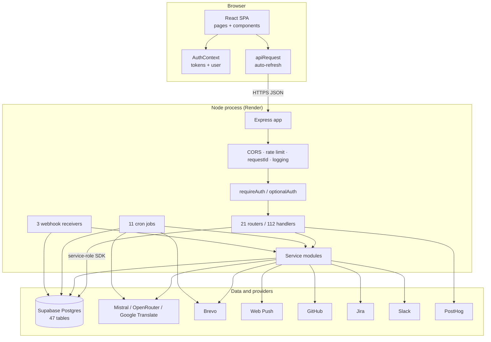
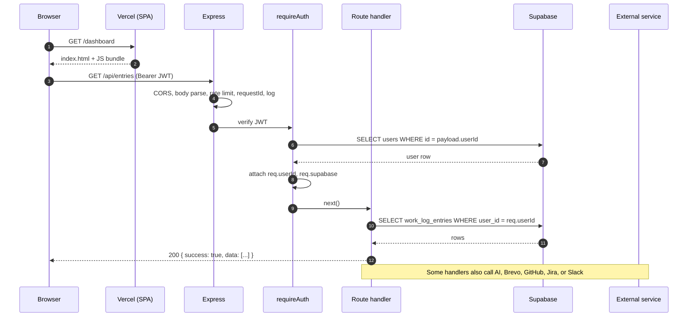
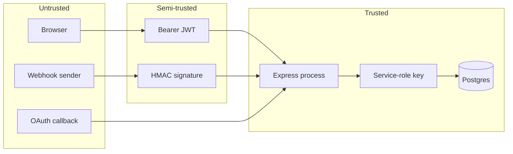
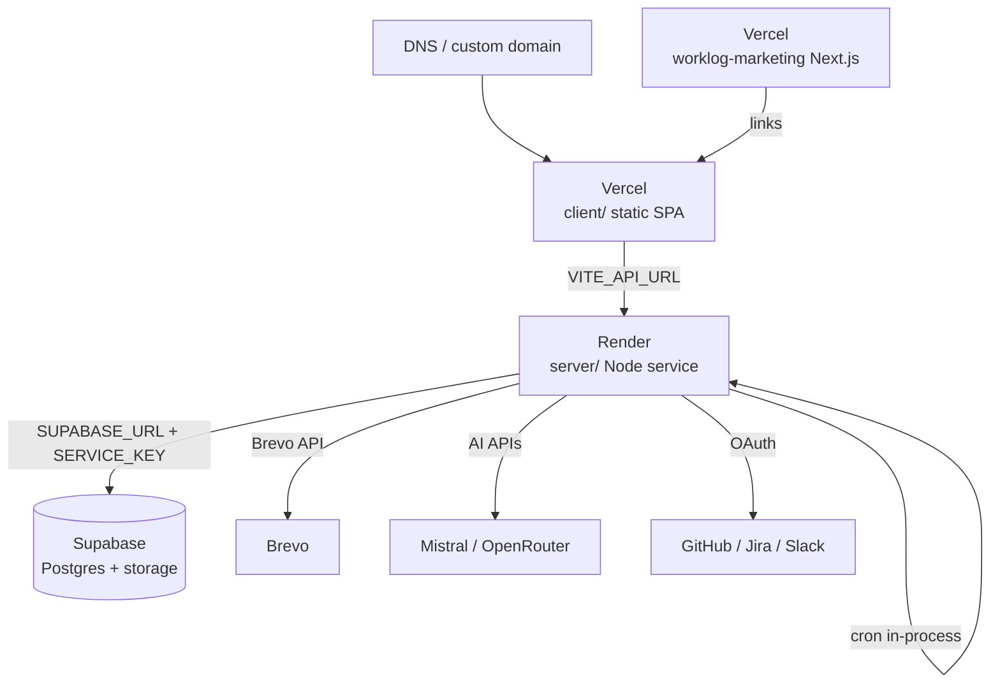

# System Architecture

> **Status:** Verified
> **Source commit:** `7567207`
> **Last reviewed:** 2026-11-27
> **Audience:** Junior, Senior

---

## 1. The one-paragraph version

Worklog AI is a **client-server, modular-monolith web application**. A React
single-page app runs in the browser and calls an Express REST API. The API
authenticates every request with its own JWT, then reads and writes Supabase
Postgres through a service-role client. Complex domains (authorization, goals,
teams, subscriptions, reports) live in service modules; simpler routes query
the database directly. Eleven cron jobs and three webhook receivers run inside
the same Node process. AI, email, chat, and developer-tool integrations are
external HTTP dependencies.

---

## 2. The story: opening the app

Imagine Priya opens `https://app.example.com` on Monday morning.

1. Vercel serves `client/index.html` and the Vite bundle.
2. React mounts `AuthProvider` (`client/src/context/AuthContext.tsx:43`).
3. `loadAuthState()` looks for `accessToken` and `refreshToken` in
   `localStorage` or `sessionStorage` (`:61-105`).
4. If tokens exist, the browser calls `GET /api/users/profile` with
   `Authorization: Bearer <token>`.
5. Express runs CORS, body parsing, rate limiting (production), request-ID
   middleware, and request logging (`server/src/index.ts:79-181`).
6. `requireAuth` verifies the JWT, loads the user row, attaches `req.userId`,
   `req.user`, and a fresh service-role Supabase client (`middleware/auth.ts:138-201`).
7. The profile handler queries `users` and returns `{ success, data }`.
8. `AuthContext` stores the user, identifies them in PostHog, and applies their
   saved language.
9. `ProtectedRoute` renders the Dashboard inside `Layout`.
10. The Dashboard calls `/api/entries`, `/api/summaries`, and other endpoints;
    each repeats steps 4–7.

If the access token is expired, `apiRequest` calls `/api/auth/refresh` once,
stores the rotated pair, and retries the original request
(`client/src/lib/api.ts:59-70`).

---

## 3. Context diagram

**Plain language:** the browser is a customer in a restaurant. The Express API
is the waiter who checks your reservation (JWT), takes your order, and either
fetches it from the kitchen (Postgres) or calls a specialist (AI, email,
GitHub). Cron jobs are staff who work before the restaurant opens.

---

## 4. Subsystem responsibilities

| Subsystem | Owns | Does **not** own |
|---|---|---|
| React client | Rendering, navigation, form state, token storage, optimistic UI | Authorization decisions, password hashing, data integrity |
| Express API | Authentication, authorization, validation, orchestration, scheduled work | Rendering, long-term session storage in the browser |
| Service modules | Domain rules (roles, goals, tiers, reports) | HTTP parsing |
| Supabase Postgres | Durable state, constraints, indexes, RLS declarations | Primary authorization (service role bypasses RLS) |
| Shared package | Type contracts | Runtime behavior |
| Marketing site | Public content and SEO | Product data |

---

## 5. Request lifecycle

### Where each concern lives

| Concern | File |
|---|---|
| CORS allowlist | `server/src/index.ts:62-95` |
| Raw webhook body capture | `server/src/index.ts:97-110` |
| Rate limiting | `server/src/index.ts:117-135` |
| Request IDs and logging | `server/src/middleware/requestId.ts`, `index.ts:138-181` |
| JWT verification | `server/src/middleware/auth.ts:138-201` |
| Org/team authorization | `server/src/services/authz.ts:239-284` |
| Tier gating | `server/src/middleware/tierGate.ts` |
| Global error handler | `server/src/index.ts:227-231` |
| Router mounting | `server/src/index.ts:184-204` |
| Scheduled jobs | `server/src/index.ts:312-330` |
| Graceful shutdown | `server/src/index.ts:340-372` |

---

## 6. The five data planes

Thinking in planes makes the system easier to reason about.

### 6.1 Identity plane

- Signup: validate → hash password (bcrypt) → insert `users` → create email
  verification token (hashed) → send Brevo email.
- Login: look up by email → compare bcrypt hash → require verified email →
  issue JWT + refresh token.
- Refresh: hash presented token → find unrevoked, unexpired row → revoke old →
  issue new pair.
- Logout: revoke the presented refresh token.
- Evidence: `server/src/routes/auth.ts`, `server/src/middleware/auth.ts`.

### 6.2 Product-data plane

- Weekly entries, appraisals, monthly summaries, chat sessions/messages,
  feedback, AI Pulse bookmarks.
- Every row is scoped to `user_id`; handlers use `.eq('user_id', req.userId)`.
- Evidence: `server/src/routes/entries.ts`, `appraisal.ts`, `summaries.ts`,
  `chat.ts`, `aiPulse.ts`.

### 6.3 Collaboration plane

- Organizations → departments → teams (closure table) → members.
- Goals → key results → assignees → links → updates.
- Authorization is rank-based and checked per request.
- Evidence: `server/src/services/teamService.ts`, `goalService.ts`,
  `authz.ts`, `routes/organizations.ts`, `teams.ts`, `goals.ts`.

### 6.4 Integration plane

- OAuth state stored in `temp_oauth_states`; callbacks exchange codes for
  tokens; tokens stored in `user_integrations` or `org_integrations`.
- Inbound webhooks verify signatures and write `integration_events`.
- Adapters normalize Jira/GitHub/Slack payloads into work-log references and
  goal links.
- Evidence: `server/src/lib/jiraAdapter.ts`, `githubAdapter.ts`,
  `slackAdapter.ts`, `webhookSecurity.ts`, `routes/webhooks/*`.

### 6.5 Background plane

- 11 node-cron jobs run in-process: reminders, monthly summaries, news
  collection, weekly digest, weekly sync, goal rollup, goal digest, pruning,
  and three marketing loops.
- Jobs use database locks (`global_locks`, `is_syncing`, `is_refreshing`) to
  avoid duplicate work across instances.
- Evidence: `server/src/jobs/*`, `server/src/index.ts:234-255`.

---

## 7. Architectural patterns actually present

| Pattern | Present? | Evidence | Trade-off |
|---|---|---|---|
| Client-server | Yes | SPA + REST API | Simple deploy; two codebases |
| SPA with client routing | Yes | `client/src/App.tsx` | Fast navigation; larger JS bundle |
| Modular monolith | Yes | One Express app, 21 routers | Simple ops; one failure domain |
| Layered (shallow) | Partly | Routes → services → DB, but many routes query directly | Fast to add features; inconsistent boundaries |
| Service pattern | Partly | `goalService`, `teamService`, `authz`, `subscriptionService`, `reportGenerationService` | Domain logic reusable; not universal |
| Repository pattern | No | Supabase query builder used inline | Less abstraction, fewer indirections |
| Dependency injection | No | Modules import singletons (`supabase`, `mistral`) | Simple; harder to test in isolation |
| Event-driven | Partly | Webhooks + cron, no message queue | Low ops cost; no replay/backpressure |
| Multi-tenant | Yes | `org_id` scoping + role checks | Requires discipline on every query |
| Microservices | No | Single Node process | Avoids distributed complexity |
| Server-side rendering | No (product) | Vite SPA | Marketing site uses Next.js SSR/SSG |
| Shared type contract | Yes | `shared/index.ts` | Compile-time safety; manual sync with DB |

### What this architecture is good at

- One deployable backend keeps operations cheap.
- Service-role access plus Node authorization gives precise, testable rules.
- Shared types catch contract drift between client and server.
- Cron-in-process avoids extra infrastructure for a small team.

### What it costs

- One process hosts HTTP, webhooks, and cron: a CPU-heavy job can slow requests.
- Authorization discipline is manual; a missing `.eq('user_id', ...)` is a
  cross-tenant leak.
- No repository layer means query logic is duplicated across routes.
- No message queue means failed webhook processing is not automatically retried.

---

## 8. Trust boundaries

| Boundary | Control | Where |
|---|---|---|
| Browser → API | JWT signature + expiry + user existence | `middleware/auth.ts` |
| Webhook → API | HMAC / shared secret per provider | `lib/webhookSecurity.ts` |
| OAuth callback → API | Single-use state row with expiry | `temp_oauth_states` |
| API → DB | Service-role key (full access) | `lib/database.ts` |
| Org boundary | `requireOrgRole` / `canEditGoal` | `services/authz.ts` |
| Team boundary | `requireTeamRole` + closure inheritance | `services/authz.ts` |

**The critical rule:** because the API holds a service-role key, the database
cannot protect one tenant from another. Node code must do it. This is stated at
the top of `middleware/auth.ts` and `services/authz.ts`.

---

## 9. Deployment topology

- Client build: `tsc -b && vite build`, output prepared by
  `client/public/scripts/vercel-prepare-output.mjs`.
- Server build: `tsc`, start `node dist/index.js`; Render uses
  `render.yaml`/`nixpacks.toml`.
- Database: SQL files applied manually or through Supabase migrations.
- Jobs start only after `app.listen` succeeds (`index.ts:312`).

Details: [deployment architecture](./deployment-architecture.md).

---

## 10. Failure domains

| Failure | User impact | Current behavior |
|---|---|---|
| Supabase unavailable | All data routes fail | 500 from handlers; jobs log and continue |
| JWT secret missing/short | Server refuses to start | Throws at `middleware/auth.ts:32-35` |
| AI provider down | Appraisal/chat/report fail | Provider-specific error; some fallbacks |
| Brevo down | Verification/reminder emails not sent | `sendEmail` returns `{ success: false }` |
| Slack/Jira/GitHub down | Sync/webhook processing delayed | Logged; webhook returns error; no queue retry |
| Cron job crashes | That job's work is skipped | Process-level handlers log; next schedule retries |
| Duplicate Render instances | Duplicate cron runs | DB locks attempt to prevent overlap |

---

## 11. Why the architecture looks like this

The product started as a small weekly-log tool. The fastest path was a Vite SPA
plus a single Express service. As team features arrived, the team added service
modules and database migrations rather than splitting services. That decision
keeps deployment simple and latency low, at the cost of manual authorization
discipline and a shared failure domain.

The most important consequence for a new engineer: **read the authorization
checks, not just the route path.** A route that looks correct can still leak
data if it forgets to scope by `req.userId` or `org_id`.

---

## Related documents

- [Project overview](../01-project-overview.md)
- [Frontend architecture](./frontend-architecture.md)
- [Backend architecture](./backend-architecture.md)
- [Database architecture](./database-architecture.md)
- [Auth and authorization](./auth-and-authorization.md)
- [Deployment architecture](./deployment-architecture.md)
- [Security architecture](../08-security/security-architecture.md)

## Verification notes

Inspected: `server/src/index.ts`, `server/src/middleware/auth.ts`,
`server/src/lib/database.ts`, `server/src/services/authz.ts`,
`server/src/services/subscriptionService.ts`, `client/src/App.tsx`,
`client/src/context/AuthContext.tsx`, `client/src/lib/api.ts`, route inventory,
job inventory, deployment manifests.

Not verified: live provider behavior, multi-instance lock contention, Render
runtime configuration.
