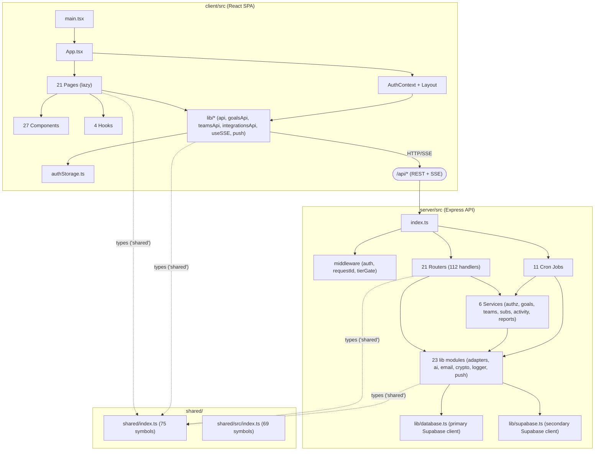

# Module Dependencies

> **Status:** Verified (Static TypeScript/ES module import graph + SQL/external edges inspected)
> **Source commit:** `7567207`
> **Last reviewed:** 2026-11-27
> **Audience:** Junior, Senior

---

## 1. Plain-Language Overview (Explain Like I Am Five)

Think of files in a software project like LEGO instructions pointing to smaller bags of pieces:

- Pages (`Dashboard.tsx`, `Goals.tsx`) borrow reusable bricks from `components/` (`GoalCard.tsx`) and use messengers (`lib/api.ts`) to talk to the backend.
- On the server, `index.ts` plugs in 21 route counters (`routes/*`), which borrow shared helpers (`services/*` and `lib/*`), which talk to Postgres (`database.ts` / `supabase.ts`).
- **Are there any messy knots (circular loops)?** No! An automated check across all 168 source files found **0 static import cycles**. However, there are a few slightly quirky wiring choices (like one library helper importing a route file, two separate Postgres helpers, and two slightly different copies of `shared` types) documented below so nobody trips on them.

---

## 2. High-Level Package & Layer Dependency Graph

**Plain language:** Data flows strictly downward (`App → Pages → Components/APIs` on client, and `index → Middleware/Routes → Services → Libraries → Database` on server), with zero import loops.

---

## 3. Dependency Hubs & Coupling Findings (Verified)

### 3.1 Circular Dependencies: None Found (`0`)
Running DFS cycle detection across all internal TypeScript/JS module edges in `files.json` reports **zero static cycles**. Two minor dynamic imports intentionally avoid startup initialization loops:
- `server/src/index.ts:240`: dynamically imports `./lib/database.js` inside `startServer()`.
- `server/src/lib/githubAdapter.ts:22-25`, `jiraAdapter.ts:200-203`, `slackAdapter.ts:23-26`: lazily import `./crypto.js` inside `getCrypto()` so modules importing the adapters in tests or non-integration contexts do not trigger top-level encryption-key validation until a secret is actually decrypted. *(Note: `routes/integrations.ts` still statically imports `../lib/crypto.js` at startup, meaning server boot fails immediately if `INTEGRATION_ENCRYPTION_KEY(S)` is missing or invalid!)*

### 3.2 Dual `shared` Type Definitions (`shared/index.ts` vs `shared/src/index.ts`)
- `shared/package.json:6-7` points `"main"` and `"types"` to `./index.ts` (**75 interfaces/types**, 604 lines), which Vite (`client/vite.config.ts:11`) and Node `package.json` resolution consume when modules write `import ... from 'shared'`.
- Meanwhile, `shared/tsconfig.json`, `client/tsconfig.json:20`, and `server/tsconfig.json:23` define `shared/*` path mappings against `../shared/*`, and `shared/src/index.ts` (550 lines, 69 symbols) contains diverged definitions:
  - **Only in `shared/index.ts`:** `GenerateAppraisalResponse`, `ReminderLog`, `ApiError`, `AIArticle`, `AIImpactCard`, `BookmarkRequest`, `Bookmark`, `preferred_language` on `UserProfile`, `'gitlab'` on `IntegrationProvider`.
  - **Only in `shared/src/index.ts`:** `JoinWaitlistRequest`, `firstName` / `onboardingCompleted` on `UserProfile` and `UpdateProfileRequest`.

### 3.3 Inverted Dependency (`lib` Importing `routes`)
- **`server/src/lib/userLanguage.ts` → `server/src/routes/translate.ts`:** Route handlers (`auth.ts`, `appraisal.ts`, `chat.ts`) call `userLanguage.ts`, which imports helper functions (`isRtlLang` / `languageName` / `normalizeLang` / `translateStrings` — wait: let's check what `userLanguage.ts` imports: `translate.ts` hosts language normalization helpers inside a route module instead of `lib/`). Moving pure translation helpers into `server/src/lib/` would clean up layering.

### 3.4 Duplicate Database Singletons (`database.ts` vs `supabase.ts`)
- **`server/src/lib/database.ts`** is imported across middleware, services, webhooks, most routes, and jobs (`auth.ts`, `users.ts`, `feedback.ts`, `goals`, `teams`, `integrations`, `reminderJob`, `weeklySyncJob`, `goalRollupJob`, `goalDigestJob`, `weeklyDigestJob`, `newsCollectionJob`, `pruneJob`, marketing loops).
- **`server/src/lib/supabase.ts`** creates a **second** independent `createClient(...)` instance imported only by `summaryService.ts`, `chatService.ts`, `monthlySummaryJob.ts`, and `routes/translate.ts`.

### 3.5 Declared vs Unused Dependencies
- `server/package.json`: declares `@anthropic-ai/sdk` and `@types/nodemailer`, neither imported in `server/src/`.
- `client/package.json`: declares `logrocket` (`^12.1.1`) and `@supabase/supabase-js` (`lib/supabase.ts` instantiates a client never imported by any page/context/lib module).
- Root `package.json`: declares `@anthropic-ai/claude-agent-sdk`, `@anthropic-ai/sdk`, `headroom-ai`, `openai`, none imported by `client/`, `server/`, or `worklog-marketing/`.

---

## Related Documents

- [Directory Map](./directory-map.md)
- [System Architecture](../02-architecture/system-architecture.md)
- [Technical Debt](../12-code-review/technical-debt.md)

## Verification Notes

- Verified via automated AST import scanner (`files.json`) checking all 168 source files and package dependency manifests.