# Frontend Functions: Components

> **Status:** Verified
> **Source commit:** `7567207`
> **Last reviewed:** 2026-11-27
> **Audience:** Junior, Senior

---

## 1. Component inventory

| Component | File | Tier | Purpose |
|---|---|---|---|
| `Layout` | `components/Layout.tsx` | A | App shell (header, nav, footer) |
| `LanguageSwitcher` | `components/LanguageSwitcher.tsx` | A | Language dropdown |
| `LandingPage` | `components/LandingPage.tsx` | A | Hero, features, testimonials, CTA |
| `PremiumGate` | `components/premium/PremiumGate.tsx` | A | Render children if tier ≥ required |
| `BookmarkBtn` | `components/ai-pulse/BookmarkBtn.tsx` | A | Bookmark toggle |
| `ImpactCard` | `components/ai-pulse/ImpactCard.tsx` | B | Impact card display |
| `SEOHead` | `components/ai-pulse/SEOHead.tsx` | B | Per-article SEO meta |
| `ShareCard` | `components/ai-pulse/ShareCard.tsx` | B | Social share buttons |
| `Timeline` | `components/ai-pulse/Timeline.tsx` | B | Article timeline view |
| `ChatWindow` | `components/Chat/ChatWindow.tsx` | A | Full chat UI (messages, input, SSE) |
| `MessageBubble` | `components/Chat/MessageBubble.tsx` | B | Single message render |
| `SessionList` | `components/Chat/SessionList.tsx` | B | Sidebar session list |
| `AssigneePicker` | `components/goals/AssigneePicker.tsx` | A | Multi-select user picker |
| `GoalCard` | `components/goals/GoalCard.tsx` | B | Goal display with progress |
| `GoalForm` | `components/goals/GoalForm.tsx` | A | Create/edit goal modal |
| `GoalProgressBar` | `components/goals/GoalProgressBar.tsx` | B | Visual progress bar |
| `KeyResultEditor` | `components/goals/KeyResultEditor.tsx` | A | KR list editor |
| `LinkEditor` | `components/goals/LinkEditor.tsx` | A | Work item link editor |
| `RoleBadge` | `components/goals/RoleBadge.tsx` | B | Role label with color |
| `ConnectionCard` | `components/integrations/ConnectionCard.tsx` | B | Connected integration display |
| `OAuthButton` | `components/integrations/OAuthButton.tsx` | B | OAuth connect button |
| `FaqAccordion` | `components/landing/FaqAccordion.tsx` | B | Expandable FAQ |
| `PainGrid` | `components/landing/PainGrid.tsx` | B | Problem/solution grid |
| `PlaygroundWidget` | `components/landing/PlaygroundWidget.tsx` | A | Public appraisal playground |
| `PricingSection` | `components/landing/PricingSection.tsx` | B | Pricing cards |
| `MemberList` | `components/teams/MemberList.tsx` | A | Org/team member table with roles |
| `TeamTree` | `components/teams/TeamTree.tsx` | A | Recursive team tree with drag-reparent |

---

## 2. Tier A components (detailed)

### `Layout` — `client/src/components/Layout.tsx`

**Identity:** `Layout` / `components/Layout.tsx` / Component / Exported / A

**Purpose:** App shell: header (logo, nav, user menu), main content area, footer.

**Technical:**
- Props: `{ children: ReactNode }`
- Header: Logo → `/`, Nav links (Dashboard, Log, Appraisals, Chat, Goals, Team Goals, Org Settings, Integrations, AI Pulse, Billing)
- User menu (if logged in): Profile, Settings, Sign out
- Mobile responsive: hamburger menu
- Uses `useAuth()`, `useIsLoggedIn()`, `useHasOrg()`, `useTranslation()`

**State:** `mobileMenuOpen` (boolean)

**Child components:** `LanguageSwitcher`, `Outlet` (React Router)

---

### `LanguageSwitcher` — `client/src/components/LanguageSwitcher.tsx`

**Identity:** `LanguageSwitcher` / `components/LanguageSwitcher.tsx` / Component / Exported / A

**Purpose:** Language dropdown with flags, calls `i18n.changeLanguage()`.

**Technical:**
- Props: None
- State: `open` (boolean)
- Data: `languages = [{ code: 'en', name: 'English', flag: '🇺🇸' }, { code: 'es', name: 'Español', flag: '🇪🇸' }, ...]`
- On select: `i18n.changeLanguage(code)` → triggers `DynamicBackend` → updates `localStorage.impactly_language`
- Renders dropdown with flag + name

**Calls:** `i18n.changeLanguage`, `useTranslation`

---

### `PremiumGate` — `client/src/components/premium/PremiumGate.tsx`

**Identity:** `PremiumGate` / `components/premium/PremiumGate.tsx` / Component / Exported / A

**Purpose:** Conditional render based on subscription tier.

**Technical:**
- Props: `{ requiredTier: 'pro' | 'enterprise', children: ReactNode, fallback?: ReactNode }`
- Uses `useSubscription()` → `tier`
- Logic: `const hasAccess = requiredTier === 'pro' ? ['pro','enterprise'].includes(tier) : tier === 'enterprise'`
- Renders `children` if `hasAccess`, else `fallback` or "Upgrade to {requiredTier}"

**Calls:** `useSubscription()`

---

### `PlaygroundWidget` — `client/src/components/landing/PlaygroundWidget.tsx`

**Identity:** `PlaygroundWidget` / `components/landing/PlaygroundWidget.tsx` / Component / Exported / A

**Purpose:** Public AI appraisal playground (no auth required).

**Technical:**
- Form: criteria textarea, period picker, company goals, values
- On submit: `apiRequest('/api/appraisal/playground-generate', { method: 'POST', body })` → `lib/api.ts`
- Shows generated text + word count + copy button
- Rate limited on server (`playgroundLimiter`)

**State:** `criteria`, `periodStart`, `periodEnd`, `companyGoals`, `values`, `generating`, `result`, `error`

**Calls:** `apiRequest` (with `ignoreAuthRedirect: true`)

---

### `AssigneePicker` — `client/src/components/goals/AssigneePicker.tsx`

**Identity:** `AssigneePicker` / `components/goals/AssigneePicker.tsx` / Component / Exported / A

**Purpose:** Multi-select user picker for goal assignees.

**Technical:**
- Props: `{ selected: string[], onChange: (ids: string[]) => void, orgId: string }`
- Fetches org members: `teamsApi.getOrgMembers(orgId)` → `lib/teamsApi.ts`
- Renders multi-select dropdown with checkboxes
- On change: calls `onChange(newSelectedIds)`

**Calls:** `teamsApi.getOrgMembers()`, `useTranslation`

---

### `GoalForm` — `client/src/components/goals/GoalForm.tsx`

**Identity:** `GoalForm` / `components/goals/GoalForm.tsx` / Component / Exported / A

**Purpose:** Create/edit goal modal with scope, period, dates, parent, description, progress mode.

**Technical:**
- Props: `{ goal?: Goal, onSubmit: (data) => void, onClose: () => void, orgId: string }`
- Form state: all goal fields + `keyResults`, `assignees`, `links`
- Validation: required fields per scope
- On submit: `goalsApi.createGoal()` or `goalsApi.updateGoal()` → `lib/goalsApi.ts`
- Nested editors: `KeyResultEditor`, `LinkEditor`, `AssigneePicker`

**State:** `formData`, `keyResults`, `assignees`, `links`, `loading`, `error`

**Calls:** `goalsApi.createGoal()`, `goalsApi.updateGoal()`, `teamsApi.getUserOrgs()`, `teamsApi.getTeamMembers()`

---

### `KeyResultEditor` — `client/src/components/goals/KeyResultEditor.tsx`

**Identity:** `KeyResultEditor` / `components/goals/KeyResultEditor.tsx` / Component / Exported / A

**Purpose:** Key result list editor (add/edit/delete/reorder).

**Technical:**
- Props: `{ keyResults: GoalKeyResult[], onChange: (krs) => void, goalId: string }`
- Renders list with inline edit: title, metric type, target, start, unit, weight, sort order
- Add: opens modal → `goalsApi.addKeyResult()`
- Edit: inline → `goalsApi.updateKeyResult()`
- Delete: confirmation → `goalsApi.deleteKeyResult()`
- Reorder: drag-drop → updates `sortOrder` → `onChange`

**Calls:** `goalsApi.addKeyResult()`, `goalsApi.updateKeyResult()`, `goalsApi.deleteKeyResult()`

---

### `LinkEditor` — `client/src/components/goals/LinkEditor.tsx`

**Identity:** `LinkEditor` / `components/goals/LinkEditor.tsx` / Component / Exported / A

**Purpose:** Jira/GitHub work item link editor.

**Technical:**
- Props: `{ links: GoalLink[], onChange: (links) => void, goalId: string }`
- Add: paste URL → parses provider (Jira/GitHub), extracts external_id, key → `goalsApi.addLink()`
- Edit: inline → `goalsApi.updateLink()` (not exposed, uses patch)
- Delete: `goalsApi.deleteLink()`
- Displays: provider badge, external key, title, state, done checkbox, weight

**Calls:** `goalsApi.addLink()`, `goalsApi.deleteLink()`

---

### `ChatWindow` — `client/src/components/Chat/ChatWindow.tsx`

**Identity:** `ChatWindow` / `components/Chat/ChatWindow.tsx` / Component / Exported / A

**Purpose:** Full chat UI: message list, input, SSE streaming.

**Technical:**
- Props: `{ sessionId: string }`
- Mount: `getChatMessages(sessionId)` → `chatApi.ts` + `useSSE` hook for streaming
- State: `messages`, `input`, `sending`, `streaming`
- On send: `sendChatMessage(sessionId, content)` → SSE via `useSSE` → appends tokens to assistant message
- Renders: `MessageBubble` for each message

**State:** `messages`, `input`, `sending`, `streaming`, `assistantMessageId`

**Calls:** `chatApi.getChatMessages()`, `chatApi.sendChatMessage()`, `useSSE`

---

### `SessionList` — `client/src/components/Chat/SessionList.tsx`

**Identity:** `SessionList` / `components/Chat/SessionList.tsx` / Component / Exported / B

**Purpose:** Sidebar session list with create/delete.

**Technical:**
- Props: `{ sessions: ChatSession[], activeId: string, onSelect: (id) => void, onDelete: (id) => void }`
- Renders list with title, period, updated date
- Active session highlighted
- Delete: confirmation → `chatApi.deleteChatSession()`

**Calls:** `chatApi.deleteChatSession()`

---

### `MemberList` — `client/src/components/teams/MemberList.tsx`

**Identity:** `MemberList` / `components/teams/MemberList.tsx` / Component / Exported / A

**Purpose:** Org/team member table with role dropdowns, remove buttons.

**Technical:**
- Props: `{ members: OrgMember[], onRoleChange: (userId, role) => void, onRemove: (userId) => void }`
- Renders table: avatar, name, email, role (editable select), actions
- Role change: `teamsApi.updateTeamMember(teamId, userId, { role })`
- Remove: confirmation → `teamsApi.removeTeamMember(teamId, userId)`

**Calls:** `teamsApi.updateTeamMember()`, `teamsApi.removeTeamMember()`

---

### `TeamTree` — `client/src/components/teams/TeamTree.tsx`

**Identity:** `TeamTree` / `components/teams/TeamTree.tsx` / Component / Exported / A

**Purpose:** Recursive team tree with drag-and-drop reparenting.

**Technical:**
- Props: `{ teams: Team[], onReparent: (teamId, newParentId) => void, onDelete: (teamId) => void }`
- Recursive component: renders team node → children
- Drag-drop: `react-dnd` or native HTML5 drag-drop
- On drop: `teamsApi.reparentTeam(teamId, newParentId)`
- Delete: confirmation → `teamsApi.deleteTeam(teamId)`

**Calls:** `teamsApi.reparentTeam()`, `teamsApi.deleteTeam()`

---

## 3. Tier B components (compact)

| Component | File | Purpose |
|---|---|---|
| `ImpactCard` | `ai-pulse/ImpactCard.tsx` | Impact card display |
| `SEOHead` | `ai-pulse/SEOHead.tsx` | Per-article SEO meta |
| `ShareCard` | `ai-pulse/ShareCard.tsx` | Social share buttons |
| `Timeline` | `ai-pulse/Timeline.tsx` | Article timeline view |
| `MessageBubble` | `Chat/MessageBubble.tsx` | Single message render |
| `SessionList` | `Chat/SessionList.tsx` | Sidebar session list |
| `GoalCard` | `goals/GoalCard.tsx` | Goal display with progress |
| `GoalProgressBar` | `goals/GoalProgressBar.tsx` | Visual progress bar |
| `RoleBadge` | `goals/RoleBadge.tsx` | Role label with color |
| `ConnectionCard` | `integrations/ConnectionCard.tsx` | Connected integration display |
| `OAuthButton` | `integrations/OAuthButton.tsx` | OAuth connect button |
| `FaqAccordion` | `landing/FaqAccordion.tsx` | Expandable FAQ |
| `PainGrid` | `landing/PainGrid.tsx` | Problem/solution grid |
| `PricingSection` | `landing/PricingSection.tsx` | Pricing cards |

---

## 4. Component hierarchy (Mermaid)

```mermaid
flowchart TB
    APP["App.tsx"]
    APP --> LAYOUT["Layout.tsx"]
    LAYOUT --> LANG["LanguageSwitcher.tsx"]
    LAYOUT --> OUTLET["Outlet (pages)"]
    
    OUTLET --> LANDING["LandingPage.tsx"]
    LANDING --> PAIN["PainGrid.tsx"]
    LANDING --> PLAYGROUND["PlaygroundWidget.tsx"]
    LANDING --> PRICING["PricingSection.tsx"]
    LANDING --> FAQ["FaqAccordion.tsx"]
    LANDING --> SHARE["ai-pulse/ShareCard.tsx"]
    
    OUTLET --> DASHBOARD["Dashboard.tsx"]
    OUTLET --> LOGENTRY["LogEntry.tsx"]
    OUTLET --> APPRAISAL["Appraisal.tsx"]
    OUTLET --> CHAT["Chat.tsx"]
    CHAT --> CHATWINDOW["ChatWindow.tsx"]
    CHATWINDOW --> MESSAGE["MessageBubble.tsx"]
    CHAT --> SESSIONLIST["SessionList.tsx"]
    
    OUTLET --> GOALS["Goals.tsx"]
    GOALS --> GOALFORM["GoalForm.tsx"]
    GOALFORM --> KR["KeyResultEditor.tsx"]
    GOALFORM --> LINKED["LinkEditor.tsx"]
    GOALFORM --> ASSIGNEE["AssigneePicker.tsx"]
    GOALS --> GOALCARD["GoalCard.tsx"]
    GOALCARD --> PROGRESS["GoalProgressBar.tsx"]
    GOALCARD --> BADGE["RoleBadge.tsx"]
    
    OUTLET --> TEAMGOALS["TeamGoals.tsx"]
    TEAMGOALS --> TEAMTREE["TeamTree.tsx"]
    TEAMGOALS --> MEMBERLIST["MemberList.tsx"]
    
    OUTLET --> ORGSETTINGS["OrgSettings.tsx"]
    ORGSETTINGS --> TEAMTREE
    ORGSETTINGS --> MEMBERLIST
    
    OUTLET --> INTEGRATIONS["Integrations.tsx"]
    INTEGRATIONS --> CONNCARD["ConnectionCard.tsx"]
    INTEGRATIONS --> OAUTHBTN["OAuthButton.tsx"]
    
    OUTLET --> AIPULSE["AIPulseHub.tsx"]
    AIPULSE --> TIMELINE["Timeline.tsx"]
    AIPULSE --> IMPACT["ImpactCard.tsx"]
    AIPULSE --> BOOKMARK["BookmarkBtn.tsx"]
    AIPULSE --> SHARE2["ShareCard.tsx"]
    AIPULSE --> SEO["SEOHead.tsx"]
```

---

## Related documents

- [Frontend pages](../04-function-documentation/frontend-pages.md)
- [Frontend hooks/context/lib](../04-function-documentation/frontend-hooks-context-lib.md)
- [Frontend architecture](../02-architecture/frontend-architecture.md)
- [Client file map](../03-codebase-structure/file-by-file-client.md)

## Verification notes

All components traced from `client/src/components/` at commit `7567207`. Drag-drop implementation in `TeamTree` not verified at runtime.