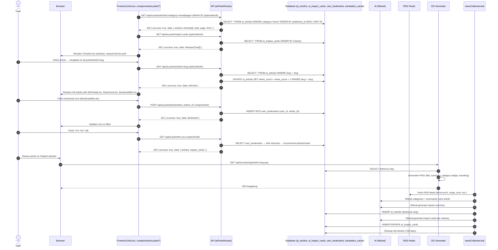

# Feature Flow: AI Pulse

> **Status:** Partially verified (code inspection)
> **Source commit:** `7567207`
> **Last reviewed:** 2026-11-27
> **Audience:** Junior, Senior

---

## 1. What does this feature do?

Curates AI news articles and industry impact cards. Provides personalized feeds, bookmarks, social sharing, and OG image generation for social previews. Content sourced via daily news collection job using RSS feeds and AI categorization.

---

## 2. User interaction trace

---

## 3. Files involved

| File | Responsibility |
|---|---|
| `server/src/routes/aiPulse.ts` | 13 handlers: articles, cards, bookmarks, admin, OG, for-you, collect |
| `server/src/jobs/newsCollectionJob.ts` | Daily 6 AM: RSS fetch → Mistral → insert articles/cards |
| `server/src/lib/newsService.ts` | `collectNews`, `processArticle`, `categorizeArticle` |
| `server/src/lib/mistral.ts` | `mistral` client, `chatModel` |
| `server/src/lib/database.ts` | `supabase` service-role client |
| `client/src/pages/ai-pulse/Hub.tsx` | Main hub: tabs, article list, card grid |
| `client/src/components/ai-pulse/BookmarkBtn.tsx` | Bookmark toggle |
| `client/src/components/ai-pulse/ImpactCard.tsx` | Card display |
| `client/src/components/ai-pulse/SEOHead.tsx` | Per-article meta tags |
| `client/src/components/ai-pulse/ShareCard.tsx` | Social share buttons |
| `client/src/components/ai-pulse/Timeline.tsx` | Article timeline view |
| `client/src/components/landing/PlaygroundWidget.tsx` | Public appraisal playground (shared) |
| `client/src/lib/api.ts` | AI Pulse API calls (articles, cards, bookmarks) |

---

## 4. Functions involved (in execution order)

### Article listing
1. `Hub.tsx` mount → `getArticles()` → `lib/api.ts` → `GET /api/ai-pulse/articles`
2. `aiPulseRoutes.get('/articles')` → `server/src/routes/aiPulse.ts:70`
3. `supabase.from('ai_articles').select('*').eq('category', category).order('published_at', { ascending: false }).range(from, to)`

### Article detail
1. `Hub.tsx` click → `getArticle(slug)` → `lib/api.ts`
2. `aiPulseRoutes.get('/articles/:slug')` → `aiPulse.ts:101`
3. `supabase.from('ai_articles').select('*').eq('slug', slug).single()`
4. Increment `views_count`

### Bookmarks
1. `BookmarkBtn.tsx` click → `createBookmark({ article_id })` → `lib/api.ts`
2. `aiPulseRoutes.post('/bookmarks')` → `aiPulse.ts:220`
3. `supabase.from('user_bookmarks').insert({ user_id, article_id })`

### For You (personalized)
1. `Hub.tsx` "For You" tab → `getForYou()` → `lib/api.ts`
2. `aiPulseRoutes.get('/for-you')` → `aiPulse.ts:387`
3. Fetch user's bookmarks → infer categories → recommend

### OG Image
1. Social crawler → `GET /api/ai-pulse/og/article/:slug.png`
2. `aiPulseRoutes.get('/og/article/:slug.png')` → `aiPulse.ts:517`
3. Server-side canvas/HTML-to-image generation → returns PNG

### News Collection Job
1. `newsCollectionJob.start()` → `jobs/newsCollectionJob.ts`
2. `newsService.collectNews()` → `lib/newsService.ts`
3. `rss-parser` fetches feeds → `Mistral` categorizes each
4. `INSERT ai_articles` (dedup by slug)
5. `Mistral` generates impact cards → `INSERT/UPDATE ai_impact_cards`

---

## 5. Data transformation

| Stage | Data shape |
|---|---|
| Article list response | `{ articles: AIArticle[], total, page, limit }` |
| Article detail | `AIArticle` (with incremented `views_count`) |
| Impact card | `AIImpactCard` (industry, what_changed, impact_level, companies[], predictions) |
| Bookmark request | `{ article_id }` or `{ impact_card_id }` |
| Bookmark response | `Bookmark { id, user_id, article_id, impact_card_id, created_at }` |
| For You response | `{ articles: AIArticle[], impact_cards: AIImpactCard[] }` |
| OG image | PNG binary |
| News job input | RSS feed items (title, link, content, pubDate) |
| News job AI prompt | "Categorize this article: {title, content}" → category enum |
| Impact card AI prompt | "Summarize industry impact for {industry} based on these articles" |

---

## 6. Failure scenarios

| Failure point | Behavior |
|---|---|
| Article not found | 404 |
| Bookmark already exists | 409 `{ error: "Already bookmarked" }` |
| Mistral categorization fails | Article inserted with category='news' (default) |
| RSS feed unavailable | Logs warning; skips feed |
| OG generation fails | Returns placeholder PNG |
| Duplicate article (slug) | `ON CONFLICT (slug) DO UPDATE` |
| 401 on bookmark | `apiRequest` refreshes token → retries |

---

## 7. Simple story

Imagine a **daily AI newspaper** curated just for tech:

1. **Every morning at 6 AM**, a robot reads 50+ tech RSS feeds (TechCrunch, The Verge, arXiv, etc.)
2. **Mistral reads each article**, tags it (News, Models, Startups, Research, Tools, etc.), writes a 2-sentence summary
3. **Articles appear in the hub** — filter by category, scroll timeline
3. **Click an article** → read full text, see AI-generated "impact summary"
4. **Bookmark** interesting ones → they appear in your "For You" feed
5. **Share on LinkedIn** → beautiful OG image with title, summary, category badge
6. **Weekly** → AI analyzes all articles per industry (Healthcare, Finance, etc.) → generates "Impact Cards": what changed, key companies, future predictions, opportunities, risks

---

## Related documents

- [AI Pulse endpoints](../06-api-reference/endpoint-reference-platform-misc.md)
- [External services: AI](../09-integrations/external-services.md#3-ai-providers)
- [News collection job](../04-function-documentation/backend-jobs-infra.md)

## Verification notes

Paths traced from `server/src/routes/aiPulse.ts`, `server/src/jobs/newsCollectionJob.ts`,
`server/src/lib/newsService.ts`, `client/src/pages/ai-pulse/Hub.tsx` at commit `7567207`.
Not verified at runtime: RSS feed reliability, Mistral categorization accuracy, OG image quality, personalized recommendation logic.