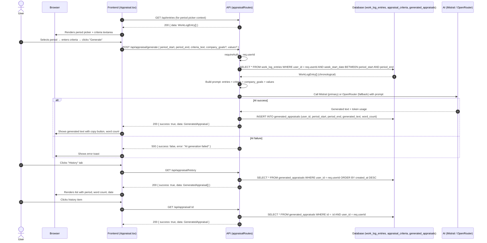

# Feature Flow: Appraisal Generation

> **Status:** Verified
> **Source commit:** `7567207`
> **Last reviewed:** 2026-11-27
> **Audience:** Junior, Senior

---

## 1. What does this feature do?

Generates an AI-written self-appraisal from the user's weekly work log entries over a specified period, using criteria the user provides (company goals, values, review criteria text).

---

## 2. User interaction trace

---

## 3. Files involved

| File | Responsibility |
|---|---|
| `server/src/routes/appraisal.ts` | 4 handlers: playground, generate, history, get |
| `server/src/lib/mistral.ts` | `mistral` client, `chatModel = 'mistral-large-latest'` |
| `server/src/lib/openRouter.ts` | `openRouter` client, `MODEL_MAP` for fallbacks |
| `server/src/lib/aiSummaryService.ts` | `buildAppraisalPrompt` (prompt construction) |
| `server/src/lib/summaryService.ts` | Shared AI call logic |
| `server/src/middleware/auth.ts` | `requireAuth` |
| `server/src/lib/database.ts` | `supabase` service-role client |
| `client/src/pages/Appraisal.tsx` | Period picker, criteria form, generate button, history view |
| `client/src/lib/api.ts` | `generateAppraisal`, `getAppraisalHistory`, `getAppraisal` |
| `client/src/components/landing/PlaygroundWidget.tsx` | Public playground (no auth) |

---

## 4. Functions involved (in execution order)

### Generate appraisal (authenticated)
1. `Appraisal.tsx` → `generateAppraisal(body)` → `lib/api.ts:168`
2. `apiRequest` → `POST /api/appraisal/generate`
3. `appraisalRoutes.post('/generate')` → `server/src/routes/appraisal.ts:111`
4. `supabase.from('work_log_entries').select('*').eq('user_id', userId).gte('week_start_date', periodStart).lte('week_start_date', periodEnd)`
5. `buildAppraisalPrompt(entries, criteria, companyGoals, values)` → `lib/aiSummaryService.ts`
6. `mistral.chat.complete()` or `openRouter.chat.completions.create()`
7. `supabase.from('generated_appraisals').insert({ user_id, period_start, period_end, generated_text, word_count }).select().single()`

### Playground (public, rate-limited)
1. `PlaygroundWidget.tsx` → `POST /api/appraisal/playground-generate`
2. `appraisalRoutes.post('/playground-generate')` → `server/src/routes/appraisal.ts:29`
3. Uses demo entries or empty context
4. Same AI call path

### History
1. `Appraisal.tsx` history tab → `getAppraisalHistory()` → `lib/api.ts:177`
2. `appraisalRoutes.get('/history')` → `server/src/routes/appraisal.ts:304`
3. `supabase.from('generated_appraisals').select('*').eq('user_id', userId).order('created_at', { ascending: false })`

---

## 5. Data transformation

| Stage | Data shape |
|---|---|
| Generate request | `{ period_start: "YYYY-MM-DD", period_end: "YYYY-MM-DD", criteria_text: "...", company_goals?: "...", values?: "..." }` |
| Entries fetched | `WorkLogEntry[]` (chronological, filtered by period) |
| Prompt built | System + user messages with entries formatted as bullet points |
| AI response | `{ choices: [{ message: { content: "Generated appraisal text..." } }] }` |
| Database insert | `{ user_id, period_start, period_end, generated_text, word_count: text.split(' ').length }` |
| Generate response | `{ success: true, data: { id, user_id, period_start, period_end, generated_text, word_count, created_at } }` |

---

## 6. Failure scenarios

| Failure point | Behavior |
|---|---|
| No entries in period | 400 `{ error: "No work log entries found for this period" }` |
| Missing criteria | 400 validation error |
| Mistral API error | Falls back to OpenRouter (if configured) |
| Both AI providers fail | 500 `{ success: false, error: "AI generation failed" }` |
| Database insert fails | 500 `{ success: false, error: "Failed to save appraisal" }` |
| Playground rate limit | 429 from `playgroundLimiter` |
| 401 on request | `apiRequest` refreshes token → retries |

---

## 7. Simple story

Imagine you're writing your **annual performance review**:

1. You **select the review period** (e.g., "Jan–Jun 2026").
2. You **paste your company's review criteria** (what they're evaluating you on).
3. Optionally, you add **company goals** and **core values** for context.
4. The app **pulls all your weekly diaries** from that period.
5. It **feeds everything to an AI** (like a ghostwriter) with instructions: "Write a professional self-appraisal using these entries and these criteria."
6. The AI **returns a polished draft** — you copy it, tweak it, submit it.
7. The draft is **saved in your history** so you can revisit or regenerate.

The **playground** is like a free sample: try it without an account to see how it works.

---

## Related documents

- [Core AI endpoints](../06-api-reference/endpoint-reference-core-ai.md)
- [Appraisal functions](../04-function-documentation/backend-core-ai.md)
- [AI providers](../09-integrations/external-services.md#3-ai-providers)

## Verification notes

All paths traced from `server/src/routes/appraisal.ts`, `server/src/lib/aiSummaryService.ts`,
`server/src/lib/mistral.ts`, `server/src/lib/openRouter.ts`, `client/src/pages/Appraisal.tsx` at commit `7567207`.
Not verified at runtime: actual AI provider responses, fallback behavior, token usage.