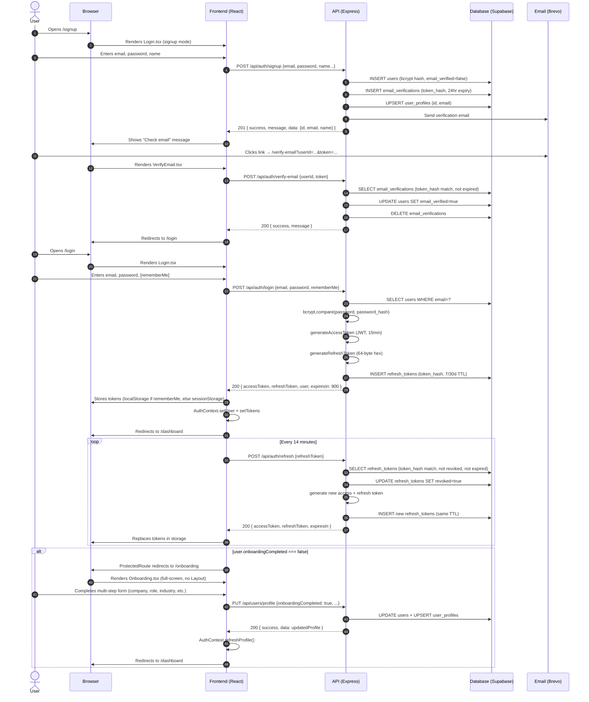

# Feature Flow: Auth & Onboarding

> **Status:** Verified
> **Source commit:** `7567207`
> **Last reviewed:** 2026-11-27
> **Audience:** Junior, Senior

---

## 1. What does this feature do?

Handles the complete identity lifecycle: signup with email verification, login with JWT + rotating refresh tokens, password reset, and first-time onboarding profile capture.

---

## 2. User interaction trace

---

## 3. Files involved

| File | Responsibility |
|---|---|
| `server/src/routes/auth.ts` | 9 handlers: signup, verify, resend, login, logout, me, forgot, reset, refresh |
| `server/src/middleware/auth.ts` | `requireAuth`, `optionalAuth`, token generation/validation, `hashToken` |
| `server/src/lib/auth-utils.ts` | `hashPassword`, `comparePassword`, `generateToken`, `validatePasswordStrength` |
| `server/src/lib/email.ts` | `sendVerificationEmail`, `sendPasswordResetEmail` (Brevo) |
| `server/src/lib/userLanguage.ts` | `languageFromAcceptHeader` for email localization |
| `client/src/context/AuthContext.tsx` | `AuthProvider`, `useAuth`, token storage, 14-min refresh loop |
| `client/src/lib/api.ts` | `apiRequest` (401 refresh + retry), `refreshAccessToken` |
| `client/src/lib/authStorage.ts` | `getStoredTokens`, `storeStoredTokens`, `clearStoredTokens` |
| `client/src/pages/Login.tsx` | Signup/login forms, rememberMe toggle |
| `client/src/pages/VerifyEmail.tsx` | Verification page |
| `client/src/pages/ForgotPassword.tsx` | Reset request |
| `client/src/pages/ResetPassword.tsx` | Reset with token |
| `client/src/pages/Onboarding.tsx` | Multi-step profile capture |
| `client/src/App.tsx` | `ProtectedRoute` (onboarding gate), `OnboardingRoute` |

---

## 4. Functions involved (in execution order)

### Signup
1. `authRoutes.post('/signup')` — `server/src/routes/auth.ts:38`
2. `hashPassword` → `lib/auth-utils.ts:9`
3. `generateToken` → `lib/auth-utils.ts:23`
4. `hashToken` → `middleware/auth.ts:257`
5. `sendVerificationEmail` → `lib/email.ts`
6. `identifyUser` + `captureEvent` → `lib/posthog.ts`

### Login
1. `authRoutes.post('/login')` — `server/src/routes/auth.ts:326`
2. `comparePassword` → `lib/auth-utils.ts:16`
3. `generateAccessToken` → `middleware/auth.ts:41`
4. `generateRefreshToken` → `middleware/auth.ts:51`
5. `createRefreshToken` → `middleware/auth.ts:57`
6. `identifyUser` + `captureEvent` → `lib/posthog.ts`

### Token Refresh
1. `AuthContext.handleRefreshToken` → `AuthContext.tsx:219`
2. `apiRequest` 401 path → `lib/api.ts:61-70`
3. `authRoutes.post('/refresh')` → `server/src/routes/auth.ts:630`
4. `validateRefreshToken` → `middleware/auth.ts:99`
5. `revokeRefreshToken` → `middleware/auth.ts:83`
6. `createRefreshToken` (new pair)

### Onboarding
1. `ProtectedRoute` gate → `App.tsx:59`
2. `Onboarding.tsx` form submission
3. `api.ts` `updateProfile` → `PUT /api/users/profile`
4. `usersRoutes.put('/profile')` → `server/src/routes/users.ts:82`
5. `AuthContext.refreshProfile` → `AuthContext.tsx:200`

---

## 5. Data transformation

| Stage | Data shape |
|---|---|
| Signup request | `{ email, password, name?, company_name?, job_title? }` |
| Users table insert | `{ email, password_hash, name, company_name, job_title, email_verified: false, ... }` |
| Verification token | `{ user_id, token_hash: SHA256(token), expires_at: +24h }` |
| Login response | `{ user: {id, email, name, firstName, companyName, jobTitle, onboardingCompleted}, accessToken, refreshToken, expiresIn: 900 }` |
| Refresh token storage | `localStorage` (rememberMe) or `sessionStorage` |
| Onboarding update | `{ onboardingCompleted: true, companyName, jobTitle, industry, function, ... }` |

---

## 6. Failure scenarios

| Failure point | Behavior |
|---|---|
| Signup: email exists | 400 `{ error: "Email already registered" }` (unique constraint) |
| Signup: weak password | 400 with strength errors (≥8 chars, 1 letter, 1 number) |
| Signup: Brevo email fails | Logs warning; signup succeeds (best effort) |
| Verify: token expired | 400 `{ error: "Token has expired" }` |
| Verify: token invalid | 400 `{ error: "Invalid or expired token" }` |
| Login: user not found | Generic 401 (anti-enumeration) |
| Login: email not verified | 403 `{ error: "Email not verified", code: "EMAIL_NOT_VERIFIED" }` |
| Login: wrong password | Generic 401 (anti-enumeration) |
| Refresh: token revoked/expired | 401 `{ error: "Invalid or expired refresh token" }` → `AuthContext.clearAuth()` |
| Refresh: network error | `AuthContext.clearAuth()` → redirect to `/login` |
| 401 on API call | `apiRequest` refreshes once → retries → on second 401 clears auth + redirects |
| Onboarding: validation error | Form shows inline errors; `updateProfile` returns 400 |

---

## 7. Simple story

Imagine a new employee (Priya) joining a company:

1. **Signup** = Priya fills out a registration card. HR (server) hashes her password, creates her badge (user row), and sends a welcome letter (verification email) with a one-time key.
2. **Verification** = Priya uses the key at reception. HR marks her "verified" and shreds the key.
3. **Login** = Priya shows her badge daily. Reception issues a day-pass (15-min JWT) and a monthly master key (30-day refresh token, stored securely).
3. **Auto-renew** = Every 14 minutes, her day-pass is quietly renewed using the master key.
4. **Onboarding** = On her first day, she fills out her employee profile (department, role, skills). Once done, she gets full building access.
5. **Forgot badge** = If she loses her master key, HR sends a one-hour temporary key to her email. Using it invalidates all old master keys (security).

---

## Related documents

- [Auth architecture](../02-architecture/auth-and-authorization.md)
- [Auth endpoints](../06-api-reference/endpoint-reference-auth-users.md)
- [Auth functions](../04-function-documentation/backend-auth-users.md)
- [Client auth functions](../04-function-documentation/frontend-hooks-context-lib.md)

## Verification notes

All paths traced from `server/src/routes/auth.ts`, `server/src/middleware/auth.ts`,
`client/src/context/AuthContext.tsx`, `client/src/lib/api.ts` at commit `7567207`.
Runtime behavior (Brevo email delivery, token rotation under load) not verified.