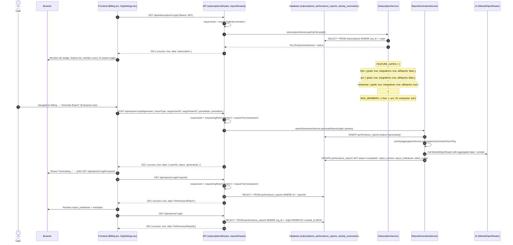

# Feature Flow: Billing & Reports

> **Status:** Partially verified (code inspection)
> **Source commit:** `7567207`
> **Last reviewed:** 2026-11-27
> **Audience:** Junior, Senior

---

## 1. What does this feature do?

Manages organization subscription tiers (Free/Pro/Enterprise) with feature gates. Generates AI-powered performance reports for Enterprise tier. **Note: No payment provider integration found** — tier enforcement exists but no Stripe/Paddle checkout or billing webhook.

---

## 2. User interaction trace

---

## 3. Files involved

| File | Responsibility |
|---|---|
| `server/src/routes/reports.ts` | 3 handlers: generate, list, get (Enterprise only) |
| `server/src/routes/subscriptions.ts` | 1 handler: get org subscription |
| `server/src/services/subscriptionService.ts` | `getOrgTier`, `isFeatureEnabled`, `clearTierCache`, `MAX_MEMBERS`, `FEATURE_GATES` |
| `server/src/services/reportGenerationService.ts` | `generateReport`, `getReport`, `listReports` |
| `server/src/services/activityAggregationService.ts` | `aggregateUserActivity`, `aggregateTeamActivity`, `aggregateOrgActivity` |
| `server/src/middleware/tierGate.ts` | `requireTier(minTier)` middleware |
| `server/src/lib/mistral.ts` | AI client |
| `server/src/lib/openRouter.ts` | AI fallback |
| `server/src/lib/aiSummaryService.ts` | `buildReportPrompt` |
| `client/src/pages/Billing.tsx` | Tier display, member count, upgrade prompts |
| `client/src/pages/OrgSettings.tsx` | Subscription tab |
| `client/src/components/premium/PremiumGate.tsx` | Render children only if tier ≥ required |
| `client/src/context/SubscriptionContext.tsx` | `SubscriptionProvider`, `useSubscription` |
| `client/src/lib/api.ts` | Report/subscription API calls |

---

## 4. Functions involved (in execution order)

### Tier lookup
1. `Billing.tsx` mount → `useSubscription()` → `SubscriptionContext.tsx`
2. `refresh()` → `fetch(/api/subscriptions/${orgId})` → `api.ts`
3. `subscriptionsRoutes.get('/:orgId')` → `server/src/routes/subscriptions.ts:24`
4. `subscriptionService.getOrgTier(db, orgId)` → `subscriptionService.ts:92`
5. Returns tier + caches for 60s

### Report generation
1. `Billing.tsx` "Generate" → `generateReport()` → `api.ts`
2. `reportsRoutes.post('/:orgId/generate')` → `reports.ts:24`
3. `requireTier('enterprise')` → `tierGate.ts`
4. `reportGenerationService.generateReport(orgId, params)` → `reportGenerationService.ts`
5. `activityAggregationService.aggregate*Activity` → `activityAggregationService.ts`
6. `Mistral/OpenRouter` call with prompt from `aiSummaryService.buildReportPrompt`
7. Save to `performance_reports` (status='generating' → 'completed')

### Feature gate (PremiumGate)
1. `PremiumGate.tsx` → `useSubscription()` → `tier`
2. Renders children if `['pro','enterprise'].includes(tier)` or `tier === 'enterprise'`

---

## 5. Data transformation

| Stage | Data shape |
|---|---|
| Subscription response | `{ id, org_id, tier, status, current_period_start, current_period_end, cancel_at_period_end, max_members, ai_reports_enabled, created_at, updated_at }` |
| Report generate request | `{ reportType: 'self'|'individual'|'team'|'organization', targetUserId?, targetTeamId?, periodStart, periodEnd }` |
| Report generate response | `{ success: true, data: { reportId, status: 'generating' } }` |
| Report response | `{ id, org_id, report_type, target_user_id, target_team_id, period_start, period_end, generated_by, report_content, report_markdown, ai_model, token_usage, generation_time_ms, status, error_message, created_at, updated_at }` |
| Activity aggregation | GitHub issues/PRs + Jira issues + Slack messages → normalized JSON |

---

## 6. Failure scenarios

| Failure point | Behavior |
|---|---|
| Not enterprise tier | 403 from `requireTier('enterprise')` |
| AI generation fails | `status='failed'`, `error_message` saved |
| Tier cache stale | 60s TTL; `clearTierCache(orgId)` called on webhook (not found) |
| Member limit exceeded | Not enforced in API (only in UI) |
| Payment provider missing | **No checkout/webhook found** — tier changes only via manual DB update |

---

## 7. Simple story

**Current reality (no payment provider):**

1. **Admin views Billing page** → sees "Free tier", "1 member limit", "AI reports: disabled"
2. **Wants Pro** → clicks "Upgrade" → **nothing happens** (no Stripe/Paddle integration)
3. **Manual workaround**: DBA updates `subscriptions` table → `tier='pro'`, `status='active'`
4. **App respects tier**: `requireTier` middleware gates `/api/reports/*`, `PremiumGate` hides Enterprise UI
5. **Enterprise user generates report** → AI aggregates GitHub/Jira/Slack data → writes markdown report

**Missing:** Payment integration (Stripe/Paddle), webhook for subscription updates, dunning, invoices.

---

## Related documents

- [Platform endpoints](../06-api-reference/endpoint-reference-platform-misc.md)
- [Subscription service](../04-function-documentation/backend-teams-goals.md)
- [Report generation](../04-function-documentation/backend-teams-goals.md)
- [Subscription context](../04-function-documentation/frontend-hooks-context-lib.md)

## Verification notes

Paths traced from `server/src/routes/reports.ts`, `server/src/routes/subscriptions.ts`,
`server/src/services/subscriptionService.ts`, `server/src/services/reportGenerationService.ts`,
`client/src/pages/Billing.tsx` at commit `7567207`.
**Critical gap**: No payment provider integration found. Tier enforcement works but no way to change tiers programmatically.