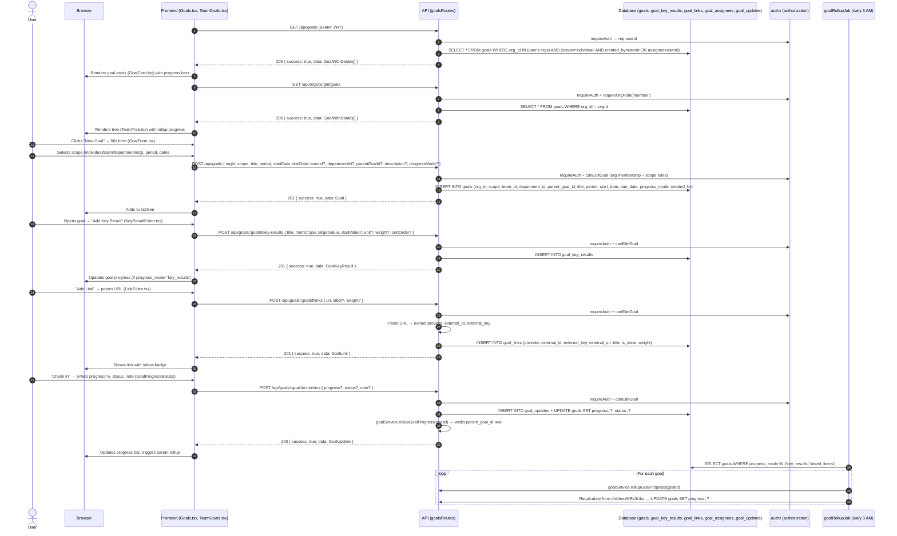

# Feature Flow: Goals & OKRs

> **Status:** Verified
> **Source commit:** `7567207`
> **Last reviewed:** 2026-11-27
> **Audience:** Junior, Senior

---

## 1. What does this feature do?

Enables organizations to create hierarchical goals (OKRs) with key results, assignees, linked work items (Jira/GitHub), progress check-ins, and automatic progress rollups from children to parents.

---

## 2. User interaction trace

---

## 3. Files involved

| File | Responsibility |
|---|---|
| `server/src/routes/goals.ts` | 12 handlers: CRUD, KRs, assignees, check-ins, links, parent |
| `server/src/services/goalService.ts` | `createGoal`, `rollupGoalProgress`, `canEditGoal` checks |
| `server/src/services/authz.ts` | `canEditGoal`, `getEffectiveTeamRole`, `requireOrgRole`, `requireTeamRole` |
| `server/src/services/teamService.ts` | Team hierarchy for scope checks |
| `server/src/jobs/goalRollupJob.ts` | Daily rollup cron |
| `server/src/jobs/goalDigestJob.ts` | Daily goal reminder emails |
| `client/src/pages/Goals.tsx` | Personal goals list |
| `client/src/pages/TeamGoals.tsx` | Team/org goal tree |
| `client/src/components/goals/GoalCard.tsx` | Goal display with progress |
| `client/src/components/goals/GoalForm.tsx` | Create/edit goal modal |
| `client/src/components/goals/GoalProgressBar.tsx` | Visual progress |
| `client/src/components/goals/KeyResultEditor.tsx` | KR list management |
| `client/src/components/goals/LinkEditor.tsx` | Jira/GitHub link management |
| `client/src/components/goals/AssigneePicker.tsx` | Multi-select assignees |
| `client/src/lib/goalsApi.ts` | All goal API calls |

---

## 4. Functions involved (in execution order)

### Create goal
1. `Goals.tsx` / `TeamGoals.tsx` → `createGoal()` → `goalsApi.ts`
2. `goalsRoutes.post('/')` → `server/src/routes/goals.ts:23`
3. `authz.canEditGoal` → `authz.ts:168` (scope-specific checks)
4. `goalService.createGoal` → `goalService.ts`

### Add key result
1. `KeyResultEditor.tsx` → `addKeyResult()` → `goalsApi.ts`
2. `goalsRoutes.post('/:goalId/key-results')` → `goals.ts:129`
3. `authz.canEditGoal` → `authz.ts:168`
4. Insert `goal_key_results`

### Link work item
1. `LinkEditor.tsx` → `addLink()` → `goalsApi.ts`
2. `goalsRoutes.post('/:goalId/links')` → `goals.ts:276`
3. Parse URL → `jiraAdapter` / `githubAdapter` extract IDs
4. Insert `goal_links` (unique on goal_id + provider + external_id)

### Check-in
1. `GoalProgressBar.tsx` → `addCheckIn()` → `goalsApi.ts`
2. `goalsRoutes.post('/:goalId/checkins')` → `goals.ts:219`
3. `authz.canEditGoal` → `authz.ts:168`
4. Insert `goal_updates` + `UPDATE goals SET progress, status`
5. `goalService.rollupGoalProgress(goalId)` → walks `parent_goal_id` tree

### Rollup job
1. `goalRollupJob.start()` → `server/src/jobs/goalRollupJob.ts`
2. For each goal with `progress_mode` in ('key_results','linked_items'):
   - `goalService.rollupGoalProgress(goalId)`
   - Recalculate from children/KRs/links → `UPDATE goals SET progress`

---

## 5. Data transformation

| Stage | Data shape |
|---|---|
| Create request | `{ orgId, scope, title, period, startDate, dueDate, teamId?, departmentId?, parentGoalId?, description?, progressMode? }` |
| Goal response | `GoalWithDetails` (goal + key_results[] + links[] + assignees[] + updates[]) |
| KR request | `{ title, metricType, targetValue, startValue?, unit?, weight?, sortOrder? }` |
| Link request | `{ url, label?, weight? }` → parsed to provider, external_id, external_key |
| Check-in request | `{ progress?, status?, note? }` |
| Rollup input | Children goals + KRs + links |
| Rollup output | `UPDATE goals SET progress = calculated_value` |

---

## 6. Failure scenarios

| Failure point | Behavior |
|---|---|
| User not org member | 403 (authz gates before handler) |
| Cannot edit goal (scope) | 403 from `canEditGoal` |
| Invalid parent goal (cycle) | 400 from `setParentGoal` validation |
| Duplicate KR/link | 409 (unique constraints) |
| Rollup job error | Logs error; continues with next goal |
| 401 on request | `apiRequest` refreshes token → retries |

---

## 7. Simple story

Think of a **corporate goal pyramid**:

1. **CEO sets company OKR** (org scope) → "Grow revenue 20%"
2. **VP breaks it down** (team scope) → "Launch 3 features" → linked to Jira epics
3. **Team lead adds key results** → "Feature A shipped", "Feature B shipped"
4. **Engineer checks in** → "Feature A 100% done" → progress rolls up to team → VP → CEO
5. **Daily job recalculates** all rollups so dashboards stay current
6. **Weekly digest emails** remind assignees to check in

---

## Related documents

- [Teams & Goals endpoints](../06-api-reference/endpoint-reference-teams-goals.md)
- [Goal functions](../04-function-documentation/backend-teams-goals.md)
- [Authz details](../02-architecture/auth-and-authorization.md)
- [Client goals API](../04-function-documentation/frontend-hooks-context-lib.md)

## Verification notes

All paths traced from `server/src/routes/goals.ts`, `server/src/services/goalService.ts`,
`server/src/services/authz.ts`, `client/src/pages/Goals.tsx`,
`client/src/components/goals/*` at commit `7567207`.
Not verified at runtime: rollup accuracy under concurrent updates, job scheduling.