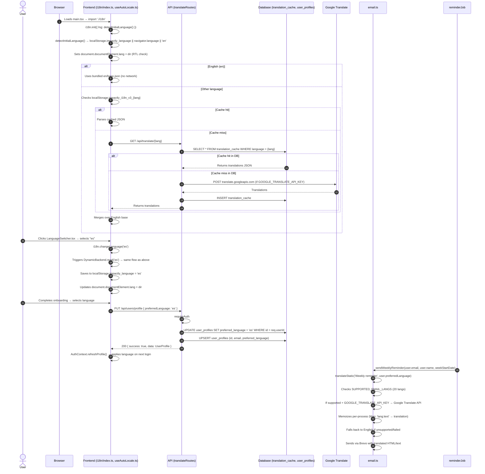

# Feature Flow: i18n & Localization

> **Status:** Verified
> **Source commit:** `7567207`
> **Last reviewed:** 2026-11-27
> **Audience:** Junior, Senior

---

## 1. What does this feature do?

Provides full internationalization: UI translation via i18next with dynamic backend (fetches translations from API), email translation via Google Translate, RTL language support, and per-user language preference persistence.

---

## 2. User interaction trace

---

## 3. Files involved

| File | Responsibility |
|---|---|
| `client/src/i18n/index.ts` | i18next config, DynamicBackend, RTL, detectInitialLanguage |
| `client/src/i18n/useAutoLocale.ts` | Hook: applies detected locale on mount |
| `client/src/components/LanguageSwitcher.tsx` | Dropdown: flag + name, calls i18n.changeLanguage |
| `client/src/lib/api.ts` | `apiRequest` for `/api/translate/:lang` |
| `server/src/routes/translate.ts` | 2 handlers: GET /languages, GET /:languageCode |
| `server/src/lib/email.ts` | `translateStatic` (Google Translate + memoization) |
| `server/src/lib/userLanguage.ts` | `languageFromAcceptHeader` (Accept-Language parsing) |
| `server/src/lib/database.ts` | `supabase` client for translation_cache |
| `server/src/middleware/auth.ts` | `optionalAuth` for `/api/translate/:lang` |
| `client/src/context/AuthContext.tsx` | Persists language on login/hydration |
| `client/src/locales/en/base.json` | Bundled English translations |

---

## 4. Functions involved (in execution order)

### Client i18n init
1. `main.tsx` → `import './i18n'` (side effect)
2. `i18n/index.ts` → `i18n.use(DynamicBackend).use(initReactI18next).init({ lng: detectInitialLanguage(), fallbackLng: 'en', ... })`
3. `detectInitialLanguage()` → `localStorage.impactly_language` || `navigator.language` || `'en'`
4. `DynamicBackend.read(lang)` → if `lang !== 'en'`: check cache → fetch `/api/translate/{lang}` → merge over English

### Language switch
1. `LanguageSwitcher.tsx` → `i18n.changeLanguage(newLang)`
2. Triggers `DynamicBackend.read(newLang)` → same as above
5. `localStorage.setItem('impactly_language', newLang)`

### Server translation API
1. `translateRoutes.get('/languages')` → returns supported langs list
2. `translateRoutes.get('/:languageCode')` → `server/src/routes/translate.ts:71`
3. `supabase.from('translation_cache').select('translations').eq('language', lang).maybeSingle()`
4. Returns `{ translations: Record<string, string> }`

### Email translation
1. `email.sendWeeklyReminder` → `translateStatic('Weekly reminder', userLang)`
2. `translateStatic` → `lib/email.ts:44`
3. `emailTranslationCache.get('lang:text')` → if hit, return
4. If `GOOGLE_TRANSLATE_API_KEY` and supported lang:
   - `fetch('https://translation.googleapis.com/language/translate/v2', { key, q: [text], target: lang })`
   - Cache result → return
5. Fallback: return English text

### AuthContext language persistence
1. `AuthContext.loadAuthState()` → on successful `/api/users/profile`
2. `data.data.preferredLanguage` → `localStorage.setItem('impactly_language', preferred)`
3. On next visit, `detectInitialLanguage()` picks it up

---

## 5. Data transformation

| Stage | Data shape |
|---|---|
| DynamicBackend request | `GET /api/translate/es` |
| Server DB query | `SELECT translations FROM translation_cache WHERE language = 'es'` |
| Server response | `{ translations: { "key": "valor", ... } }` |
| Client merge | `{ ...enBase, ...esTranslations }` |
| Email translate request | `translateStatic('Weekly reminder', 'es')` |
| Google Translate response | `{ data: { translations: [{ translatedText: 'Recordatorio semanal' }] } }` |
| Cache key | `'es:Weekly reminder'` → `'Recordatorio semanal'` |
| Supported email langs | `en, es, fr, de, pt, it, nl, pl, ru, tr, ar, he, hi, bn, id, vi, th, ja, ko, zh` |

---

## 6. Failure scenarios

| Failure point | Behavior |
|---|---|
| Translation API 404/500 | Falls back to English base |
| Google Translate key missing | Returns English; logs warning |
| Unsupported language | Returns English; logs warning |
| Cache corrupted (JSON parse) | Falls back to network fetch |
| RTL language (ar, he, etc.) | `document.documentElement.dir = 'rtl'` |
| User has no preference | `detectInitialLanguage()` → browser language → English |

---

## 7. Simple story

Imagine the app as a **multilingual receptionist**:

1. **You walk in** (app loads) → receptionist checks your ID badge (`localStorage.impactly_language`) or asks your language (`navigator.language`)
2. **If English** → speaks English immediately (bundled)
3. **If Spanish** → checks her notebook (`localStorage.impactly_i18n_v3_es`) → if empty, calls headquarters (`/api/translate/es`) → HQ checks archive (`translation_cache`) → if missing, calls Google Translate → saves in archive → sends back
4. **You switch to French** → receptionist updates your badge, fetches French translations
5. **Email arrives** → receptionist translates it using Google Translate (memoized so she doesn't ask twice)
6. **RTL languages** → receptionist flips the room layout (`dir=rtl`)

**Cache versioning**: `TRANSLATION_VERSION = 3` in cache key → bump to invalidate all.

---

## Related documents

- [Translation endpoints](../06-api-reference/endpoint-reference-platform-misc.md)
- [Email translation](../09-integrations/external-services.md#7-google-translate)
- [Auth context](../04-function-documentation/frontend-hooks-context-lib.md)
- [Client i18n](../03-codebase-structure/file-by-file-client.md)

## Verification notes

Paths traced from `client/src/i18n/index.ts`, `client/src/i18n/useAutoLocale.ts`,
`client/src/components/LanguageSwitcher.tsx`, `server/src/routes/translate.ts`,
`server/src/lib/email.ts`, `server/src/lib/userLanguage.ts`,
`client/src/context/AuthContext.tsx` at commit `7567207`.
Not verified at runtime: Google Translate API behavior, cache invalidation on version bump, RTL rendering completeness.