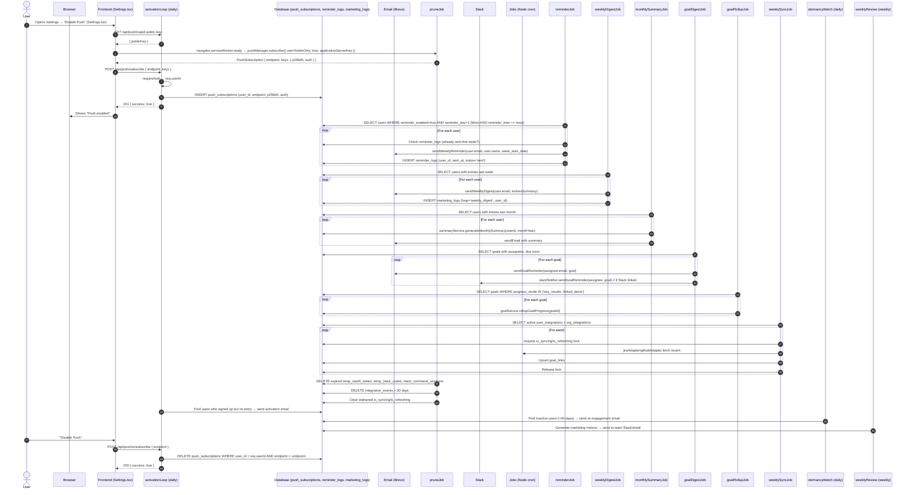

# Feature Flow: Notifications & Jobs

> **Status:** Partially verified (code inspection)
> **Source commit:** `7567207`
> **Last reviewed:** 2026-11-27
> **Audience:** Junior, Senior

---

## 1. What does this feature do?

Manages all background jobs (11 cron jobs) and notification channels: weekly reminder emails, monthly summaries, weekly digests, goal reminders, push notifications, Slack notifications, and marketing loops.

---

## 2. User interaction trace

---

## 3. Files involved

| File | Responsibility |
|---|---|
| `server/src/jobs/reminderJob.ts` | Weekly reminder emails (Mon 9 AM) |
| `server/src/jobs/weeklyDigestJob.ts` | Weekly digest emails (Mon 8 AM) |
| `server/src/jobs/monthlySummaryJob.ts` | Monthly AI summaries (1st of month) |
| `server/src/jobs/goalDigestJob.ts` | Daily goal reminders (7 AM) |
| `server/src/jobs/goalRollupJob.ts` | Daily goal progress rollups (3 AM) |
| `server/src/jobs/weeklySyncJob.ts` | Daily Jira/GitHub sync (2 AM) |
| `server/src/jobs/pruneJob.ts` | Daily cleanup (4 AM) |
| `server/src/jobs/marketing/activationLoop.ts` | Activation emails |
| `server/src/jobs/marketing/dormancyWatch.ts` | Dormant user re-engagement |
| `server/src/jobs/marketing/weeklyReview.ts` | Weekly marketing report |
| `server/src/lib/email.ts` | Brevo email sending + Google Translate |
| `server/src/lib/webPush.ts` | VAPID keys, push sending |
| `server/src/lib/slackNotifier.ts` | Slack goal reminders, digests |
| `server/src/routes/push.ts` | VAPID key, subscribe, unsubscribe |
| `server/src/lib/summaryService.ts` | Monthly summary generation |
| `server/src/lib/slackAdapter.ts` | Slack API calls |
| `client/src/pages/Settings.tsx` | Push toggle, notification prefs |
| `client/src/lib/push.ts` | Client push subscription |
| `client/src/lib/api.ts` | Push API calls |

---

## 4. Functions involved (in execution order)

### Push subscription
1. `Settings.tsx` → `push.subscribe()` → `lib/push.ts`
2. `pushRoutes.post('/subscribe')` → `server/src/routes/push.ts:21`
3. `supabase.from('push_subscriptions').insert({ user_id, endpoint, p256dh, auth })`

### Weekly reminder job
1. `reminderJob.start()` → `jobs/reminderJob.ts` (cron: `0 9 * * 1`)
2. Query users with `reminder_enabled`, `reminder_day=1`, `reminder_time <= now()`
3. `email.sendWeeklyReminder(user.email, user.name, weekStartDate)` → `lib/email.ts`
4. `INSERT reminder_logs`

### Email sending
1. `email.sendEmail({ to, subject, htmlBody, textBody })` → `lib/email.ts:88`
2. `fetch('https://api.brevo.com/v3/smtp/email', { method: 'POST', headers: { 'api-key': BREVO_API_KEY } })`
3. Returns `{ success, messageId }`

### Web push
1. `webPush.sendPushNotification(userId, payload)` → `lib/webPush.ts`
2. `getVapidKeys()` → `web-push` library
3. Iterate user's `push_subscriptions` → `webPush.sendNotification(subscription, payload)`

### Slack notifications
1. `slackNotifier.sendGoalReminder(userId, goal)` → `lib/slackNotifier.ts`
2. `getTeamSlackChannels(orgId, teamId)` → `subscriptionService.ts`
3. `slackAdapter.postMessage(channel, blocks)` → `lib/slackAdapter.ts`

### Prune job
1. `pruneJob.start()` → `jobs/pruneJob.ts` (cron: `0 4 * * *`)
2. `DELETE FROM temp_oauth_states WHERE expires_at < now()`
3. `DELETE FROM temp_slack_codes WHERE expires_at < now()`
4. `DELETE FROM slack_command_sessions WHERE expires_at < now()`
5. `DELETE FROM integration_events WHERE received_at < now() - 30 days`
6. Clear orphaned `is_syncing=true`, `is_refreshing=true`

---

## 5. Data transformation

| Stage | Data shape |
|---|---|
| Push subscription request | `{ endpoint, keys: { p256dh, auth } }` |
| Push subscription DB | `{ user_id, endpoint, p256dh, auth, created_at }` |
| VAPID keys | `{ publicKey, privateKey, subject: 'mailto:...' }` |
| Reminder email | Template with user name, week start date, login link |
| Digest email | Template with entry summaries, streak, links |
| Slack message | Blocks: header, goal title, due date, progress bar, action button |
| Push payload | `{ title: 'Worklog AI', body: 'Time to log your week!', url: '/log' }` |
| Prune criteria | `expires_at < now()`, `received_at < now() - 30 days` |

---

## 6. Failure scenarios

| Failure point | Behavior |
|---|---|
| Brevo API key missing | Email skipped; warning logged |
| Push send fails (expired sub) | Logs error; subscription not auto-removed |
| Slack notification fails | Logs error; continues |
| Job lock held | Skips; logs warning; retries next run |
| Cron not running (free tier spin-down) | Jobs don't execute; no alert |
| Duplicate reminder | `reminder_logs` check prevents |
| 401 on push API | `apiRequest` refreshes token → retries |

---

## 7. Simple story

Think of a **notification engine** that runs while you sleep:

1. **Every Monday 8 AM**: Weekly digest email with your stats
2. **Every Monday 9 AM**: "Time to log your week!" reminder
3. **Every day 2 AM**: Syncs your Jira/GitHub issues to goal links
4. **Every day 3 AM**: Recalculates all goal progress rollups
5. **Every day 4 AM**: Cleans up expired temp data
6. **Every day 6 AM**: Collects AI news for AI Pulse
7. **Every day 7 AM**: Reminds goal assignees of due dates
8. **1st of month**: Generates your monthly AI summary
9. **Marketing loops** (if enabled): Activates new users, wakes dormant ones, sends weekly team report

**Opt-out**: Unsubscribe link in emails; "Disable Push" in Settings; `MARKETING_LOOPS_ENABLED=false` disables marketing jobs.

---

## Related documents

- [Job functions](../04-function-documentation/backend-jobs-infra.md)
- [Email service](../09-integrations/external-services.md#4-brevo-email)
- [Push notifications](../09-integrations/external-services.md#5-web-push)
- [Auth flow](../05-feature-flows/auth-and-onboarding.md)

## Verification notes

Paths traced from `server/src/jobs/*.ts`, `server/src/lib/email.ts`, `server/src/lib/webPush.ts`,
`server/src/lib/slackNotifier.ts`, `server/src/routes/push.ts` at commit `7567207`.
Not verified at runtime: cron scheduling on Render free tier, Brevo delivery, push delivery, Slack API rate limits.