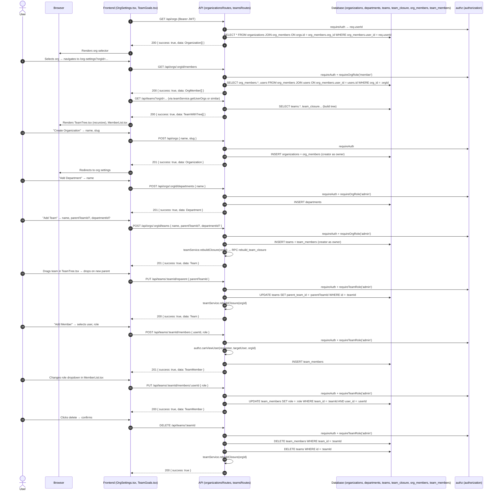

# Feature Flow: Organizations & Teams

> **Status:** Verified
> **Source commit:** `7567207`
> **Last reviewed:** 2026-11-27
> **Audience:** Junior, Senior

---

## 1. What does this feature do?

Manages organizational hierarchy: organizations → departments → nested teams → members with roles. Provides team tree visualization, drag-and-drop reparenting, role-based access control, and team closure table for O(1) ancestor queries.

---

## 2. User interaction trace

---

## 3. Files involved

| File | Responsibility |
|---|---|
| `server/src/routes/organizations.ts` | 7 handlers: create, list, members, departments, teams, rebuild-closure, goals |
| `server/src/routes/teams.ts` | 6 handlers: reparent, delete, my-role, add/update/remove member |
| `server/src/services/teamService.ts` | `createOrg`, `createTeam`, `rebuildClosure`, `addTeamMember`, `getUserOrgs` |
| `server/src/services/authz.ts` | `getUserOrgRole`, `getEffectiveTeamRole`, `requireOrgRole`, `requireTeamRole`, rank maps |
| `server/src/services/goalService.ts` | Goal scope checks using team hierarchy |
| `client/src/pages/OrgSettings.tsx` | Org selector, departments, teams, members |
| `client/src/pages/TeamGoals.tsx` | Team selector, goal tree |
| `client/src/components/teams/TeamTree.tsx` | Recursive team tree with drag-reparent |
| `client/src/components/teams/MemberList.tsx` | Member table with role dropdowns |
| `client/src/lib/teamsApi.ts` | All org/team API calls |
| `client/src/hooks/useHasOrg.ts` | Checks user org membership |
| `client/src/hooks/useTeamRole.ts` | Fetches user's role in a team |

---

## 4. Functions involved (in execution order)

### Org creation
1. `OrgSettings.tsx` → `createOrg()` → `teamsApi.ts`
2. `organizationsRoutes.post('/')` → `organizations.ts:24`
3. `teamService.createOrg` → inserts org + org_members (owner)

### Team creation + closure rebuild
1. `OrgSettings.tsx` → `createTeam()` → `teamsApi.ts`
2. `organizationsRoutes.post('/:orgId/teams')` → `organizations.ts:104`
3. `teamService.createTeam` → inserts team + team_members
4. `teamService.rebuildClosure(orgId)` → RPC `rebuild_team_closure`

### Team reparent (drag-drop)
1. `TeamTree.tsx` drag end → `reparentTeam()` → `teamsApi.ts`
2. `teamsRoutes.put('/:teamId/reparent')` → `teams.ts:23`
3. `requireTeamRole('admin')` → `authz.ts:265`
4. `UPDATE teams SET parent_team_id`
5. `teamService.rebuildClosure(orgId)`

### Team member management
1. `MemberList.tsx` → `addTeamMember()` / `updateTeamMember()` / `removeTeamMember()`
2. `teamsRoutes.post/put/delete('/:teamId/members/...')` → `teams.ts:95/136/157`
3. `requireTeamRole('admin')` + `authz.canViewUser`

### Effective team role calculation
1. `authz.getEffectiveTeamRole(db, userId, teamId)` → `authz.ts:64`
2. Max of: direct role, org role mapped, ancestor team roles (manager/admin/owner)
3. Used by `requireTeamRole`, `canManageTeamGoals`, `canEditGoal`

---

## 5. Data transformation

| Stage | Data shape |
|---|---|
| Create org request | `{ name, slug }` |
| Org response | `{ id, name, slug, created_at, updated_at }` |
| Team create request | `{ name, parentTeamId?, departmentId? }` |
| Team response | `{ id, org_id, department_id, parent_team_id, name, created_at, updated_at }` |
| Team tree | Recursive: `{ ...Team, children: TeamTree[] }` |
| Member add request | `{ userId, role }` |
| Member response | `{ id, team_id, user_id, role, org_id, created_at, user: {id, email, name} }` |
| Closure table | `ancestor_id, descendant_id, depth` (0=self, 1=child, ...) |

---

## 6. Failure scenarios

| Failure point | Behavior |
|---|---|
| Slug taken | 400 `{ error: "Slug already in use" }` |
| User not org member | 403 (authz gates) |
| Insufficient role | 403 (requireOrgRole/requireTeamRole) |
| Reparent cycle | 400 (cycle detection in rebuildClosure) |
| User not found | 400 `{ error: "User not found in organization" }` |
| Duplicate member | 409 (unique constraint on team_members) |
| 401 on request | `apiRequest` refreshes token → retries |

---

## 7. Simple story

Imagine a **corporate org chart** that lives in the app:

1. **Founder creates "Acme Inc."** → becomes owner
2. **Adds departments**: Engineering, Sales, Marketing
3. **Creates teams**: Frontend, Backend (under Engineering)
4. **Drags "Mobile" under "Frontend"** → hierarchy updates instantly
5. **Adds Alice as "Admin" to Backend** → she can manage that team
6. **Bob joins Frontend as "Member"** → sees team goals, can check in
7. **Behind the scenes**: `team_closure` table rebuilds so "Who's Alice's boss's boss?" is instant

---

## Related documents

- [Teams & Goals endpoints](../06-api-reference/endpoint-reference-teams-goals.md)
- [Authz details](../02-architecture/auth-and-authorization.md)
- [Team service](../04-function-documentation/backend-teams-goals.md)
- [Client teams API](../04-function-documentation/frontend-hooks-context-lib.md)

## Verification notes

All paths traced from `server/src/routes/organizations.ts`, `server/src/routes/teams.ts`,
`server/src/services/teamService.ts`, `server/src/services/authz.ts`,
`client/src/components/teams/*` at commit `7567207`.
Not verified at runtime: closure rebuild performance on large orgs, drag-drop UX edge cases.