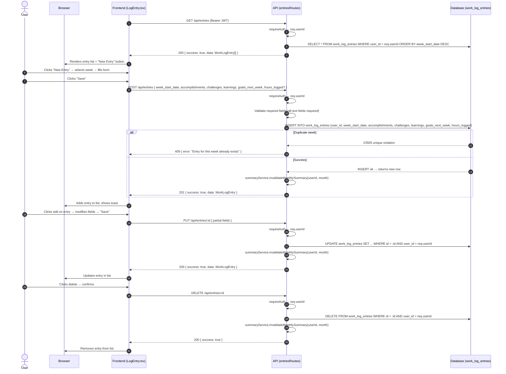

# Feature Flow: Weekly Logging

> **Status:** Verified
> **Source commit:** `7567207`
> **Last reviewed:** 2026-11-27
> **Audience:** Junior, Senior

---

## 1. What does this feature do?

Allows users to create, read, update, and delete weekly work log entries (accomplishments, challenges, learnings, goals for next week, optional hours). One entry per user per week (Monday start date).

---

## 2. User interaction trace

---

## 3. Files involved

| File | Responsibility |
|---|---|
| `server/src/routes/entries.ts` | 5 handlers: list, get, create, update, delete |
| `server/src/lib/summaryService.ts` | `invalidateMonthlySummary` (called on create/update/delete) |
| `server/src/middleware/auth.ts` | `requireAuth` (attaches `req.userId`, `req.supabase`) |
| `server/src/lib/database.ts` | `supabase` service-role client |
| `client/src/pages/LogEntry.tsx` | Form, list, create/edit/delete UI |
| `client/src/lib/api.ts` | `getEntries`, `createEntry`, `updateEntry`, `deleteEntry` |
| `client/src/lib/formatters.ts` | `formatWeekRange`, `formatDate` for display |

---

## 4. Functions involved (in execution order)

### List entries
1. `LogEntry` mount → `useEffect` → `getEntries()` → `lib/api.ts:114`
2. `apiRequest` → `GET /api/entries` → `lib/api.ts:38`
3. `entriesRoutes.get('/')` → `server/src/routes/entries.ts:14`
4. `supabase.from('work_log_entries').select('*').eq('user_id', userId).order('week_start_date', { ascending: false })`

### Create entry
1. `LogEntry` form submit → `createEntry(body)` → `lib/api.ts:122`
2. `apiRequest` → `POST /api/entries`
3. `entriesRoutes.post('/')` → `server/src/routes/entries.ts:74`
4. Validation → `supabase.from('work_log_entries').insert({ user_id: userId, ... }).select().single()`
5. `summaryService.invalidateMonthlySummary(userId, month)` → `lib/summaryService.ts`

### Update entry
1. `LogEntry` form submit → `updateEntry(id, body)` → `lib/api.ts:129`
2. `entriesRoutes.put('/:id')` → `server/src/routes/entries.ts:166`
3. `supabase.from('work_log_entries').update({...}).eq('id', id).eq('user_id', userId).select().single()`
4. `invalidateMonthlySummary`

### Delete entry
1. `LogEntry` delete click → `deleteEntry(id)` → `lib/api.ts:139`
2. `entriesRoutes.delete('/:id')` → `server/src/routes/entries.ts:215`
3. `supabase.from('work_log_entries').delete().eq('id', id).eq('user_id', userId)`
4. `invalidateMonthlySummary`

---

## 5. Data transformation

| Stage | Data shape |
|---|---|
| Create request | `{ week_start_date: "YYYY-MM-DD", accomplishments: "...", challenges: "...", learnings: "...", goals_next_week: "...", hours_logged?: number }` |
| Database insert | Adds `user_id`, `created_at`, `updated_at`, `status: 'manual'` |
| Create response | `{ success: true, data: WorkLogEntry }` (with generated `id`, timestamps) |
| List response | `{ success: true, data: WorkLogEntry[] }` ordered by `week_start_date DESC` |
| Update request | Partial create body (any subset of fields) |
| Delete response | `{ success: true }` |

---

## 6. Failure scenarios

| Failure point | Behavior |
|---|---|
| Missing required fields | 400 `{ error: "All fields are required" }` (server validation) |
| Duplicate `week_start_date` | 409 `{ error: "Entry for this week already exists" }` (unique constraint) |
| Entry not found / not owned | 404 `{ error: "Entry not found" }` (`.eq('user_id', userId)` fails) |
| Supabase error | 500 `{ success: false, error: "Failed to fetch entries" }` |
| Network error | `apiRequest` throws → `LogEntry` catches → shows error toast |
| 401 on request | `apiRequest` refreshes token once → retries → on second 401 clears auth |

---

## 7. Simple story

Think of a **weekly diary** that lives in the cloud:

1. **Every Monday**, you open your diary app.
2. You **pick the week** (it defaults to this week).
3. You **write four paragraphs**: what you nailed, what was hard, what you learned, what's next.
4. Optionally, you **log hours**.
5. You hit **Save** — it's stored forever, linked to you, and you can't accidentally save twice for the same week.
6. Later, you can **edit** any week, or **delete** a draft you never finished.
7. Behind the scenes, saving **invalidates your monthly summary** so the next AI summary regenerates with the fresh entry.

---

## Related documents

- [Core AI endpoints](../06-api-reference/endpoint-reference-core-ai.md)
- [Entries functions](../04-function-documentation/backend-core-ai.md)
- [Client API](../04-function-documentation/frontend-hooks-context-lib.md)
- [Dashboard flow](./dashboard-and-summaries.md)

## Verification notes

All paths traced from `server/src/routes/entries.ts`, `client/src/pages/LogEntry.tsx`,
`client/src/lib/api.ts`, `server/src/lib/summaryService.ts` at commit `7567207`.
Verified: unique constraint, ownership scoping, summary invalidation side effect.