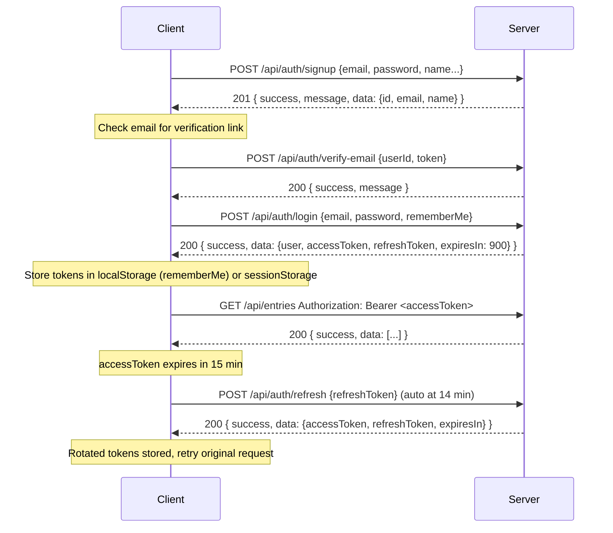

# API Overview

> **Status:** Verified
> **Source commit:** `7567207`
> **Last reviewed:** 2026-11-27
> **Audience:** Junior, Senior

---

## 1. API basics

| Property | Value |
|---|---|
| Base URL | `VITE_API_URL` (e.g. `https://api.example.com`) |
| Protocol | HTTPS (production), HTTP (localhost) |
| Format | JSON request/response |
| Auth | `Authorization: Bearer <JWT>` |
| Auth fallback | Refresh token rotation on 401 |
| Error format | `{ success: false, error: "message" }` |
| Success format | `{ success: true, data: ... }` (most endpoints) |
| Rate limiting | 100 req/15 min (prod), 20 auth req/hr (prod) |
| CORS | Allowlist: localhost, `FRONTEND_URL`, allowlisted Vercel apps |

---

## 2. Authentication flow



### Token details

| Token | Lifetime | Storage | Rotation |
|---|---|---|---|
| Access token (JWT) | 15 minutes | Memory + localStorage/sessionStorage | Auto at 14 min via `AuthContext`; on 401 via `apiRequest` |
| Refresh token (opaque) | 30 days (rememberMe) / 7 days | localStorage/sessionStorage | Rotated on each use; SHA-256 hashed in DB |

### Password reset

```
POST /api/auth/forgot-password {email} → 200 (always, anti-enumeration)
Check email → click link → POST /api/auth/reset-password {token, newPassword}
→ Revokes ALL refresh tokens for user → 200 { success }
```

---

## 3. Request/response conventions

### Success response (most endpoints)

```json
{
  "success": true,
  "data": { ... } | [ ... ]
}
```

### Error response

```json
{
  "success": false,
  "error": "Human-readable message"
}
```

### Auth error responses

| Status | Body | When |
|---|---|---|
| 400 | `{ error: "Email and password required" }` | Missing fields |
| 401 | `{ error: "Invalid or expired token" }` | Bad/missing JWT |
| 401 | `{ error: "Invalid or expired refresh token" }` | Bad refresh token |
| 403 | `{ error: "Email not verified", code: "EMAIL_NOT_VERIFIED", email: "..." }` | Login before verification |
| 403 | `{ error: "Forbidden" }` | Org/team role check failed |
| 404 | `{ error: "Entry not found" }` | Resource not found or not owned |
| 429 | `{ error: "Too many requests" }` | Rate limit exceeded |
| 500 | `{ success: false, error: "Internal server error" }` | Unhandled exception |

---

## 4. Middleware chain (per request)

```
Request
  → CORS (allowlist)
  → Raw body capture (webhooks only)
  → JSON / URL-encoded parse
  → trust proxy (Render)
  → Rate limit (prod only)
  → Request ID
  → Request logging + PostHog
  → Route match
  → requireAuth / optionalAuth (per route)
  → requireOrgRole / requireTeamRole (per route)
  → requireTier (per route)
  → Handler
  → Global error handler (on throw)
Response
```

---

## 5. Endpoint catalog (112 total)

### By domain

| Domain | Mount path | Handlers | Module |
|---|---|---:|---|
| Auth | `/api/auth` | 9 | `routes/auth.ts` |
| Work logs | `/api/entries` | 5 | `routes/entries.ts` |
| Appraisals | `/api/appraisal` | 4 | `routes/appraisal.ts` |
| Users | `/api/users` | 4 | `routes/users.ts` |
| Summaries | `/api/summaries` | 2 | `routes/summaries.ts` |
| Chat | `/api/chat` | 5 | `routes/chat.ts` |
| Feedback | `/api/feedback` | 2 | `routes/feedback.ts` |
| AI Pulse | `/api/ai-pulse` | 13 | `routes/aiPulse.ts` |
| Translate | `/api/translate` | 2 | `routes/translate.ts` |
| Waitlist | `/api/waitlist` | 1 | `routes/waitlist.ts` |
| Organizations | `/api/orgs` | 7 | `routes/organizations.ts` |
| Teams | `/api/teams` | 6 | `routes/teams.ts` |
| Goals | `/api/goals` | 12 | `routes/goals.ts` |
| Integrations | `/api/integrations` | 19 | `routes/integrations.ts` |
| Subscriptions | `/api/subscriptions` | 1 | `routes/subscriptions.ts` |
| Reports | `/api/reports` | 3 | `routes/reports.ts` |
| Channel prefs | `/api/channel-preferences` | 5 | `routes/channelPreferences.ts` |
| Push | `/api/push` | 3 | `routes/push.ts` |
| GitHub webhook | `/api/webhooks/github` | 1 | `routes/webhooks/github.ts` |
| Jira webhook | `/api/webhooks/jira` | 1 | `routes/webhooks/jira.ts` |
| Slack webhook | `/api/webhooks/slack` | 1 | `routes/webhooks/slack.ts` |
| **Total** | | **112** | |

---

## 6. Authorization matrix

| Endpoint pattern | Auth | Org role | Team role | Tier |
|---|---|---|---|---|
| `/api/auth/*` (except `/me`) | None | — | — | — |
| `/api/auth/me` | `requireAuth` | — | — | — |
| `/api/entries/*` | `requireAuth` | — | — | — |
| `/api/appraisal/*` | `requireAuth` | — | — | — |
| `/api/users/*` | `requireAuth` | — | — | — |
| `/api/summaries/*` | `requireAuth` | — | — | — |
| `/api/chat/*` | `requireAuth` | — | — | — |
| `/api/feedback/*` | `requireAuth` | — | — | — |
| `/api/ai-pulse/articles` | `optionalAuth` | — | — | — |
| `/api/ai-pulse/bookmarks/*` | `requireAuth` | — | — | — |
| `/api/ai-pulse/admin/*` | None (admin check in handler) | — | — | — |
| `/api/orgs/*` | `requireAuth` | `member`+` | — | — |
| `/api/teams/*` | `requireAuth` | — | `admin`+` | — |
| `/api/goals/*` | `requireAuth` | — | `manager`+` (per scope) | — |
| `/api/integrations/*` | `requireAuth` | `member`/`admin` (per op) | — | — |
| `/api/subscriptions/*` | `requireAuth` | `member` | — | — |
| `/api/reports/*` | `requireAuth` | `member` | — | `enterprise` |
| `/api/channel-preferences/*` | `requireAuth` | `member`/`admin` | — | — |
| `/api/push/*` | `requireAuth` (except VAPID key) | — | — | — |
| `/api/webhooks/*` | Signature verification | — | — | — |

---

## 7. Rate limiting

| Scope | Window | Max | Environment |
|---|---|---:|---|
| Global | 15 min | 100 | Production only |
| `/api/auth/*` | 1 hour | 20 | Production only |
| `/api/auth/signup` | — | — | No limit (but validation) |
| `/api/auth/forgot-password` | — | — | No limit (anti-enumeration) |
| `/api/waitlist` | — | Custom limiter | Production |
| `/api/appraisal/playground-generate` | — | Custom limiter | Production |
| `/api/integrations/slack/link/*` | — | Custom limiter | Production |

Rate limit disabled when `NODE_ENV === 'development'`.

---

## 8. Versioning and stability

- No explicit versioning in URL (`/api/v1/...` not used).
- Breaking changes deployed with coordination between client/server.
- Shared types (`shared/`) provide compile-time safety.

---

## 9. Testing endpoints manually

```bash
# 1. Signup
curl -X POST https://api.example.com/api/auth/signup \
  -H "Content-Type: application/json" \
  -d '{"email":"test@example.com","password":"Pass1234","name":"Test"}'

# 2. Login
curl -X POST https://api.example.com/api/auth/login \
  -H "Content-Type: application/json" \
  -d '{"email":"test@example.com","password":"Pass1234","rememberMe":true}'

# 3. Use access token
ACCESS_TOKEN="eyJ..."
curl -H "Authorization: Bearer $ACCESS_TOKEN" \
  https://api.example.com/api/entries

# 4. Refresh
REFRESH_TOKEN="abc..."
curl -X POST https://api.example.com/api/auth/refresh \
  -H "Content-Type: application/json" \
  -d "{\"refreshToken\":\"$REFRESH_TOKEN\"}"
```

---

## 10. Reference files

Detailed endpoint documentation is split across five files:

| File | Domains covered | Handler count |
|---|---|---:|
| `endpoint-reference-auth-users.md` | Auth, Users | 13 |
| `endpoint-reference-core-ai.md` | Entries, Appraisal, Summaries, Chat, Feedback | 18 |
| `endpoint-reference-teams-goals.md` | Orgs, Teams, Goals | 25 |
| `endpoint-reference-integrations-webhooks.md` | Integrations, Webhooks | 21 |
| `endpoint-reference-platform-misc.md` | AI Pulse, Push, Translate, Waitlist, Subscriptions, Reports, Channel Prefs | 35 |

---

## Related documents

- [Auth architecture](../02-architecture/auth-and-authorization.md)
- [Backend architecture](../02-architecture/backend-architecture.md)
- [Function documentation](../04-function-documentation/backend-*.md)

## Verification notes

Route inventory from `server/src/index.ts:184-204` and grep of all `router.(get|post|put|patch|delete)` in `server/src/routes/`. Auth requirements from middleware usage in each route file.