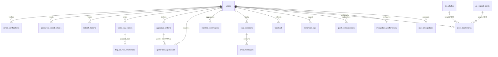
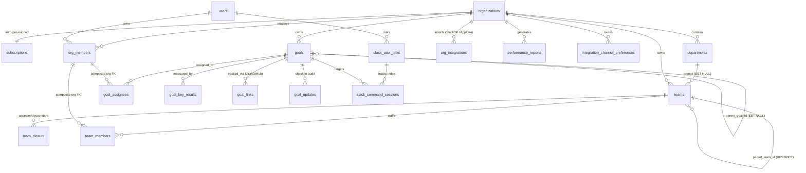

# Database Relationships & Entity-Relationship Diagrams

> **Status:** Verified
> **Source commit:** `7567207`
> **Last reviewed:** 2026-11-27
> **Audience:** Junior, Senior

---

## 1. Plain-Language Overview (Explain Like I Am Five)

Think of foreign keys as colored ribbons connecting index cards across drawers:

- **Your personal cards (`users`)** tie directly to your tokens, work logs, monthly summaries, AI appraisals, chat sessions, push subscriptions, bookmarks, and feedback. If you delete your account (`DELETE /api/users/account`), `ON DELETE CASCADE` acts like a chain reaction that cleans up all your private drawers.
- **Organization cards (`organizations`)** tie together departments, teams, members, OKR goals, workspace integrations, subscriptions, and AI performance reports using **double-key locks (`(id, org_id)`)** so a bug in code can *never* accidentally connect Company A's goal to Company B's team!
- **Audit preservation rule:** Historical records that belong to the company rather than one person—such as `goal_updates.user_id` and `org_integrations.installed_by`—use `ON DELETE SET NULL` instead of `CASCADE` so team history isn't wiped out when an employee leaves.

---

## 2. Core User & Productivity ERD

**Plain language:** Every personal diary entry, summary, chat message, and browser notification belongs to one `users` row. Bookmarks point to *either* an `ai_articles` row or an `ai_impact_cards` row (enforced by `bookmark_target_check` XOR rule).

---

## 3. Enterprise Orgs, Teams, Goals & Integrations ERD

**Plain language:** Companies hold departments, nested teams (with a fast `team_closure` shortcut map), OKR goals (which can nest inside parent goals), and Slack/Jira/GitHub workspace connections.

---

## 4. Relational Design Patterns & Composite Tenant Locks

1. **Composite Tenant Foreign Keys (`(entity_id, org_id)`):**
   - `departments`, `teams`, and `goals` all define `UNIQUE(id, org_id)`.
   - Child tables (`teams.fk_team_parent`, `team_members.fk_team_member_team_org`, `goal_assignees.fk_goal_assignee_goal_org`, `goal_links.fk_goal_link_goal_org`, `goal_updates.fk_goal_updates_goal_org`, `slack_command_sessions.fk_slack_command_sessions_goal`) reference `(parent_id, org_id)`.
   - **Why:** Even if a bug in TypeScript tries to assign a user from Org B onto a goal in Org A, PostgreSQL itself throws a foreign-key constraint violation!
2. **Audit-Trail `ON DELETE SET NULL` vs `ON DELETE CASCADE`:**
   - `goal_updates.user_id` (`2026-06-16:281-295`), `org_integrations.installed_by` (`:314`), `goals.created_by` (`:209`), and `performance_reports.target_user_id` (`2026-06-20:43`) use `SET NULL` so check-ins, reports, and active Slack/GitHub integrations keep working when an individual admin leaves.
   - `teams.parent_team_id` uses `ON DELETE RESTRICT` (`2026-06-16:159`) — parent teams with children cannot be deleted directly until reparented (unless explicitly cleared in `teamService.deleteTeam`).
3. **Immutability Triggers:**
   - `prevent_org_id_mutation()` prevents changing `org_id` on existing rows across 13 multi-tenant tables (`teams`, `departments`, `goals`, `org_members`, `team_members`, `goal_assignees`, `goal_links`, `goal_updates`, `org_integrations`, `subscriptions`, `performance_reports`, `activity_summaries`, `integration_channel_preferences`).

---

## Related Documents

- [Database Schema](./schema.md)
- [Queries, Locks & Triggers](./queries-and-operations.md)

## Verification Notes

- Verified all FK constraints, `UNIQUE(id, org_id)` composite keys, and `ON DELETE` behaviors across `supabase-schema*.sql` and `supabase-migrations/*.sql`.