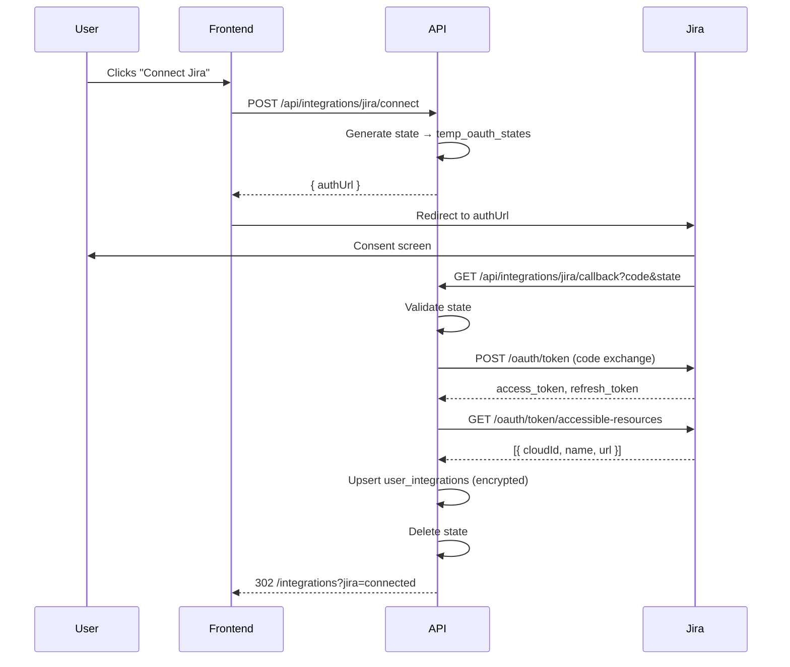

# Jira, GitHub, and Slack Integrations

> **Status:** Partially verified (code inspection)
> **Source commit:** `7567207`
> **Last reviewed:** 2026-11-27
> **Audience:** Junior, Senior

---

## 1. Jira Integration

### 1.1 Overview

| Aspect | Detail |
|---|---|
| **Auth** | OAuth 2.0 (3-legged) — user-level and org-level |
| **Scopes** | `read:jira-work`, `read:jira-user`, `offline_access` |
| **Token storage** | `user_integrations` / `org_integrations` (encrypted) |
| **Webhook** | `POST /api/webhooks/jira` — signature verification |
| **Sync** | `weeklySyncJob` (daily 2 AM) + manual trigger |
| **Adapters** | `lib/jiraAdapter.ts`, `lib/webhookSecurity.ts` |

### 1.2 User-level OAuth flow

**Endpoints:**
- `POST /api/integrations/jira/connect` → `integrations.ts:133`
- `GET /api/integrations/jira/connect` → `integrations.ts:149`
- `GET /api/integrations/jira/callback` → `integrations.ts:159`
- `POST /api/integrations/jira/confirm` → `integrations.ts:167`
- `GET /api/integrations/jira/sites` → `integrations.ts:273`
- `POST /api/integrations/jira/select-site` → `integrations.ts:293`

### 1.3 Org-level OAuth flow

Same pattern under `/jira/org-connect`, `/jira/org-callback`, `/jira/org-confirm`.
Stores in `org_integrations` with `external_install_id = cloudId`.

### 1.4 Webhook

| Property | Value |
|---|---|
| **Endpoint** | `POST /api/webhooks/jira` |
| **Verification** | `webhookSecurity.verifyJiraSignature` (JWT or shared secret) |
| **Events** | `jira:issue_created`, `jira:issue_updated`, `jira:issue_deleted` |
| **Processing** | `jiraAdapter.normalizeEvent` → insert `integration_events` → update `goal_links` |

**Adapter functions (`lib/jiraAdapter.ts`):**
- `fetchUserProjects(accessToken, cloudId)`
- `fetchProjectIssues(accessToken, cloudId, projectKey)`
- `exchangeCodeForToken(code, state)`
- `fetchAccessibleResources(accessToken)`
- `normalizeEvent(payload)` → `{ provider, eventType, externalId, externalKey, title, state, url, isDone }`

### 1.5 Sync job

`weeklySyncJob.ts` (daily 2 AM):
1. For each active `user_integrations` + `org_integrations` (Jira)
2. Acquire lock (`is_syncing` + `sync_started_at`)
3. Fetch recent issues from each project
4. Normalize → upsert `goal_links` (matching by `external_id`)
5. Release lock

**Lock table:** `integration_preferences.is_syncing` / `sync_started_at`

### 1.6 Goal linking

When a Jira issue is linked to a goal (`POST /api/goals/:goalId/links`):
1. Frontend sends Jira issue URL
2. Backend parses `cloudId`, `projectKey`, `issueId`
3. Creates `goal_links` row with `provider='jira'`
4. Webhook updates `is_done`, `state`, `title` automatically

---

## 2. GitHub Integration

### 2.1 Overview

| Aspect | Detail |
|---|---|
| **Auth** | OAuth 2.0 (user) + GitHub App (org) |
| **Scopes** | `repo`, `read:org`, `read:user`, `workflow` |
| **Token storage** | `user_integrations` / `org_integrations` (encrypted) |
| **Webhook** | `POST /api/webhooks/github` — HMAC SHA-256 |
| **Sync** | `weeklySyncJob` + manual |
| **Adapters** | `lib/githubAdapter.ts`, `lib/githubApp.ts` |

### 2.2 User OAuth flow

Same pattern as Jira:
- `POST/GET /api/integrations/github/connect` → `integrations.ts:339`
- `GET /api/integrations/github/callback` → `integrations.ts:365`
- `POST /api/integrations/github/confirm` → `integrations.ts:373`

**Token exchange:** `githubAdapter.exchangeCodeForToken(code)`

### 2.3 GitHub App (org)

| Step | Endpoint |
|---|---|
| Start | `POST /api/integrations/github/app-connect` → `integrations.ts:670` |
| Callback | `GET /api/integrations/github/app-callback` → `integrations.ts:696` |
| Confirm | `POST /api/integrations/github/app-callback` → `integrations.ts:732` |

**App flow:** User installs GitHub App on org → `installation_id` →
`githubApp.createInstallationToken(installationId)` → token for API calls.

### 2.4 Webhook

| Property | Value |
|---|---|
| **Endpoint** | `POST /api/webhooks/github` |
| **Verification** | `webhookSecurity.verifyGitHubSignature` (HMAC SHA-256) |
| **Events** | `issues`, `pull_request`, `push` (configurable) |
| **Processing** | `githubAdapter.normalizeEvent` → `integration_events` → `goal_links` |

**Adapter functions (`lib/githubAdapter.ts`):**
- `fetchUserRepos(accessToken)`
- `fetchRepoIssues(accessToken, owner, repo)`
- `fetchPullRequests(accessToken, owner, repo)`
- `exchangeCodeForToken(code)`
- `normalizeEvent(payload)` → `{ provider, eventType, externalId, externalKey, title, state, url, isDone }`

### 2.5 Goal linking

Same as Jira: URL parsed → `provider='github'` → `goal_links` created.
Webhook updates `is_done` (closed), `state` (open/closed/merged).

---

## 3. Slack Integration

### 3.1 Overview

| Aspect | Detail |
|---|---|
| **Auth** | OAuth 2.0 (org install + user link) |
| **Scopes** | `channels:read`, `groups:read`, `chat:write`, `commands`, `links:read`, `links:write` |
| **Token storage** | `org_integrations` (bot token), `slack_user_links` (user token) |
| **Webhook** | `POST /api/webhooks/slack` — HMAC SHA-256 |
| **Commands** | `/worklog` slash command |
| **Notifications** | Goal reminders, digests |
| **Adapters** | `lib/slackAdapter.ts`, `lib/slackOAuth.ts`, `lib/slackNotifier.ts` |

### 3.2 Org install flow

1. `POST /api/integrations/slack/org-connect` → `integrations.ts:547`
2. `GET /api/integrations/slack/org-callback` → `integrations.ts:578`
3. `POST /api/integrations/slack/org-confirm` → `integrations.ts:586`

Stores bot token in `org_integrations` (`provider='slack'`).

### 3.3 User link (for slash commands / DMs)

1. `POST /api/integrations/slack/link/start` → `integrations.ts:794`
   - Generates short code → `temp_slack_codes`
   - Returns `expiresAt`
2. User enters code in Slack `/worklog link <code>`
3. Slack sends command to webhook
4. `POST /api/integrations/slack/link/confirm` → `integrations.ts:848`
   - Verifies code → exchanges for user token
   - Stores in `slack_user_links`

### 3.4 Slash command (`/worklog`)

**Webhook flow:**
1. Slack sends `command` payload to `POST /api/webhooks/slack`
2. `slackAdapter.handleCommand(payload)` → opens modal/form
3. User submits → `view_submission` callback
4. Creates work log entry or goal check-in

**Command handlers (`lib/slackAdapter.ts`):**
- `handleCommand(payload)` → dispatches by `command`
- `openLogEntryModal(triggerId)`
- `openGoalCheckinModal(triggerId, goalId)`
- `handleViewSubmission(payload)`

### 3.5 Notifications

`lib/slackNotifier.ts`:
- `sendGoalReminder(userId, goal)` → DM or channel
- `sendDigest(userId, entries)` → weekly summary
- `sendNotification(channelId, text, blocks)`

**Channel config:** `integration_channel_preferences` (team Slack channels).

### 3.6 Webhook

| Property | Value |
|---|---|
| **Endpoint** | `POST /api/webhooks/slack` |
| **Verification** | `webhookSecurity.verifySlackSignature` (HMAC SHA-256 + timestamp) |
| **Events** | `command`, `view_submission`, `link_shared`, `message` |
| **Processing** | Routes to `slackAdapter` or `slackNotifier` |

---

## 4. Cross-cutting patterns

### 4.1 OAuth state management

| Table | Purpose | Expiry |
|---|---|---|
| `temp_oauth_states` | Jira, GitHub, GitHub App, Slack org | 10 min |
| `temp_slack_codes` | Slack user link codes | 10 min |

**Cleanup:** Startup clears expired (`index.ts:247-250`). No periodic cleanup.

### 4.2 Token encryption

| Table | Fields encrypted | Algorithm |
|---|---|---|
| `user_integrations` | `access_token`, `refresh_token` | AES-256-GCM (`lib/crypto.ts`) |
| `org_integrations` | `config` (secrets) | AES-256-GCM |
| `slack_user_links` | `access_token`, `refresh_token` | AES-256-GCM |

**Key:** `ENCRYPTION_KEY` env var (32 bytes).

### 4.3 Sync locks

| Table | Lock columns | Purpose |
|---|---|---|
| `integration_preferences` | `is_syncing`, `sync_started_at` | Prevent concurrent Jira/GitHub sync per user/team |
| `user_integrations` | `is_refreshing`, `refresh_started_at` | Prevent concurrent token refresh |
| `org_integrations` | `is_refreshing`, `refresh_started_at` | Prevent concurrent org token refresh |

**Job:** `weeklySyncJob` acquires lock before sync.

### 4.4 Webhook signature verification

| Provider | Header | Algorithm |
|---|---|---|
| GitHub | `X-Hub-Signature-256` | HMAC SHA-256 |
| Jira | `X-Atlassian-Webhook-Signature` | JWT or shared secret |
| Slack | `X-Slack-Signature` + `X-Slack-Request-Timestamp` | HMAC SHA-256 |

**Raw body capture:** `express.json({ verify })` on webhook routes (`index.ts:97-110`).

---

## 5. Goal link synchronization

| Trigger | Action |
|---|---|
| User creates link via UI | `POST /api/goals/:goalId/links` → parses URL → creates `goal_links` |
| Jira webhook (`issue_updated`) | `jiraAdapter.normalizeEvent` → upsert `goal_links` by `external_id` |
| GitHub webhook (`issues`, `pull_request`) | `githubAdapter.normalizeEvent` → upsert `goal_links` |
| Slack link sharing | `link_shared` event → parse URL → create `goal_links` |
| Weekly sync job | Fetch all issues/PRs → full refresh of `goal_links` |

**Deduplication:** `UNIQUE (goal_id, provider, external_id)` on `goal_links`.

---

## 6. Configuration requirements

| Provider | Required env vars |
|---|---|
| Jira | `JIRA_CLIENT_ID`, `JIRA_CLIENT_SECRET` |
| GitHub | `GITHUB_CLIENT_ID`, `GITHUB_CLIENT_SECRET` |
| GitHub App | `GITHUB_APP_ID`, `GITHUB_APP_PRIVATE_KEY` |
| Slack | `SLACK_CLIENT_ID`, `SLACK_CLIENT_SECRET`, `SLACK_SIGNING_SECRET` |

---

## Related documents

- [External services](../09-integrations/external-services.md)
- [API endpoints: integrations](../06-api-reference/endpoint-reference-integrations-webhooks.md)
- [Security: webhook verification](../08-security/security-architecture.md#5-webhook-security)
- [Backend integration functions](../04-function-documentation/backend-integrations.md)

## Verification notes

All flows traced from `server/src/routes/integrations.ts`, `webhooks/*.ts`,
`lib/jiraAdapter.ts`, `lib/githubAdapter.ts`, `lib/githubApp.ts`,
`lib/slackAdapter.ts`, `lib/slackOAuth.ts`, `lib/slackNotifier.ts`,
`lib/webhookSecurity.ts` at commit `7567207`. Runtime behavior (OAuth
handshakes, webhook delivery, token refresh) not verified without live
credentials.