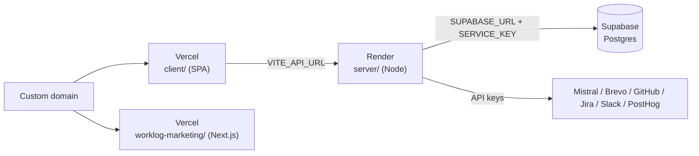

# Deployment Guide

> **Status:** Verified (config files)
> **Source commit:** `7567207`
> **Last reviewed:** 2026-11-27
> **Audience:** Junior, Senior

---

## 1. Architecture recap



---

## 2. Frontend (Vercel)

### 2.1 Project: `client/`

| Setting | Value |
|---|---|
| Framework | Vite (auto-detected) |
| Root directory | `./client` |
| Build command | `npm run build` → `tsc -b && vite build` |
| Output directory | `./dist` |
| Install command | `npm install` (monorepo) |
| Node version | 20 (from `package.json` engines) |

### 2.2 Vercel configuration (`client/vercel.json`)

```json
{
  "rewrites": [{ "source": "/(.*)", "destination": "/index.html" }]
}
```

SPA fallback: all routes serve `index.html`.

### 2.3 Build pipeline

1. `tsc -b` — type-checks project (includes `shared/` via workspaces)
2. `vite build` — bundles SPA to `dist/`
3. `client/public/scripts/vercel-prepare-output.mjs` — copies `index.html` → `200.html` for SPA fallback

### 2.4 Environment variables (Vercel project settings)

| Variable | Value |
|---|---|
| `VITE_SUPABASE_URL` | Supabase project URL |
| `VITE_SUPABASE_ANON_KEY` | Supabase anon key |
| `VITE_API_URL` | Render service URL (e.g., `https://worklog-api.onrender.com`) |
| `VITE_PUBLIC_POSTHOG_PROJECT_TOKEN` | PostHog client token |
| `VITE_POSTHOG_HOST` | `https://us.i.posthog.com` |

### 2.5 Custom domain

1. Vercel → Project → Settings → Domains
2. Add `app.example.com`
3. Configure DNS: `CNAME app.example.com cname.vercel-dns.com`
4. SSL auto-provisioned

---

## 3. Backend (Render)

### 3.1 Project: `server/`

| Setting | Value |
|---|---|
| Runtime | Node.js (auto-detected) |
| Root directory | `./server` |
| Build command | `npm run build` → `tsc` |
| Start command | `npm run start` → `node dist/index.js` |
| Install command | `npm install` (monorepo) |
| Node version | 20 (from `nixpacks.toml`) |

### 3.2 Render Blueprint (`render.yaml`)

```yaml
services:
  - type: web
    name: worklog-api
    rootDir: server
    buildCommand: npm run build
    startCommand: npm run start
    envVars:
      - key: NODE_ENV
        value: production
    # Add all env vars below
```

### 3.3 Nixpacks config (`nixpacks.toml`)

```toml
[phases.setup]
nixPkgs = ["nodejs-20", "python3"]

[phases.install]
cmds = ["npm ci --workspaces=false --prefix server"]

[phases.build]
cmds = ["npm run build --workspace=server"]

[start]
cmd = "npm run start --workspace=server"
```

### 3.4 Environment variables (Render service settings)

| Variable | Source |
|---|---|
| `JWT_SECRET` | Render secret (generate 32+ chars) |
| `SUPABASE_URL` | Render env |
| `SUPABASE_SERVICE_KEY` | Render secret |
| `FRONTEND_URL` | Vercel domain (e.g., `https://app.example.com`) |
| `MISTRAL_API_KEY` | Render secret |
| `OPENROUTER_API_KEY` | Render secret |
| `BREVO_API_KEY` | Render secret |
| `VAPID_PUBLIC_KEY` | Render env |
| `VAPID_PRIVATE_KEY` | Render secret |
| `VAPID_SUBJECT` | Render env |
| `POSTHOG_API_KEY` | Render secret |
| `GITHUB_CLIENT_ID` | Render env |
| `GITHUB_CLIENT_SECRET` | Render secret |
| `GITHUB_APP_ID` | Render env |
| `GITHUB_APP_PRIVATE_KEY` | Render secret (file) |
| `JIRA_CLIENT_ID` | Render env |
| `JIRA_CLIENT_SECRET` | Render secret |
| `SLACK_CLIENT_ID` | Render env |
| `SLACK_CLIENT_SECRET` | Render secret |
| `SLACK_SIGNING_SECRET` | Render secret |
| `ENCRYPTION_KEY` | Render secret |
| `NODE_ENV` | `production` |
| `PORT` | Render sets automatically |

### 3.5 Process model

- **Single process** (`node dist/index.js`)
- Handles HTTP, webhooks, and all 11 cron jobs
- Render free tier spins down after inactivity → cron stops
- Paid tier keeps process alive

### 3.6 Health check

Render uses `GET /health` → `{ status: "ok", timestamp: "..." }`

### 3.7 Graceful shutdown

`server/src/index.ts:340-372` handles `SIGTERM`/`SIGINT`:
1. Stop all 11 cron jobs
2. `shutdownPostHog()`
3. `process.exit(0)`

Render sends `SIGTERM` on deploy; ~30s grace period.

---

## 4. Database (Supabase)

### 4.1 Project

- Supabase Postgres (cloud or self-hosted)
- Region: match Render/Vercel region for latency

### 4.2 Schema application

No migration runner. Apply manually in order:

```bash
psql "$SUPABASE_URL" -f supabase-schema.sql
psql "$SUPABASE_URL" -f supabase-schema-custom-auth.sql
psql "$SUPABASE_URL" -f supabase-migration-ai-pulse.sql
psql "$SUPABASE_URL" -f migrations/001_monthly_summaries_and_chat.sql
# ... continue through all 14 files ...
```

### 4.3 Connection pooling

- Server (Render): Use direct connection (`db.xxx.supabase.co:5432`)
- Serverless/edge: Use pooler (`aws-0-xxx.pooler.supabase.com:6543`)

### 4.4 Backups

- Supabase Pro: Point-in-time recovery (7 days)
- Manual: `pg_dump` or Supabase dashboard backup

---

## 5. Marketing site (Vercel)

### 5.1 Project: `worklog-marketing/`

| Setting | Value |
|---|---|
| Framework | Next.js 14 (App Router) |
| Root directory | `./worklog-marketing` |
| Build command | `npm run build` |
| Output | Static export + serverless functions |

### 5.2 Environment variables

| Variable | Purpose |
|---|---|
| `POSTHOG_KEY` | Analytics |
| `NEXT_PUBLIC_POSTHOG_HOST` | PostHog host |

### 5.3 Custom domain

Same as client: add `example.com` to Vercel project.

---

## 6. DNS configuration

| Record | Type | Value |
|---|---|---|
| `app.example.com` | CNAME | `cname.vercel-dns.com` |
| `example.com` | CNAME | `cname.vercel-dns.com` |
| `api.example.com` | CNAME | `worklog-api.onrender.com` (or custom Render domain) |

**Note:** Render provides `*.onrender.com`; custom domain requires paid plan.

---

## 7. CI/CD (not present in repo)

### Recommended pipeline

```yaml
# .github/workflows/deploy.yml (proposed)
on:
  push:
    branches: [main]
jobs:
  typecheck:
    runs-on: ubuntu-latest
    steps:
      - uses: actions/checkout@v4
      - uses: actions/setup-node@v4
        with: { node-version: 20, cache: npm }
      - run: npm ci
      - run: npm run typecheck
  lint:
    runs-on: ubuntu-latest
    steps:
      - uses: actions/checkout@v4
      - uses: actions/setup-node@v4
        with: { node-version: 20, cache: npm }
      - run: npm ci
      - run: npm run lint
  test-server:
    runs-on: ubuntu-latest
    steps:
      - uses: actions/checkout@v4
      - uses: actions/setup-node@v4
        with: { node-version: 20, cache: npm }
      - run: npm ci
      - run: npm test --workspace=server
  deploy-client:
    needs: [typecheck, lint]
    runs-on: ubuntu-latest
    steps:
      - uses: actions/checkout@v4
      - uses: amondnet/vercel-action@v25
        with:
          vercel-token: ${{ secrets.VERCEL_TOKEN }}
          vercel-org-id: ${{ secrets.VERCEL_ORG_ID }}
          vercel-project-id: ${{ secrets.VERCEL_CLIENT_PROJECT_ID }}
          vercel-args: '--prod'
  deploy-server:
    needs: [typecheck, lint]
    runs-on: ubuntu-latest
    steps:
      - uses: actions/checkout@v4
      - uses: render/action@v1
        with:
          api-key: ${{ secrets.RENDER_API_KEY }}
          service-id: ${{ secrets.RENDER_SERVICE_ID }}
```

---

## 8. Post-deployment verification

| Check | Method |
|---|---|
| Client loads | Visit `https://app.example.com` |
| API health | `curl https://api.example.com/health` |
| Auth flow | Sign up → verify email → login |
| Work log CRUD | Create/read/update/delete entry |
| AI appraisal | Generate appraisal (requires AI key) |
| Webhooks | Check Render logs for signature verification |
| Cron jobs | Check Render logs for job startup messages |
| Analytics | PostHog → Events → `api_request`, `user_signed_up` |

---

## 9. Rollback

| Target | Method |
|---|---|
| Vercel (client/marketing) | Vercel dashboard → Deployments → Promote previous |
| Render (server) | Render dashboard → Deploys → Rollback |
| Supabase | Point-in-time recovery (Pro) or manual SQL |

---

## 10. Monitoring

| Signal | Tool |
|---|---|
| Uptime | Render health checks, Vercel analytics |
| Errors | PostHog exceptions, Render logs |
| Performance | Vercel Web Analytics, PostHog `api_request` |
| Costs | Render billing, Vercel usage, Supabase usage, provider dashboards |

---

## Related documents

- [Environment variables](./environment-variables.md)
- [Local setup](./local-setup.md)
- [Database migrations](../07-database/migrations.md)
- [System architecture](../02-architecture/deployment-architecture.md)

## Verification notes

Config files inspected: `client/vercel.json`, `client/vite.config.ts`,
`render.yaml`, `nixpacks.toml`, `server/package.json`, `server/src/index.ts`.
No actual deployment performed. Render/Vercel specific behaviors inferred
from config and documentation.